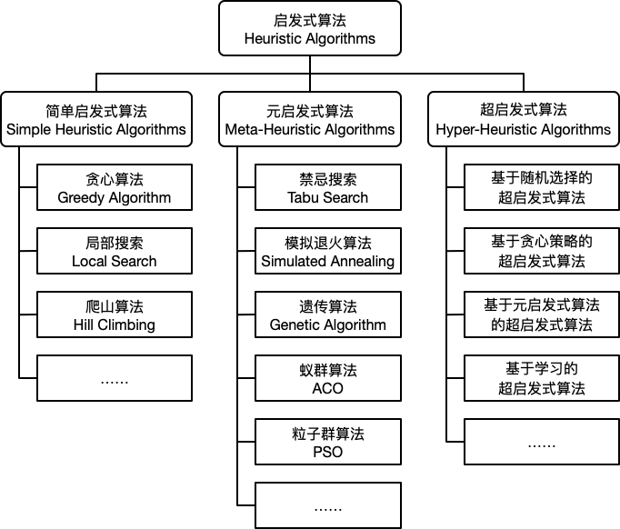
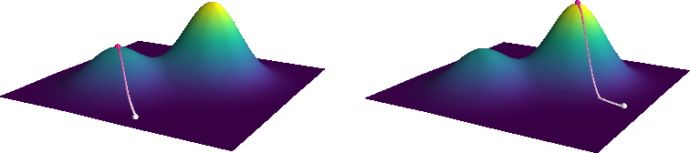
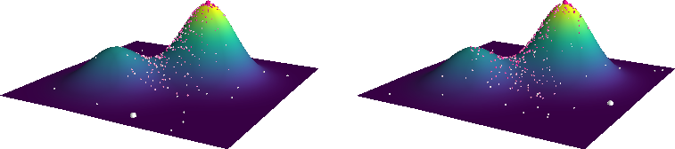
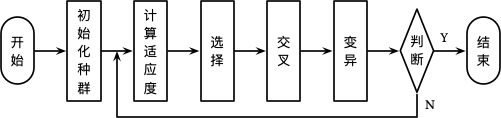
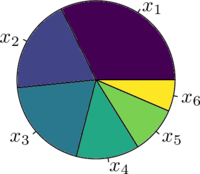
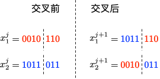
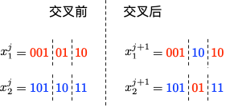
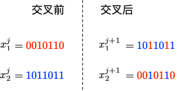
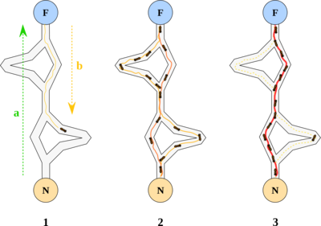
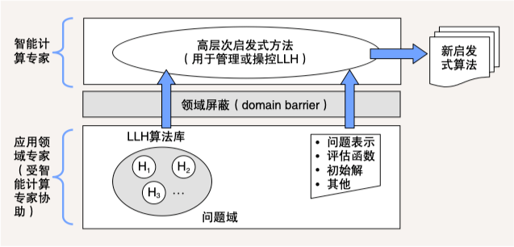

# 1 启发式算法简介

启发式算法 (Heuristic Algorithms) 是相对于最优算法提出的。一个问题的最优算法是指求得该问题每个实例的最优解.

启发式算法可以这样定义 ：一个基于直观或经验构造的算法，在可接受的花费 (指计算时间、占用空间等) 下给出待解决组合优化问题每一个实例的一个可行解，该可行解与最优解的偏离程度不一定事先可以预计。在某些情况下，特别是实际问题中，最优算法的计算时间使人无法忍受或因问题的难度使其计算时间随问题规模的增加以指数速度增加，此时只能通过启发式算法求得问题的一个可行解。

利用启发式算法进行目标优化的一些优缺点如下：

| 优点                                     | 缺点                                          |
| ---------------------------------------- | --------------------------------------------- |
| 1.算法简单直观，易于修改                 | 1. 不能保证为全局最优解                       |
| 2.算法能够在可接受的时间内给出一个较优解 | 2. 算法不稳定，性能取决于具体问题和设计者经验 |

启发式算法简单的划分为如下三类：

* **简单启发式算法 (Simple Heuristic Algorithms)**
* **元启发式算法 (Meta-Heuristic Algorithms)**
* **超启发式算法 (Hyper-Heuristic Algorithms)** 。

# 2 简单启发式算法 (Simple Heuristic Algorithms)

## 2.1 贪心算法 (Greedy Algorithm)

贪心算法是指一种在求解问题时总是采取当前状态下最优的选择从而得到最优解的算法。贪心算法的基本步骤定义如下：

1. 确定问题的最优子结构。
2. 设计递归解，并保证在任一阶段，最优选择之一总是贪心选择。
3. 实现基于贪心策略的递归算法，并转换成迭代算法。

对于利用贪心算法求解的问题需要包含如下两个重要的性质

1. 最优子结构性质。当一个问题具有最优子结构性质时，可用动态规划法求解，但有时用贪心算法求解会更加的简单有效。同时并非所有具有最优子结构性质的问题都可以利用贪心算法求解。
2. 贪心选择性质。所求问题的整体最优解可以通过一系列局部最优的选择 (即贪心选择) 来达到。这是贪心算法可行的基本要素，也是贪心算法与动态规划算法的主要区别。

贪心算法和动态规划算法之间的差异如下表所示：

| 贪心算法                                         | 动态规划                                        |
| ------------------------------------------------ | ----------------------------------------------- |
| 每个阶段可以根据选择当前状态最优解快速的做出决策 | 每个阶段的选择建立在子问题的解之上              |
| 可以在子问题求解之前贪婪的做出选择               | 子问题需先进行求解                              |
| 自顶向下的求解                                   | 自底向上的求解 (也可采用带备忘录的自顶向下方法) |
| 通常情况下简单高效                               | 效率可能比较低                                  |

## 2.2 局部搜索 (Local Search) 和爬山算法 (Hill Climbing)

局部搜索算法基于贪婪思想，从一个候选解开始，持续地在其**邻域**中搜索，直至邻域中没有更好的解。对于一个优化问题：

    $min$  $f(x),x\in R^n$
其中， $f(x)$为目标函数。搜索可以理解为从一个解移动到另一个解的过程，令$s(x)$表示通过移动得到的一个解，$S(x)$为从当前解出发所有可能的解的集合 (邻域)，则局部搜索算法的步骤描述如下：

1. 初始化一个可行解$x$
2. 在当前解的邻域内选择一个移动后的解$s(x)$,使得$f(s(x))<f(x),s(x)\in S(x)$，如果不存在这样的解，则 $x$为最优解，算法停止。
3. 令$x=s(x)$，重复步骤 2。
   当我们的优化目标为最大化目标函数$f(x)$时，这种局部搜索算法称之为爬山算法。

# 3 元启发式算法 (Meta-Heuristic Algorithms)

元启发式算法 (Meta-Heuristic Algorithms) 是启发式算法的改进，通常使用随机搜索技巧，可以应用在非常广泛的问题上，但不能保证效率。

本节部分内容参考了《智能优化方法》 和《现代优化计算方法》 。

## 3.1 禁忌搜索 (Tabu Search)

禁忌搜索 (Tabu Search) 是由 Glover提出的一种优化方法。禁忌搜索通过在解邻域内搜索更优的解的方式寻找目标的最优解，在搜索的过程中将搜索历史放入禁忌表 (Tabu List) 中从而避免重复搜索。禁忌表通过模仿人类的记忆功能，禁忌搜索因此得名。

在禁忌搜索算法中，禁忌表用于防止搜索过程出现循环，避免陷入局部最优。对于一个给定长度的禁忌表，随着新的禁忌对象的不断进入，旧的禁忌对象会逐步退出，从而可以重新被访问。禁忌表是禁忌搜索算法的核心，其功能同人类的短时记忆功能相似，因此又称之为“短期表”。

在某些特定的条件下，无论某个选择是否包含在禁忌表中，我们都接受这个选择并更新当前解和历史最优解，这个选择所满足的特定条件称之为渴望水平。

一个基本的禁忌搜索算法的步骤描述如下：

1. 给定一个初始可行解，将禁忌表设置为空。
2. 选择候选集中的最优解，若其满足渴望水平，则更新渴望水平和当前解；否则选择未被禁忌的最优解。
3. 更新禁忌表。
4. 判断是否满足停止条件，如果满足，则停止算法；否则转至步骤 2。

## 3.2 模拟退火 (Simulated Annealing)

模拟退火 (Simulated Annealing) 是一种通过在邻域中寻找目标值相对小的状态从而求解全局最优的算法，现代的模拟退火是由 Kirkpatrick 等人于 1983 年提出 。模拟退火算法源自于对热力学中退火过程的模拟，在给定一个初始温度下，通过不断降低温度，使得算法能够在多项式时间内得到一个近似最优解。

对于一个优化问题$min$  $f(x)$，模拟退火算法的步骤描述如下

1. 给定一个初始可行解$x_0$，初始温度$T_0$和终止温度$T_f$，令迭代计数为 $k$。
2. 随机选取一个邻域解$x_k$，计算目标函数增量$Δf=f(x_k)−f(x)$。若$Δf<0$，则令$x=x_k$；否则生成随机数$ξ=U(0,1)$，若随机数小于转移概率$P(Δf,T)$，则令 $x=x_k$。
3. 降低温度$T$。
4. 若达到最大迭代次数$k_m$$_a$$_x$或最低温度$T_f$，则停止算法；否则转至步骤 2。

整个算法的伪代码如下：

在进行邻域搜索的过程中，当温度较高时，搜索的空间较大，反之搜索的空间较小。类似的，当$Δf>0$时，转移概率的设置也同当前温度的大小成正比。常用的降温函数有两种：

1. $T_k$$_+$$_1=T_k*r$,其中$r\in(0,95,0.99)$,$r$设置的越大，温度下降越快。
2. $T_k$$_+$$_1=T_k-ΔT,$其中$ΔT$为每一步温度的减少量。

初始温度和终止温度对算法的影响较大，相关参数设置的细节请参见参考文献。

模拟退火算法是对局部搜索和爬山算法的改进，我们通过如下示例对比两者之间的差异。

假设目标函数如下：
			$f(x,y)=e^{-(x^2+y^2)}+2e^{-((x-1.7)^2+(y-1.7)^2)}$
优化问题定义为：
			$max$ $f(x,y),x\in[-2,4],y\in[-2,4]$
我们分别令初始解为$(1.5,−1.5)$和$(3.5,0.5)$，下图 (上) 为爬山算法的结果，下图 (下) 为模拟退火算法的结果。

其中，**白色** 的大点为初始解位置，**粉色** 的大点为求解的最优解位置，颜色从白到粉描述了迭代次数。从图中不难看出，由于局部最大值的存在，从不同的初始解出发，爬山算法容易陷入局部最大值，而模拟退火算法则相对稳定。

## 3.3 遗传算法 (Genetic Algorithm)

遗传算法 (Genetic Algorithm, GA) 是由 John Holland 提出，其学生 Goldberg 对整个算法进行了进一步完善。算法的整个思想来源于达尔文的进化论，其基本思想是根据问题的目标函数构造一个适应度函数 (Fitness Function)，对于种群中的每个个体 (即问题的一个解) 进行评估 (计算适应度)，选择，交叉和变异，通过多轮的繁殖选择适应度最好的个体作为问题的最优解。算法的整个流程如下所示：

### 3.3.1 初始化种群

在初始化种群时，我们首先需要对每一个个体进行编码，常用的编码方式有二进制编码，实值编码，矩阵编码 ，树形编码等。以二进制为例 (如下不做特殊说明时均以二进制编码为例)，对于 **p∈{0,1,…,100}** **中** **pi=50** 可以表示为：

$$
x_i=50_{10}=0110010_2
$$

对于一个具体的问题，我们需要选择合适的编码方式对问题的解进行编码，编码后的个体可以称之为一个染色体。则一个染色体可以表示为：

$$
x=(p1,p2,...,p_m)
$$

其中m为染色体的长度或编码的位数。初始化种群个体共 n 个，对于任意一个个体染色体的任意一位 i，随机生成一个随机数 rand∈U(0,1)，若 rand>0.5，则 pi=1，否则 $p_i=0$。

### 3.3.2 计算适应度

适应度为评价个体优劣程度的函数 **f(x)，**通常为问题的目标函数，对最小化优化问题 **f(x)=−min∑L(y^,y)，**对最大化优化问题 **f(x)=max∑L(y^,y)，**其中 **L** 为损失函数。

### 3.3.3 选择

对于种群中的每个个体，计算其适应度，记第 i 个个体的适应度为 $F_i=f(x_i)$。则个体在一次选择中被选中的概率为：$P_i=\dfrac{F_i} {\sum_{i=1}^nF_i} $

为了保证种群的数量不变，我们需要重复n次选择过程，单次选择采用轮盘赌的方法。利用计算得到的被选中的概率计算每个个体的累积概率：
$CP_0=0$
$CP_i= \sum_{j=1}^iP_i$

对于如下一个示例:

| 指标 \ 个体   | x1    | x2    | x3    | x4    | x5    | x6    |
| ------------- | ----- | ----- | ----- | ----- | ----- | ----- |
| 适应度 (F)    | 100   | 60    | 60    | 40    | 30    | 20    |
| 概率 (P)      | 0.322 | 0.194 | 0.194 | 0.129 | 0.097 | 0.064 |
| 累积概率 (CP) | 0.322 | 0.516 | 0.71  | 0.839 | 0.936 | 1     |

每次选择时，随机生成**rand∈U(0,1)，当** **CPi−1≤rand≤CPi** **时，**选择个体 xi。选择的过程如同在下图的轮盘上安装一个指针并随机旋转，每次指针停止的位置的即为选择的个体

### 3.3.4 交叉

交叉运算类似于染色体之间的交叉，常用的方法有单点交叉，多点交叉和均匀交叉等。

* 单点交叉：在染色体中选择一个切点，然后将其中一部分同另一个染色体的对应部分进行交换得到两个新的个体。交叉过程如下图所示：
  
* 多点交叉：在染色体中选择多个切点，对其任意两个切点之间部分以概率**Pc****进行交换，其中****Pc为一个较大的值，例如** Pm=0.9。两点交叉过程如下图所示：
  
* 均匀交叉：染色体任意对应的位置以一定的概率进行交换得到新的个体。交叉过程如下图所示：
  

### 3.3.5 变异

变异即对于一个染色体的任意位置的值以一定的概率Pm 发生变化，对于二进制编码来说即反转该位置的值。其中**Pm** 为一个较小的值，例如 Pm=0.05。

### 3.3.6 小结

在整个遗传运算的过程中，不同的操作发挥着不同的作用：

1. 选择：优胜劣汰，适者生存。
2. 交叉：丰富种群，持续优化。
3. 变异：随机扰动，避免局部最优。

除此之外，对于基本的遗传算法还有多种优化方法，例如：精英主义，即将每一代中的最优解原封不动的复制到下一代中，这保证了最优解可以存活到整个算法结束。

## 3.4 蚁群算法 (Ant Colony Optimization, ACO)

1991 年，意大利学者 Dorigo M. 等人在第一届欧洲人工生命会议 (ECAL) 上首次提出了蚁群算法。1996 年 Dorigo M. 等人发表的文章 “Ant system: optimization by a colony of cooperating agents”为蚁群算法奠定了基础。在自然界中，蚂蚁会分泌一种叫做信息素的化学物质，蚂蚁的许多行为受信息素的调控。蚂蚁在运动过程中能够感知其经过的路径上信息素的浓度，蚂蚁倾向朝着信息素浓度高的方向移动。以下图为例 ：
  

蚂蚁从蚁巢 (N) 出发到达食物源所在地 (F)，取得食物后再折返回蚁巢。整个过程中蚂蚁有多种路径可以选择，单位时间内路径上通过蚂蚁的数量越多，则该路径上留下的信息素浓度越高。因此，最短路径上走过的蚂蚁数量越多，则后来的蚂蚁选择该路径的机率就越大，从而蚂蚁通过信息的交流实现了寻找食物和蚁巢之间最短路的目的。

## 3.5 粒子群算法 (Particle Swarm Optimization, PSO)

Eberhart, R. 和 Kennedy, J. 于 1995 年提出了粒子群优化算法 。粒子群算法模仿的是自然界中鸟群和鱼群等群体的行为，其基本原理描述如下

粒子群算法初始化为一群随机的粒子（随机解），然后根据迭代找到最优解。每一次迭代中，粒子通过跟踪两个极值来更新自己：第1个是粒子本身所找到的最优解，这个称为个体极值；第2个是整个种群目前找到的最优解，这个称为全局极值。也可以不用整个种群，而是用其中的一部分作为粒子的邻居，称为局部极值。

假设在一个D维搜索空间中，有N个粒子组成一个群落，其中第i个粒子表示为一个D维的向量：
$X_i=(x_{i1},x_{i2},...,x_{id}),i=1,2,,...,N$
第i个粒子的速度表示为：
$V_i=(v_{i1},v_{i2},...,v_{id}),i=1,2,,...,N$
还要保存每个个体的已经找到的最优解$p_{best} $，和一个整个群落找到的最优解$g_{best}$
第i个粒子根据下面的公式更新自己的速度和位置：
$v_{id}=W*v_{id-1}+c_1r_1(p_{id} -x_{id})+c_2r_2(p_{gd}-x_{id})$

> 该式由三部分组成，分别为
>
> 1. 惯性或动量部分，反应粒子的运动习惯。
> 2. 认知部分，粒子有向自身历史最佳位置逼近的优势。
> 3. 社会部分，粒子有向群体或领域历史最佳位置逼近的趋势

> 公式解释：这个粒子第d步的速度=上一步自身的速度惯性+自我认知部分+社会认知部分（三个部分的和）

$x_{id+1}=x_{id}+v_{id}$

这个粒子第d+1步所在的位置 = 第d步所在的位置 + 第d步的速度 * 运动的时间

x(d+1) = x(d) + v(d) * t (每一步运动的时间t一般取1)

其中，$P_{id} $是个体已知最优解，$p_{gd}$是种群已知最优解 , $w$为惯性权重, $c_1c_2$为学习因子（或加速常数 acceleration constant)，$r_1r_2$是[0,1]范围内的随机数。

>
> 在最初提出粒子群算法的论文中指出，个体学习因子和社会(或群体)学习因子取2比较合适
>
> 惯性权重w体现的是粒子继承先前的速度的能力，Shi,Y最先将惯性权重w引入到粒子群算法中，并分析指出**一个较大的惯性**
>
> **权值有利于全局搜索，而一个较小的权值则更利于局部搜索**

# 4. 超启发式算法 (Hyper-Heuristic Algorithms)

超启发式算法 (Hyper-Heuristic Algorithms) 提供了一种高层次启发式方法，通过管理或操纵一系列低层次启发式算法 (Low-Level Heuristics，LLH)，以产生新的启发式算法。这些新启发式算法被用于求解各类组合优化问题 。

下图给出了超启发式算法的概念模型。该模型分为两个层面：在问题域层面上，应用领域专家根据自己的背景知识，在智能计算专家协助下，提供一系列 LLH 和问题的定义、评估函数等信息；在高层次启发式方法层面上，智能计算专家设计高效的管理操纵机制，运用问题域所提供的 LLH 算法库和问题特征信息，构造出新的启发式算法。
  
