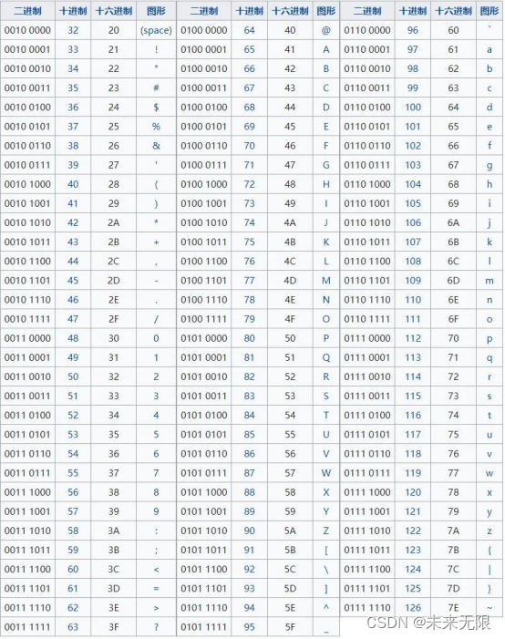
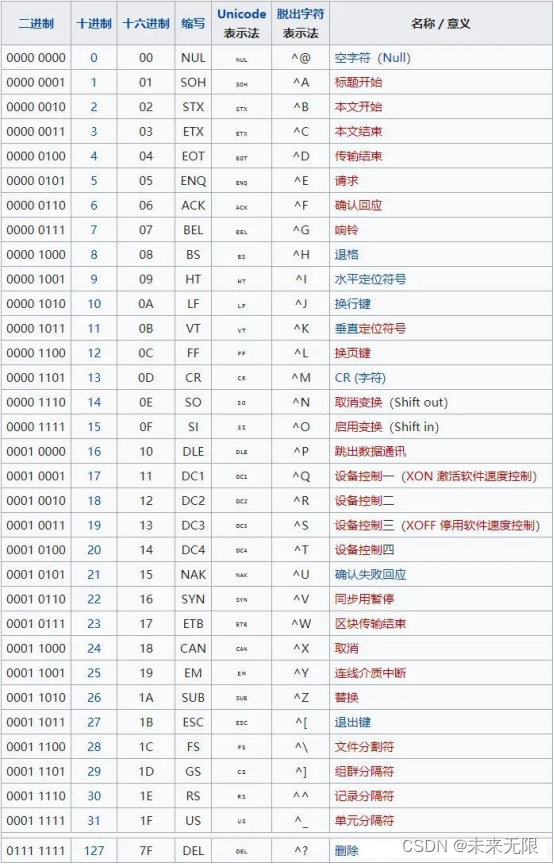

# [ASCII码](https://so.csdn.net/so/search?q=ASCII%E7%A0%81&spm=1001.2101.3001.7020)对照表（包括二进制、十进制十六进制和字符）

## 1 可以显示

## 2 不可以显示

# GBK编码

由于ASCII编码不支持中文，因此，当中国人用到计算机时，就需要寻求一种编码方式来支持中文。
于是，国人就定义了一套编码规则：当字符小于127位时，与ASCII的字符相同，但当两个大于127的字符连接在一起时，就代表一个汉字，第一个字节称为高字节（从0xA1-0xF7）,第二个字节为低字节（从0xA1-0xFE）,这样大约可以组合7000多个简体汉字。这个规则叫做GB2312。
    但是由于中国汉字很多，有些字无法表示，于是重新定义了规则：不在要求低字节一定是127之后的编码，只要第一个字节是大于127，就固定表示这是一个汉字的开始，不管后面跟的是不是扩展字符集里的内容。这种扩展之后的编码方案称之为GBK标，包括了GB2312的所有内容，同时新增了近20000个新的汉字（包括繁体字）和符号。
    但是，中国有56个民族，所以，我们再次对编码规则进行了扩展，又加了近几千个少数民族的字符，于是再次扩展后得编码叫做GB18030。中国的程序员觉得这一系列编码的标准是非常的好，于是统统称他们叫做"DBCS"（Double Byte Charecter Set 双字节字符集）。

# Unicode编码

因为世界国家很多，每个国家都定义一套自己的编码标准，结果相互之间谁也不懂谁的编码，就无法进行很好的沟通交流，所以及时的出现了一个组织ISO（国际标准化组织）决定定义一套编码方案来解决所有国家的编码问题，这个新的编码方案就叫做Unicode。注意Unicode不是一个新的编码规则，而是一套字符集（为每一个「字符」分配一个唯一的 ID（学名为码位 / 码点 / Code Point）），可以将Unicode理解为一本世界编码的字典。
    ISO规定：每个字符必须使用俩个字节，即用16位二进制来表示所有的字符，对于ASCII编码表里的字符，保持其编码不变，只是将长度扩展到了16位，其他国家的字符全部统一重新编码。

**要注意的是，Unicode只是一个符号集，它只规定了符号的二进制代码，却没有规定这个二进制代码应该如何存储。**

比如，汉字“严”的unicode是十六进制数4E25，转换成二进制数足足有15位（100111000100101），也就是说这个符号的表示至少需要2个字节。表示其他更大的符号，可能需要3个字节或者4个字节，甚至更多。

这里就有两个严重的问题，第一个问题是，如何才能区别unicode和ascii？计算机怎么知道三个字节表示一个符号，而不是分别表示三个符号呢？第二个问题是，我们已经知道，英文字母只用一个字节表示就够了，如果unicode统一规定，每个符号用三个或四个字节表示，那么每个英文字母前都必然有二到三个字节是0，这对于存储来说是极大的浪费，文本文件的大小会因此大出二三倍，这是无法接受的。

它们造成的结果是：1）出现了unicode的多种存储方式，也就是说有许多种不同的二进制格式，可以用来表示unicode。2）unicode在很长一段时间内无法推广，直到互联网的出现。 

# UTF-8编码

互联网的普及，强烈要求出现一种统一的编码方式。UTF-8就是在互联网上使用最广的一种unicode的实现方式。其他实现方式还包括UTF-16和UTF-32，不过在互联网上基本不用。重复一遍，这里的关系是，UTF-8是Unicode的实现方式之一。

UTF-8最大的一个特点，就是它是一种变长的编码方式。它可以使用1~4个字节表示一个符号，根据不同的符号而变化字节长度。

**UTF-8的编码规则很简单，只有二条：**

**1）对于单字节的符号，字节的第一位设为0，后面7位为这个符号的unicode码。因此对于英语字母，UTF-8编码和ASCII码是相同的。**

**2）对于n字节的符号（n>1），第一个字节的前n位都设为1，第n+1位设为0，后面字节的前两位一律设为10。剩下的没有提及的二进制位，全部为这个符号的unicode码。**

跟据上表，解读 UTF-8 编码非常简单。如果一个字节的第一位是0，则这个字节单独就是一个字符；如果第一位是1，则连续有多少个1，就表示当前字符占用多少个字节。

utf-8区分每个字符的开始是根据字符的高位字节来区分的，比如用一个字节表示的字符，第一个字节高位以“0”开头；用两个字节表示的字符，第一个字节的高位为以“110”开头，后面一个字节以“10开头”；用三个字节表示的字符，第一个字节以“1110”开头，后面俩字节以“10”开头；用四个字节表示的字符，第一个字节以“11110”开头，后面的三个字节以“10”开头。

下面，还是以汉字“严”为例，演示如何实现UTF-8编码。

已知“严”的unicode是4E25（100111000100101），根据上表，可以发现4E25处在第三行的范围内（0000 0800-0000 FFFF），因此“严”的UTF-8编码需要三个字节，即格式是“1110xxxx 10xxxxxx 10xxxxxx”。然后，从“严”的最后一个二进制位开始，依次从后向前填入格式中的x，多出的位补0。这样就得到了，“严”的UTF-8编码是“11100100 10111000 10100101”，转换成十六进制就是E4B8A5。
