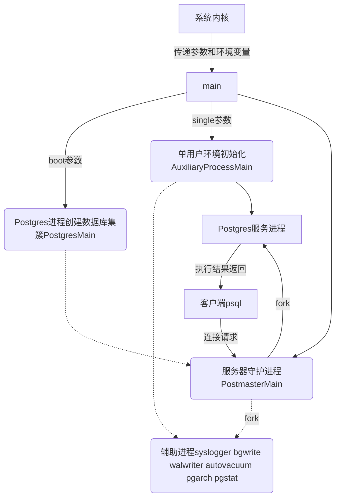
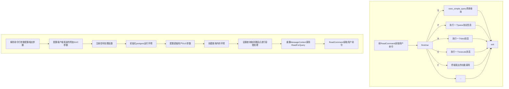

## Postmaster和Postgres程序

- 在unix/linux系统下，Postmaster仅仅是Postgres的一个符号链接。而在win系统下Postmaster是Postgres的文件拷贝。
- Postmaster和Postgres都是通过载入Postgres程序而形成的进程，只是运行时所处分支不同。
- 守护进程Postmaster负责系统的启动、关闭。监听客户端请求并为其分配服务进程Postgres。
- 服务进程Postgres接受并执行客户端请求，它在底层模块（如存储、事务管理、索引等）上调用各个主要的功能模块（如编译器、优化器、执行器），完成各种数据库操作，并返回结果。

## Postgres程序main函数流程

## 守护进程Postmaster

源文件位置 src/backend/postmaster.c入口PostmasterMain()

### 内存上下文

MemoryContextInit() 创建TopMemoryContext和ErrorContext。

AllocSetContextCreate() 创建PostmasterContext并将CurrentMemoryContext指向它。

### GUC参数

InitializeGUCOptions() 读取默认参数

getopt()和SetConfigOption() 读取命令行参数

SelectConfigFiles() 读取配置文件

CreateDataDirLockFile() 检查锁文件postmaster.pid

### 创建监听

Tcp,bonjour或UNIX_SOCKETS

### 注册信号处理函数

pqsignal_pm()

### 辅助进程启动

SysLogger_Start();

pgstat_init();

autovac_init();

StartCheckpointer();

StartBackgroundWriter();

StartWalWriter();

StartArchiver();

### 客户端认证

load_hba();基于主机的认证，读取pg_hba.conf。

load_ident();基于身份的认证，读取pg_ident.conf。

### 循环等待用户请求fork后台进程

ServerLoop();

## 服务进程Postgres

源文件位置 src/backend/tcop/postgres.c入口PostgresMain()

### 初始化内存环境

在多用户模式下，内存分配的工作是由Postmaster进程完成的。

全局布尔变量IsUnderPostmaster :true 表明运行在多用户模式下。

### 配置运行参数和处理客户端传递的GUN参数

略。（和Postmaster相同）

### 信号处理和信号屏蔽

略。（和Postmaster类似）

### 初始化Postgres的运行环境

主要两个阶段

- BaseInit(); 
  完成进程的内存、信号量以及文件句柄的创建和初始化。

- InitProcess(); 
  填充PGPROC机构填充，完成包含初始化后端缓冲池、Xlog访问、关系Cache、系统表Cache、查询计划Cache、Portal管理器、
  状态收集器以及退出码的设置。

  

### 创建内存上下文并设置查询取消跳跃点

MessageContext 用于存储从前端发送过来的消息中的查询命令，以及在查询过程中产生的中间数据（如分析树和计划树）。

sigsetjmp(系统调用函数) 设置跳跃点。当客户端取消一次查询请求或发生错误时，将通过调用siglongjmp利用全局变量PG_exception_stack(指向跳跃点的指针)从这个点退出当前事务然后从新开始查询，在错误恢复期间不允许被中断，也不接受客户端取消的查询请求。
