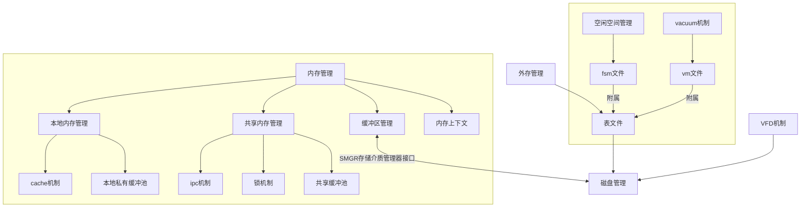
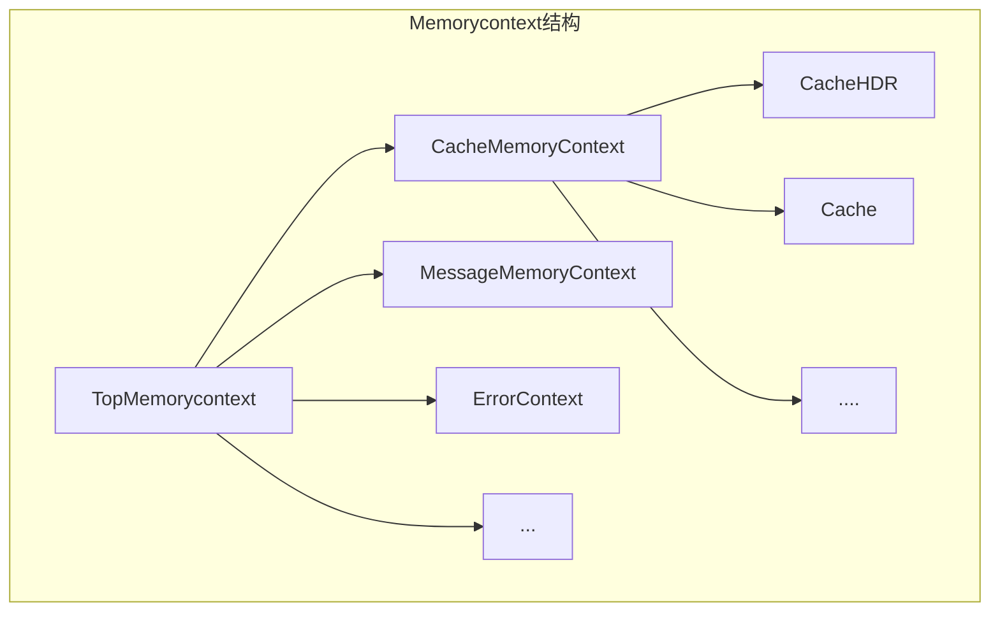
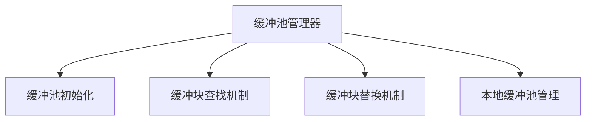
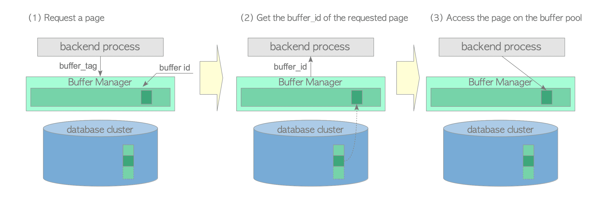
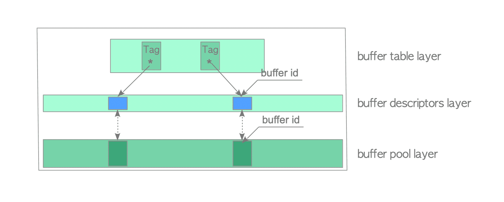
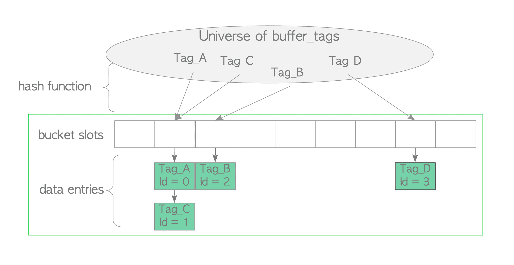
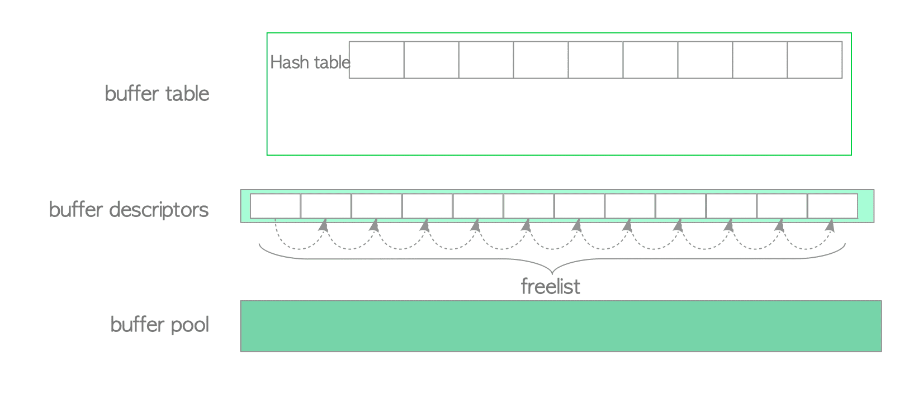
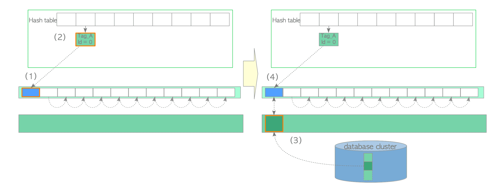

## 1. 存储管理



- 缓冲池管理

  共享缓冲池

  本地私有缓冲池
- Cache机制

  将进程最近的一些系统数据缓存在其私有内存中，其级别高于缓冲池
- 虚拟文件描述符管理(Virtual File Desciptor,VFD)

  避免操作系统对进程打开文件数的限制。
- 空闲空间管理

  快速定位空闲空间，方便插入新数据。
- 进程间通信(IPC)
- 大数据存储管理

  提供大对象(图片、文档等)和TOAST(The Oversized-Attribute Storage Technique)超尺寸字段存储技术

  ```c
  要理解TOAST，我们要先理解页（BLOCK）的概念。在PG中，页是数据在文件存储中的基本单位，其大小是固定的且只能在编译期指定，之后无法修改，默认的大小为8KB。同时，PG不允许一行数据跨页存储。那么对于超长的行数据，PG就会启动TOAST，将大的字段压缩或切片成多个物理行存到另一张系统表中（TOAST表），这种存储方式叫行外存储。
  ```

## 2. 外存管理

### 2.1 SMGR存储介质管理器

    主要代码在src/backend/storage/smgr/smgr.c,提供对外存操作的统一接口。

### 2.2 硬盘管理器

   SMGR的一种具体实现（目前只有一种）。主要代码在src/backend/storage/smgr/md.c

  硬盘管理器并非对磁盘上的文件直接操作，而是透过VFD机制进行。

```c
typedef struct _MdfdVec
{
	File		mdfd_vfd;		/* fd number in fd.c's pool */
	BlockNumber mdfd_segno;		/* segment number, from 0 */
} MdfdVec;
```

### 2.3 VFD机制

```c
typedef struct vfd
{
	int			fd;								/* current FD, or VFD_CLOSED if none */
	unsigned short fdstate;		/* bitflags for VFD's state */
	ResourceOwner resowner;		/* owner, for automatic cleanup */
	File		nextFree;					/* link to next free VFD, if in freelist */
	File		lruMoreRecently;	/* doubly linked recency-of-use list */
	File		lruLessRecently;
	off_t		fileSize;					/* current size of file (0 if not temporary) */
	char	   *fileName;				/* name of file, or NULL for unused VFD */
														/* NB: fileName is malloc'd, and must be free'd when closing the VFD */
	int			fileFlags;				/* open(2) flags for (re)opening the file */
	mode_t		fileMode;				/* mode to pass to open(2) */
} Vfd;

/*
 * Virtual File Descriptor array pointer and size.  This grows as
 * needed.  'File' values are indexes into this array.
 * Note that VfdCache[0] is not a usable VFD, just a list header.
 */
static Vfd *VfdCache;
static Size SizeVfdCache = 0;
```

- LRU池

  通过lruMoreRecently，lruLessRecently 链接组成双向链表。
- FreeList空闲链表

  通过nextFree链接

### 2.4 空闲空间管理(Free Space Map)

随着表中不断插入和删除元组，文件块中必然会产生空闲空间。FSM的引入能够更快的查找合适的空闲空间。
对于每个表文件，会产生“关系表OID_fsm”的文件。FSM文件并不是在创建表文件时创建，而是推迟到需要使用时。
即执行VACUUM操作时或为了插入元组第一次查找FSM文件时才创建。代码位置src/backend/storage/freespace/freespace.c

```c
 * Range	 Category
 * 0	- 31   0
 * 32	- 63   1
 * ...    ...  ...
 * 8096 - 8127 253
 * 8128 - 8163 254
 * 8164 - 8192 255
/*对于一个有N字节空闲空间的表块，其值FSM中记录的值为 (31+N)/32.*/   
#define FSM_CATEGORIES	256
#define FSM_CAT_STEP	(BLCKSZ / FSM_CATEGORIES)  /*8192/256=32*/
   
/*
 * Depth of the on-disk tree. We need to be able to address 2^32-1 blocks,
 * and 1626 is the smallest number that satisfies X^3 >= 2^32-1. Likewise,
 * 216 is the smallest number that satisfies X^4 >= 2^32-1. In practice,
 * this means that 4096 bytes is the smallest BLCKSZ that we can get away
 * with a 3-level tree, and 512 is the smallest we support.
 */
#define FSM_TREE_DEPTH	((SlotsPerFSMPage >= 1626) ? 3 : 4)
#define FSM_ROOT_LEVEL	(FSM_TREE_DEPTH - 1)
typedef struct
{
    int            level;            /* level */
    int            logpageno;        /* page number within the level */
} FSMAddress;
/* Address of the root page. */
static const FSMAddress FSM_ROOT_ADDRESS = {FSM_ROOT_LEVEL, 0};
/*
 * Structure of a FSM page. See src/backend/storage/freespace/README for
 * details.
 */
typedef struct
{
	/*
	 * fsm_search_avail() tries to spread the load of multiple backends by
	 * returning different pages to different backends in a round-robin
	 * fashion. fp_next_slot points to the next slot to be returned (assuming
	 * there's enough space on it for the request). It's defined as an int,
	 * because it's updated without an exclusive lock. uint16 would be more
	 * appropriate, but int is more likely to be atomically
	 * fetchable/storable.
	 */
	int			fp_next_slot;
	/*
	 * fp_nodes contains the binary tree, stored in array. The first
	 * NonLeafNodesPerPage elements are upper nodes, and the following
	 * LeafNodesPerPage elements are leaf nodes. Unused nodes are zero.
	 */
	uint8		fp_nodes[FLEXIBLE_ARRAY_MEMBER];
} FSMPageData;
typedef FSMPageData *FSMPage;
/*
 * Number of non-leaf and leaf nodes, and nodes in total, on an FSM page.
 * These definitions are internal to fsmpage.c.
 */
#define NodesPerPage (BLCKSZ - MAXALIGN(SizeOfPageHeaderData) - \
					  offsetof(FSMPageData, fp_nodes))

#define NonLeafNodesPerPage (BLCKSZ / 2 - 1)
#define LeafNodesPerPage (NodesPerPage - NonLeafNodesPerPage)
/*
 * Number of FSM "slots" on a FSM page. This is what should be used
 * outside fsmpage.c.
 */
#define SlotsPerFSMPage LeafNodesPerPage
#define offsetof(type, field)	((long) &((type *)0)->field)

For example:/*全局最大堆二叉树*/

    4
 4     2
3 4   0 2    <- This level represents heap pages
```

### 2.5 可见性映射表

为了加快VACUUM查找无效元组文件块的过程，引入可见性映射表VM。

对于每个表文件，会产生“关系表OID_vm”的文件。代码位置src/backend/access/heap/visibilitymap.c

VM文件损坏仅仅导致VACUUM忽略需要清理的页面，而不会对数据产生任何负面影响。

VACUUM两种处理方式

- 快速清理(Lazy VACUUM)

  vm仅在Lazy操作中被使用到
- 完全清理(Full VACUUM)

  需要对这个表进行扫描

VM文件块结构

```c
---------------------------------------------
|PageHeaderData|bit|bit|bit|bit|............|  
---------------------------------------------
```

## 3. 内存管理

### 3.1 内存上下文



```c
typedef struct MemoryContextData
{
	NodeTag		type;			/* identifies exact kind of context */
	/* these two fields are placed here to minimize alignment wastage: */
	bool		isReset;		/* T = no space alloced since last reset */
	bool		allowInCritSection; /* allow palloc in critical section */
	Size		mem_allocated;	/* track memory allocated for this context */
	const MemoryContextMethods *methods;	/* virtual function table */
	MemoryContext parent;		/* NULL if no parent (toplevel context) */
	MemoryContext firstchild;	/* head of linked list of children */
	MemoryContext prevchild;	/* previous child of same parent */
	MemoryContext nextchild;	/* next child of same parent */
	const char *name;			/* context name (just for debugging) */
	const char *ident;			/* context ID if any (just for debugging) */
	MemoryContextCallback *reset_cbs;	/* list of reset/delete callbacks */
} MemoryContextData;
typedef struct MemoryContextData *MemoryContext;
typedef struct MemoryContextMethods
{
	void	   *(*alloc) (MemoryContext context, Size size);
	/* call this free_p in case someone #define's free() */
	void		(*free_p) (MemoryContext context, void *pointer);
	void	   *(*realloc) (MemoryContext context, void *pointer, Size size);
	void		(*reset) (MemoryContext context);
	void		(*delete_context) (MemoryContext context);
	Size		(*get_chunk_space) (MemoryContext context, void *pointer);
	bool		(*is_empty) (MemoryContext context);
	void		(*stats) (MemoryContext context,
						  MemoryStatsPrintFunc printfunc, void *passthru,
						  MemoryContextCounters *totals,
						  bool print_to_stderr);
#ifdef MEMORY_CONTEXT_CHECKING
	void		(*check) (MemoryContext context);
#endif
} MemoryContextMethods;


typedef void (*MemoryContextCallbackFunction) (void *arg);
typedef struct MemoryContextCallback
{
	MemoryContextCallbackFunction func; /* function to call */
	void	   *arg;			/* argument to pass it */
	struct MemoryContextCallback *next; /* next in list of callbacks */
} MemoryContextCallback;

 */
static const MemoryContextMethods AllocSetMethods = {
	AllocSetAlloc,
	AllocSetFree,
	AllocSetRealloc,
	AllocSetReset,
	AllocSetDelete,
	AllocSetGetChunkSpace,
	AllocSetIsEmpty,
	AllocSetStats
#ifdef MEMORY_CONTEXT_CHECKING
	,AllocSetCheck
#endif
};

typedef struct AllocSetContext
{
	MemoryContextData header;	/* Standard memory-context fields */
	/* Info about storage allocated in this context: */
	AllocBlock	blocks;			/* head of list of blocks in this set */
	AllocChunk	freelist[ALLOCSET_NUM_FREELISTS];	/* free chunk lists */
	/* Allocation parameters for this context: */
	Size		initBlockSize;	/* initial block size */
	Size		maxBlockSize;	/* maximum block size */
	Size		nextBlockSize;	/* next block size to allocate */
	Size		allocChunkLimit;	/* effective chunk size limit */
	AllocBlock	keeper;			/* keep this block over resets */
	/* freelist this context could be put in, or -1 if not a candidate: */
	int			freeListIndex;	/* index in context_freelists[], or -1 */
} AllocSetContext;

typedef AllocSetContext *AllocSet;
typedef struct AllocBlockData *AllocBlock;	/* forward reference */
typedef struct AllocChunkData *AllocChunk;

typedef struct AllocBlockData
{
	AllocSet	aset;			/* aset that owns this block */
	AllocBlock	prev;			/* prev block in aset's blocks list, if any */
	AllocBlock	next;			/* next block in aset's blocks list, if any */
	char	   *freeptr;		/* start of free space in this block */
	char	   *endptr;			/* end of space in this block */
}			AllocBlockData;

typedef struct AllocChunkData
{
	/* size is always the size of the usable space in the chunk */
	Size		size;
#ifdef MEMORY_CONTEXT_CHECKING
	/* when debugging memory usage, also store actual requested size */
	/* this is zero in a free chunk */
	Size		requested_size;

#define ALLOCCHUNK_RAWSIZE  (SIZEOF_SIZE_T * 2 + SIZEOF_VOID_P)
#else
#define ALLOCCHUNK_RAWSIZE  (SIZEOF_SIZE_T + SIZEOF_VOID_P)
#endif							/* MEMORY_CONTEXT_CHECKING */

	/* ensure proper alignment by adding padding if needed */
#if (ALLOCCHUNK_RAWSIZE % MAXIMUM_ALIGNOF) != 0
	char		padding[MAXIMUM_ALIGNOF - ALLOCCHUNK_RAWSIZE % MAXIMUM_ALIGNOF];
#endif

	/* aset is the owning aset if allocated, or the freelist link if free */
	void	   *aset;
	/* there must not be any padding to reach a MAXALIGN boundary here! */
}			AllocChunkData;

```

### 3.2 Cache机制

    当数据库访问表时，需要表的模式信息，如列属性、OID、统计信息等。PG将表的模式信息存放在系统表中。对于PG来说，对于系统表和普通表的模式信息的访问是非常频繁的。PG引入Cache机制提高访问效率。
Cache中包含系统表元组SysCache 和表模式信息RelCache.每一个进程都维护着自己的SysCache和RelCache。
代码位置src/backend/utils/cache目录下

#### 3.2.1 SysCache

存放最近使用过的系统表的元组，在Postgres进程初始化时，InitPostgres函数内完成初始化。

```c
static CatCache *SysCache[SysCacheSize];
typedef struct catcache
{
	int			id;				/* cache identifier --- see syscache.h */
	int			cc_nbuckets;	/* # of hash buckets in this cache */
	TupleDesc	cc_tupdesc;		/* tuple descriptor (copied from reldesc) */
	dlist_head *cc_bucket;		/* hash buckets */
	CCHashFN	cc_hashfunc[CATCACHE_MAXKEYS];	/* hash function for each key */
	CCFastEqualFN cc_fastequal[CATCACHE_MAXKEYS];	/* fast equal function for
													 * each key */
	int			cc_keyno[CATCACHE_MAXKEYS]; /* AttrNumber of each key */
	dlist_head	cc_lists;		/* list of CatCList structs */
	int			cc_ntup;		/* # of tuples currently in this cache */
	int			cc_nkeys;		/* # of keys (1..CATCACHE_MAXKEYS) */
	const char *cc_relname;		/* name of relation the tuples come from */
	Oid			cc_reloid;		/* OID of relation the tuples come from */
	Oid			cc_indexoid;	/* OID of index matching cache keys */
	bool		cc_relisshared; /* is relation shared across databases? */
	slist_node	cc_next;		/* list link 链表方便查找*/
	ScanKeyData cc_skey[CATCACHE_MAXKEYS];	/* precomputed key info for heap
											 * scans */

	/*
	 * Keep these at the end, so that compiling catcache.c with CATCACHE_STATS
	 * doesn't break ABI for other modules
	 */
#ifdef CATCACHE_STATS
	long		cc_searches;	/* total # searches against this cache */
	long		cc_hits;		/* # of matches against existing entry */
	long		cc_neg_hits;	/* # of matches against negative entry */
	long		cc_newloads;	/* # of successful loads of new entry */

	/*
	 * cc_searches - (cc_hits + cc_neg_hits + cc_newloads) is number of failed
	 * searches, each of which will result in loading a negative entry
	 */
	long		cc_invals;		/* # of entries invalidated from cache */
	long		cc_lsearches;	/* total # list-searches */
	long		cc_lhits;		/* # of matches against existing lists */
#endif
} CatCache;
```

#### 3.2.2 RelCache

包含所有最近访问过的表的模式信息(包含系统表的信息)。RelCache中存放的不是元组，而是RelationData数据结构。每个RelationData表示一个表的模式信息，这些信息都是由系统表元组中的信息构造而来。

RelationData结构

```c
typedef struct RelationData
{
	RelFileNode rd_node;		/* relation physical identifier */
	/* use "struct" here to avoid needing to include smgr.h: */
	struct SMgrRelationData *rd_smgr;	/* cached file handle, or NULL */
	int			rd_refcnt;		/* reference count */
	BackendId	rd_backend;		/* owning backend id, if temporary relation */
	bool		rd_islocaltemp; /* rel is a temp rel of this session */
	bool		rd_isnailed;	/* rel is nailed in cache */
	bool		rd_isvalid;		/* relcache entry is valid */
	bool		rd_indexvalid;	/* is rd_indexlist valid? (also rd_pkindex and
								 * rd_replidindex) */
	bool		rd_statvalid;	/* is rd_statlist valid? */

	/*----------
	 * rd_createSubid is the ID of the highest subtransaction the rel has
	 * survived into or zero if the rel or its rd_node was created before the
	 * current top transaction.  (IndexStmt.oldNode leads to the case of a new
	 * rel with an old rd_node.)  rd_firstRelfilenodeSubid is the ID of the
	 * highest subtransaction an rd_node change has survived into or zero if
	 * rd_node matches the value it had at the start of the current top
	 * transaction.  (Rolling back the subtransaction that
	 * rd_firstRelfilenodeSubid denotes would restore rd_node to the value it
	 * had at the start of the current top transaction.  Rolling back any
	 * lower subtransaction would not.)  Their accuracy is critical to
	 * RelationNeedsWAL().
	 *
	 * rd_newRelfilenodeSubid is the ID of the highest subtransaction the
	 * most-recent relfilenode change has survived into or zero if not changed
	 * in the current transaction (or we have forgotten changing it).  This
	 * field is accurate when non-zero, but it can be zero when a relation has
	 * multiple new relfilenodes within a single transaction, with one of them
	 * occurring in a subsequently aborted subtransaction, e.g.
	 *		BEGIN;
	 *		TRUNCATE t;
	 *		SAVEPOINT save;
	 *		TRUNCATE t;
	 *		ROLLBACK TO save;
	 *		-- rd_newRelfilenodeSubid is now forgotten
	 *
	 * If every rd_*Subid field is zero, they are read-only outside
	 * relcache.c.  Files that trigger rd_node changes by updating
	 * pg_class.reltablespace and/or pg_class.relfilenode call
	 * RelationAssumeNewRelfilenode() to update rd_*Subid.
	 *
	 * rd_droppedSubid is the ID of the highest subtransaction that a drop of
	 * the rel has survived into.  In entries visible outside relcache.c, this
	 * is always zero.
	 */
	SubTransactionId rd_createSubid;	/* rel was created in current xact */
	SubTransactionId rd_newRelfilenodeSubid;	/* highest subxact changing
												 * rd_node to current value */
	SubTransactionId rd_firstRelfilenodeSubid;	/* highest subxact changing
												 * rd_node to any value */
	SubTransactionId rd_droppedSubid;	/* dropped with another Subid set */

	Form_pg_class rd_rel;		/* RELATION tuple */
	TupleDesc	rd_att;			/* tuple descriptor */
	Oid			rd_id;			/* relation's object id */
	LockInfoData rd_lockInfo;	/* lock mgr's info for locking relation */
	RuleLock   *rd_rules;		/* rewrite rules */
	MemoryContext rd_rulescxt;	/* private memory cxt for rd_rules, if any */
	TriggerDesc *trigdesc;		/* Trigger info, or NULL if rel has none */
	/* use "struct" here to avoid needing to include rowsecurity.h: */
	struct RowSecurityDesc *rd_rsdesc;	/* row security policies, or NULL */

	/* data managed by RelationGetFKeyList: */
	List	   *rd_fkeylist;	/* list of ForeignKeyCacheInfo (see below) */
	bool		rd_fkeyvalid;	/* true if list has been computed */

	/* data managed by RelationGetPartitionKey: */
	PartitionKey rd_partkey;	/* partition key, or NULL */
	MemoryContext rd_partkeycxt;	/* private context for rd_partkey, if any */

	/* data managed by RelationGetPartitionDesc: */
	PartitionDesc rd_partdesc;	/* partition descriptor, or NULL */
	MemoryContext rd_pdcxt;		/* private context for rd_partdesc, if any */

	/* Same as above, for partdescs that omit detached partitions */
	PartitionDesc rd_partdesc_nodetached;	/* partdesc w/o detached parts */
	MemoryContext rd_pddcxt;	/* for rd_partdesc_nodetached, if any */

	/*
	 * pg_inherits.xmin of the partition that was excluded in
	 * rd_partdesc_nodetached.  This informs a future user of that partdesc:
	 * if this value is not in progress for the active snapshot, then the
	 * partdesc can be used, otherwise they have to build a new one.  (This
	 * matches what find_inheritance_children_extended would do).
	 */
	TransactionId rd_partdesc_nodetached_xmin;

	/* data managed by RelationGetPartitionQual: */
	List	   *rd_partcheck;	/* partition CHECK quals */
	bool		rd_partcheckvalid;	/* true if list has been computed */
	MemoryContext rd_partcheckcxt;	/* private cxt for rd_partcheck, if any */

	/* data managed by RelationGetIndexList: */
	List	   *rd_indexlist;	/* list of OIDs of indexes on relation */
	Oid			rd_pkindex;		/* OID of primary key, if any */
	Oid			rd_replidindex; /* OID of replica identity index, if any */

	/* data managed by RelationGetStatExtList: */
	List	   *rd_statlist;	/* list of OIDs of extended stats */

	/* data managed by RelationGetIndexAttrBitmap: */
	Bitmapset  *rd_indexattr;	/* identifies columns used in indexes */
	Bitmapset  *rd_keyattr;		/* cols that can be ref'd by foreign keys */
	Bitmapset  *rd_pkattr;		/* cols included in primary key */
	Bitmapset  *rd_idattr;		/* included in replica identity index */

	PublicationActions *rd_pubactions;	/* publication actions */

	/*
	 * rd_options is set whenever rd_rel is loaded into the relcache entry.
	 * Note that you can NOT look into rd_rel for this data.  NULL means "use
	 * defaults".
	 */
	bytea	   *rd_options;		/* parsed pg_class.reloptions */

	/*
	 * Oid of the handler for this relation. For an index this is a function
	 * returning IndexAmRoutine, for table like relations a function returning
	 * TableAmRoutine.  This is stored separately from rd_indam, rd_tableam as
	 * its lookup requires syscache access, but during relcache bootstrap we
	 * need to be able to initialize rd_tableam without syscache lookups.
	 */
	Oid			rd_amhandler;	/* OID of index AM's handler function */

	/*
	 * Table access method.
	 */
	const struct TableAmRoutine *rd_tableam;

	/* These are non-NULL only for an index relation: */
	Form_pg_index rd_index;		/* pg_index tuple describing this index */
	/* use "struct" here to avoid needing to include htup.h: */
	struct HeapTupleData *rd_indextuple;	/* all of pg_index tuple */

	/*
	 * index access support info (used only for an index relation)
	 *
	 * Note: only default support procs for each opclass are cached, namely
	 * those with lefttype and righttype equal to the opclass's opcintype. The
	 * arrays are indexed by support function number, which is a sufficient
	 * identifier given that restriction.
	 */
	MemoryContext rd_indexcxt;	/* private memory cxt for this stuff */
	/* use "struct" here to avoid needing to include amapi.h: */
	struct IndexAmRoutine *rd_indam;	/* index AM's API struct */
	Oid		   *rd_opfamily;	/* OIDs of op families for each index col */
	Oid		   *rd_opcintype;	/* OIDs of opclass declared input data types */
	RegProcedure *rd_support;	/* OIDs of support procedures */
	struct FmgrInfo *rd_supportinfo;	/* lookup info for support procedures */
	int16	   *rd_indoption;	/* per-column AM-specific flags */
	List	   *rd_indexprs;	/* index expression trees, if any */
	List	   *rd_indpred;		/* index predicate tree, if any */
	Oid		   *rd_exclops;		/* OIDs of exclusion operators, if any */
	Oid		   *rd_exclprocs;	/* OIDs of exclusion ops' procs, if any */
	uint16	   *rd_exclstrats;	/* exclusion ops' strategy numbers, if any */
	Oid		   *rd_indcollation;	/* OIDs of index collations */
	bytea	  **rd_opcoptions;	/* parsed opclass-specific options */

	/*
	 * rd_amcache is available for index and table AMs to cache private data
	 * about the relation.  This must be just a cache since it may get reset
	 * at any time (in particular, it will get reset by a relcache inval
	 * message for the relation).  If used, it must point to a single memory
	 * chunk palloc'd in CacheMemoryContext, or in rd_indexcxt for an index
	 * relation.  A relcache reset will include freeing that chunk and setting
	 * rd_amcache = NULL.
	 */
	void	   *rd_amcache;		/* available for use by index/table AM */

	/*
	 * foreign-table support
	 *
	 * rd_fdwroutine must point to a single memory chunk palloc'd in
	 * CacheMemoryContext.  It will be freed and reset to NULL on a relcache
	 * reset.
	 */

	/* use "struct" here to avoid needing to include fdwapi.h: */
	struct FdwRoutine *rd_fdwroutine;	/* cached function pointers, or NULL */

	/*
	 * Hack for CLUSTER, rewriting ALTER TABLE, etc: when writing a new
	 * version of a table, we need to make any toast pointers inserted into it
	 * have the existing toast table's OID, not the OID of the transient toast
	 * table.  If rd_toastoid isn't InvalidOid, it is the OID to place in
	 * toast pointers inserted into this rel.  (Note it's set on the new
	 * version of the main heap, not the toast table itself.)  This also
	 * causes toast_save_datum() to try to preserve toast value OIDs.
	 */
	Oid			rd_toastoid;	/* Real TOAST table's OID, or InvalidOid */

	/* use "struct" here to avoid needing to include pgstat.h: */
	struct PgStat_TableStatus *pgstat_info; /* statistics collection area */
} RelationData;
```

#### 3.2.3 Cache同步

    PG通过SI Message(共享消息队列) 方式在进程间传递已被删除的无效元组，收到消息的进程同步将无效元组从自己的Cache中删除。

    三种无效消息传递方式

- SysCache中元组无效
- RelCache中RelationData结构无效
- SMGR无效(表物理位置变化，需通知SMGR关闭表文件)

### 3.3 缓冲池管理

调入缓冲池的磁盘块称为缓冲区、缓冲块或页面，多个缓冲区组成缓冲池。



对缓冲池中缓冲区的管理通过两种机制完成pin和lock

- pin

  实际就时访问计数器，对缓冲区加pin,pin的数目保存中缓冲区的refcount属性中。当refcount不为0表示有进程正在访问，此缓冲区不能替换。
- lock

  写操作加EXCLUSIVE锁，读时加SHARE锁。

#### 3.3.1 共享缓冲池

##### 3.3.1.1 后台进程如何读取一个页



##### 3.3.1.2 缓冲区管理器结构



* buffer table layer 是一个hash表，它存储着buffer_tag 与buffer_descriptor的buffer_id之间的映射。
* buffer descriptors layer是一个由缓冲区描述符组成的数组。每个描述符与缓冲池槽一一对应。
* buffer pool layer 是一个数组。每个槽存储一个数据文件页，数组槽的索引称为buffer_id.

###### 3.3.1.2.1 buffer_tag

PG 中的每个数据文件页面都可以分配到一个唯一的标签。

```c
typedef struct RelFileNode
{
	Oid			spcNode;		/* tablespace */
	Oid			dbNode;			/* database */
	Oid			relNode;		/* relation */
} RelFileNode;
typedef struct buftag
{
	RelFileNode rnode;		/* physical relation identifier 
					关系节点用于定位页面所属关系
					*/
	ForkNumber	forkNum;	/*关系分支编号用于定位关系文件的具体分支文件
					一个关系可以有3种分支
					编号0  关系的main分支
					编号1  空闲空间（fsm分支）
					编号2  可见性（vm分支)
					*/
	BlockNumber blockNum;		/* blknum relative to begin of reln
					页块号用于定位在具体分支文件中的偏移量
					 */
} BufferTag;
```

###### 3.3.1.2.2 buffer_table

缓冲表在逻辑上可以分为三个部分。

* 散列函数

  * 散列函数由[calc_bucket()](https://doxygen.postgresql.org/dynahash_8c.html#ae802f2654df749ae0e0aadf4b5c5bcbd) 和[hash()](https://doxygen.postgresql.org/rege__dfa_8c.html#a6aa3a27e7a0fc6793f3329670ac3b0cb)函数组合而成。
  * 伪函数表示形式  uint32 bucket_slot = calc_bucket(unsigned hash(BufferTag buffer_tag),uint32 bucket_size)
* 散列桶槽
* 数据项

  * 数据项包括两个值，即页面的buffer_tag和包含页面元数据的描述符的buffer_id.
  * 例如数据项Tag_A,id=1表示在buffer_id =1的缓冲区描述符中，存储着页面Tag_A的元数据。

如下图：


###### 3.3.1.2.3 buffer_Descriptor

缓冲区描述符保存着**页面的元数据**。这些与缓冲区描述符**相对应的页**面保存在**缓冲池的槽**中。

PG共享池管理中，使用全局数组BufferDescriptors管理缓冲区。详见InitBufferPool函数。ReadBuffer_common是所有从缓冲区读取的通用函数。

```c
typedef struct BufferDesc
{
	BufferTag	tag;			/* ID of page contained in buffer */
	int		buf_id;			/* buffer's index number (from 0) */

	/* state of the tag, containing flags, refcount and usagecount */
	pg_atomic_uint32 state;

	int		wait_backend_pid;	/* backend PID of pin-count waiter */
	int		freeNext;		/* link in freelist chain */
	LWLock		content_lock;		/* to lock access to buffer contents */
} BufferDesc;
typedef union BufferDescPadded
{
	BufferDesc	bufferdesc;
	char		pad[BUFFERDESC_PAD_TO_SIZE];
} BufferDescPadded;
BufferDescPadded *BufferDescriptors;

```

在PG启动时，所有缓冲区描述符的状态都为空，这些描述符构成了一个freelist的链表。初始阶段如下图：

下图展示了一个页面是如何加载的。


* 从freelist头部取一个空描述符，并将其钉住。即refcount和usage_count增加1。
* 在缓冲表中插入新项，该表保存了页面buffer_tag和描述符buffer_id的关系。
* 将页面从存储器中加载至缓冲区相应的槽中。
* 将页面的元数据保存至所获取的描述符中。
* 其他页面类似如上步骤。

###### 3.3.1.2.4 buffer_pool

缓冲池只是一个用于存储页面的简单数组，buffer_id是数组的索引号下标。每个缓冲池的槽就是一个页面大小8K。

##### 3.3.1.3 缓冲区管理器锁

##### 3.3.1.4缓冲区管理器的管理

##### 3.3.1.5 Ring Buffer环形缓冲区

在读写大表时，PG会使用环形缓冲区而不是缓冲池。环形缓冲区时一个很小的临时缓冲区域。当满足下列任意条件，PG将在共享内存中分配一个环形缓冲区。

1. 批量读取。当扫描关系读取的数据大小超过缓冲池的$\dfrac{1}{4}$时，环形缓冲区的大小为256K。
2. 批量写入，当执行下列sql命令时，环形缓冲区大小为16M。
   1. copy from命令。
   2. create table as命令。
   3. create materialized view或refresh materialized view命令。
   4. alter table 命令。
3. 清理过程，当自动守护进程执行清理过程时，环形缓冲区大小为256K。

> 为什么批量读取和清理过程的默认环形缓冲区大小为 256 KB？
> 源代码中缓冲区管理器目录下的 README 中解释了这个问题。
> 顺序扫描使用 256KB 的环形缓冲区，它足够小，因而能放入L2缓存中，从而使得操作系统缓存到共享缓冲区的页面传输变得高效。
> 通常更小一点也可以，但环形缓冲区需要足够大到能同时容纳扫描中被钉住的所有页面。

##### 3.3.1.6 Flushing Dirty Pages脏页刷盘

除了置换受害者页面之外，检查点进程和后台写入器进程也会将脏页刷盘至存储中。尽管两个进程都具有相同的功能（脏页刷盘），但是它们有着不同的角色和行为。

检查点进程将检查点记录写入WAL段文件，并在检查点开始时进行脏页刷盘。

后台写入器的目的是通过少量多次的脏页刷盘，减少检查点带来的密集写入的影响。后台写入器会一点点地将脏页落盘，尽可能减少对数据库活动造成的影响。在默认情况下，后台写入器每 200ms 被唤醒一次（由参数 bgwriter_delay 定义），且最多刷写 bgwriter_lru_maxpages个页面（默认为100个页面）。

> 为什么检查点进程与后台写入器相分离?
> 在 9.1及更低版本中，后台写入器会规律性地执行检查点进程。
> 在 9.2版本中，检查点进程从后台写入被单独剥离出来。原因在一篇题为“将检查点进程与后台写入器相分离”的提案中有介绍。
> 下面是一些摘录：当前（在 2011年）后台写入器进程既执行后台写入，又负责检查点，还处理一些其他的职责。
> 这意味着我们没法在不停止后台写入的情况下执行检查点最终的fsync。因此，在同一个进程中做两件事会有负面
> 的性能影响。此外，在9.2版本中，我们的一个目标是通过将轮询循环替换为锁存器，从而降低功耗。
> bgwriter中的循环复杂度太高了，以至于无法找到一种简单的使用锁存器的方法。

#### 3.3.2 本地缓冲池

    调用InitLocalBuffers函数完成初始化，缓冲区的分配主要通过LocalBufferAlloc函数。

### 3.4 IPC

    PG中IPC主要采用共享内存的方式实现，即在系统中开辟一片所有进程都可读写的内存空间，并约定好即成读写这片内存的时机和方式，这样进程之间就可以通过共享内存交换数据。在共享内存的基础上，PG的IPC还提供一下功能

1. 进程和Postermaster的通信机制
2. 统一管理进程的相关变量和函数
3. 提供SI Message机制
4. 有关清除的函数
