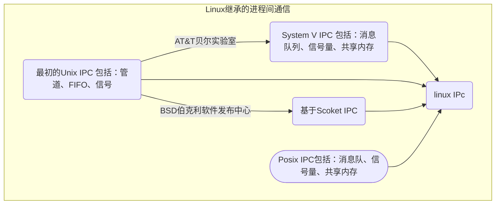
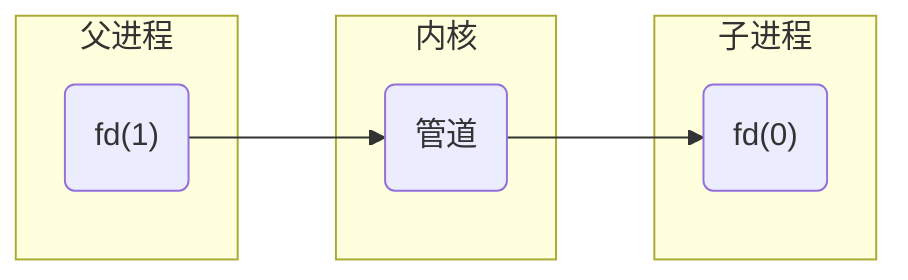

# 1. Linux IPC



# 2. 信号

信号是在软件层次上对硬件的中断机制的一种模拟，在原理上，一个进程接受到一个信号和处理器接受到中断请求可以说是一样。信号是异步的，一个进程不必通过任何操作来等待信号的到达，事实上，进程也不知道信号到底什么时候到达。信号是进程间通信机制中唯一的异步通信机制，可以看作是异步通知，通知接收信号的进程有哪些事情发生了。信号机制经过POSIX实时扩展后，功能更加强大，除了基本通知功能外，还可以传递附加信息。

信号事件的发生有两个来源：

- 硬件来源(比如我们按下了键盘或者其它硬件故障)；
- 软件来源，最常用发送信号的系统函数是kill, raise, alarm和signal函数，还包括一些非法运算等操作。

进程可以通过三种方式来响应一个信号：

- 忽略信号（SIG_IGN），即对信号不做任何处理，其中，有两个信号不能忽略：SIGKILL及SIGSTOP；
- 捕捉信号。定义信号处理函数，当信号发生时，执行相应的处理函数(void (*func)(int))；
- 执行缺省操作（SIG_DFL），Linux对每种信号都规定了默认操作。注意，进程对实时信号的缺省反应是进程终止。

Linux究竟采用上述三种方式的哪一个来响应信号，取决于传递给相应API函数的参数。

## 2.1 信号分类

- 不可靠信号(非实时信号)

  Linux信号机制基本上是从Unix系统中继承过来的。早期Unix系统中的信号机制比较简单和原始，后来在实践中暴露出一些问题，因此，把那些建立在早期机制上的信号叫做"不可靠信号"，信号值小于SIGRTMIN(Red hat 7.2中，SIGRTMIN=32，SIGRTMAX=63)的信号都是不可靠信号。这就是"不可靠信号"的来源。

  它的主要问题是：

  1. 进程每次处理信号后，就将对信号的响应设置为默认动作。在某些情况下，将导致对信号的错误处理；因此，用户如果不希望这样的操作，那么就要在信号处理函数结尾再一次调用signal()，重新安装该信号。
  2. 信号可能丢失，后面将对此详细阐述。

  因此，早期unix下的不可靠信号主要指的是进程可能对信号做出错误的反应以及信号可能丢失。Linux支持不可靠信号，但是对不可靠信号机制做了改进：在调用完信号处理函数后，不必重新调用该信号的安装函数（信号安装函数是在可靠机制上的实现）。因此，Linux下的不可靠信号问题主要指的是信号可能丢失
- 可靠信号(实时信号)

  随着时间的发展，实践证明了有必要对信号的原始机制加以改进和扩充。所以，后来出现的各种Unix版本分别在这方面进行了研究，力图实现"可靠信号"。由于原来定义的信号已有许多应用，不好再做改动，最终只好又新增加了一些信号，并在一开始就把它们定义为可靠信号，这些信号支持排队，不会丢失。同时，信号的发送和安装也出现了新版本：信号发送函数sigqueue()及信号安装函数sigaction()。POSIX.4对可靠信号机制做了标准化。但是，POSIX只对可靠信号机制应具有的功能以及信号机制的对外接口做了标准化，对信号机制的实现没有作具体的规定。
  信号值位于SIGRTMIN和SIGRTMAX之间的信号都是可靠信号，可靠信号克服了信号可能丢失的问题。Linux在支持新版本的信号安装函数sigation以及信号发送函数sigqueue的同时，仍然支持早期的signal信号安装函数，支持信号发送函数kill()。

注：不要有这样的误解：由sigqueue()发送、sigaction安装的信号就是可靠的。信号的可靠与不可靠只与信号值有关，与信号的发送及安装函数无关。目前linux中的signal()是通过sigation()函数实现的，因此，即使通过signal（）安装的信号，在信号处理函数的结尾也不必再调用一次信号安装函数。同时，由signal()安装的实时信号支持排队，同样不会丢失。对于目前linux的两个信号安装函数:signal()及sigaction()来说，它们都不能把SIGRTMIN以前的信号变成可靠信号（都不支持排队，仍有可能丢失，仍然是不可靠信号），而且对SIGRTMIN以后的信号都支持排队。这两个函数的最大区别在于，经过sigaction安装的信号都能传递信息给信号处理函数（对所有信号这一点都成立），而经过signal安装的信号却不能向信号处理函数传递信息。对于信号发送函数来说也是一样的。

## 2.2 信号生命周期

对于一个完整的信号生命周期(从信号发送到相应的处理函数执行完毕)来说，可以分为三个重要的阶段，

这三个阶段由四个重要事件来刻画，相邻两个事件的时间间隔构成信号生命周期的一个阶段。

- 信号诞生
- 信号在进程中注册
- 信号在进程中的注销
- 信号处理函数执行

下面阐述四个事件的实际意义：

1. 信号"诞生"。指的是触发信号的事件发生（如检测到硬件异常、定时器超时以及调用信号发送函数kill()或sigqueue()等）。
2. 信号在目标进程中"注册"；进程的task_struct结构中有关于本进程中已经注册但是未来得及处理信号的数据成员：

   ```c
   struct sigpending pending：
   struct sigpending{
         struct sigqueue *head, **tail;
         sigset_t signal;
   };

   //其中第三个成员是进程中所有未处理信号集，第一、第二个成员分别指向一个sigqueue类型的结构链的首尾，信息链中的每个sigqueue结构刻画一个特定信号所携带的信息，并指向下一个sigqueue结构:
   struct sigqueue{
         struct sigqueue *next;
         siginfo_t info;
   }
   ```

   注册：指的就是信号值加入到进程的未决信号集中（sigpending.signal），并且信号所携带的信息被保留到未决信号信息链的某个sigqueue结构中。只要信号在进程的未决信号集中，表明进程已经知道这些信号的存在，但还没来得及处理，或者该信号被进程阻塞。
   注： 当一个实时信号发送给一个进程时，不管该信号是否已经在进程中注册，都会被再注册一次，因此，信号不会丢失，因此，实时信号又叫做"可靠信号"。这意味着同一个实时信号可以在同一个进程的未决信号信息链中占有多个sigqueue结构。

   当一个非实时信号发送给一个进程时，如果该信号已经在进程中注册，则该信号将被丢弃，造成信号丢失。因此，非实时信号又做"不可靠信号"。这意味着同一个非实时信号在进程的未决信号信息链中，至多占有一个sigqueue结构。
3. 信号在进程中的注销。在目标进程执行过程中，会检测是否有信号等待处理（每次从系统空间返回到用户空间时都做这样的检查）。

   如果存在未决信号等待处理且该信号没有被进程阻塞，则在运行相应的信号处理函数前，进程会把信号在未决信号链中占有的结构卸掉。是否将信号从进程未决信号集中删除对于实时与非实时信号是不同的。

   对于非实时信号来说，由于在未决信号信息链中最多只占用一个sigqueue结构，因此该结构被释放后，应该把信号在进程未决信号集中删除（信号注销完毕）。

   对于实时信号来说，可能在未决信号信息链中占用多个sigqueue结构，因此应该针对占用sigqueue结构的数目区别对待：如果只占用一个sigqueue结构（进程只收到该信号一次），则应该把信号在进程的未决信号集中删除（信号注销完毕）。否则，不应该在进程的未决信号集中删除该信号（信号注销完毕）。进程在执行信号相应处理函数之前，首先要把信号在进程中注销。
4. 信号生命终止。进程注销信号后，立即执行相应的信号处理函数，执行完毕后，信号的本次发送对进程的影响彻底结束。

## 2.3 相关函数

### 2.3.1 信号安装

如果进程要处理某一信号，那么就要在进程中安装该信号。安装信号主要用来确定信号值及进程针对该信号值的动作之间的映射关系，即进程将要处理哪个信号；该信号被传递给进程时，将执行何种操作。

linux主要有两个函数实现信号的安装：

- signal() 在可靠信号系统调用的基础上实现, 是库函数。有两个参数，不支持信号传递信息，主要是用于非实时信号的安装；
- sigaction()是较新的函数，有三个参数，支持信号传递信息，主要用来与 sigqueue() 系统调用配合使用。

```c
typedef void (*sighandler_t)(int);
sighandler_t signal(int signum, sighandler_t handler);
/*第一个参数指定信号的值，第二个参数指定针对前面信号值的处理，可以忽略该信号（参数设为SIG_IGN）；可以采用系统默认方式处理信号(参数设为SIG_DFL)；也可以自己实现处理方式(参数指定一个函数地址)。 如果signal()调用成功，返回最后一次为安装信号signum而调用signal()时的handler值；失败则返回SIG_ERR。 */
int sigaction(int signum, const struct sigaction *act,struct sigaction *oldact);
/*sigaction函数用于改变进程接收到特定信号后的行为。
第一个参数为信号的值，可以为除SIGKILL及SIGSTOP外的任何一个特定有效的信号（为这两个信号定义自己的处理函数，将导致信号安装错误）。
第二个参数是指向结构sigaction的指针，在结构sigaction的实例中，指定了对特定信号的处理，可以为空进程会以缺省方式对信号处理；
第三个参数oldact指向的对象用来保存原来对相应信号的处理，可指定为NULL。
如果把第二、第三个参数都设为NULL，那么该函数可用于检查信号的有效性。

第二个参数最重要，其中包含了对指定信号的处理、信号所传递的信息、信号处理函数执行过程中应屏蔽掉哪些函数等等。sigaction结构如下*/
struct sigaction {
        union{
                __sighandler_t _sa_handler;
                void (*_sa_sigaction)(int,struct siginfo_t *, void *)；
        }_u
        sigset_t sa_mask；
        unsigned long sa_flags；
        void (*sa_restorer)(void)；
};
/*其中，sa_restorer，已过时，POSIX不支持它，不应再被使用。
1、联合数据结构中的两个元素_sa_handler以及*_sa_sigaction指定信号关联函数，即用户指定的信号处理函数。除了可以是用户自定义的处理函数外，还可以为SIG_DFL(采用缺省的处理方式)，也可以为SIG_IGN（忽略信号）。
2、由_sa_handler指定的处理函数只有一个参数，即信号值，所以信号不能传递除信号值之外的任何信息；由_sa_sigaction是指定的信号处理函数带有三个参数，是为实时信号而设的（当然同样支持非实时信号），它指定一个3参数信号处理函数。第一个参数为信号值，第三个参数没有使用（posix没有规范使用该参数的标准），第二个参数是指向siginfo_t结构的指针，结构中包含信号携带的数据值，
3、sa_mask指定在信号处理程序执行过程中，哪些信号应当被阻塞。缺省情况下当前信号本身被阻塞，防止信号的嵌套发送，除非指定SA_NODEFER或者SA_NOMASK标志位。注：请注意sa_mask指定的信号阻塞的前提条件，是在由sigaction（）安装信号的处理函数执行过程中由sa_mask指定的信号才被阻塞。
4、sa_flags中包含了许多标志位，包括刚刚提到的SA_NODEFER及SA_NOMASK标志位。另一个比较重要的标志位是SA_SIGINFO，当设定了该标志位时，表示信号附带的参数可以被传递到信号处理函数中，因此，应该为sigaction结构中的sa_sigaction指定处理函数，而不应该为sa_handler指定信号处理函数，否则，设置该标志变得毫无意义。即使为sa_sigaction指定了信号处理函数，如果不设置SA_SIGINFO，信号处理函数同样不能得到信号传递过来的数据，在信号处理函数中对这些信息的访问都将导致段错误（Segmentation fault）。注： 很多文献在阐述该标志位时都认为，如果设置了该标志位，就必须定义三参数信号处理函数。实际不是这样的，验证方法很简单：自己实现一个单一参数信号处理函 数，并在程序中设置该标志位，可以察看程序的运行结果。实际上，可以把该标志位看成信号是否传递参数的开关，如果设置该位，则传递参数；否则，不传递参 数。*/
```

### 2.3.2 信号发送

发送信号的主要函数有：kill()、raise()、 sigqueue()、alarm()、setitimer()以及abort()。

```c
int kill(pid_t pid, int sig);
/*pid为信号接受的进程ID。pid>0：进程ID为pid的进程。pid=0：同一个进程组的进程。pid<0 pid!=-1：进程组ID为 -pid的所有进程。pid=-1：除发送进程自身外，所有进程ID大于1的进程。
sig是信号值，当为0时（即空信号），实际不发送任何信号，但照常进行错误检查，因此，可用于检查目标进程是否存在，以及当前进程是否具有向目标发送信号的权限（root权限的进程可以向任何进程发送信号，非root权限的进程只能向属于同一个session或者同一个用户的进程发送信号）。Kill()最常用于pid>0时的信号发送，调用成功返回 0； 否则，返回 -1。 */ 
int raise(int sig);
/*向进程本身发送信号，参数为即将发送的信号值。调用成功返回 0；否则，返回 -1。*/ 
unsigned int alarm(unsigned int seconds);
/*专门为SIGALRM信号而设，在指定的时间seconds秒后，将向进程本身发送SIGALRM信号，又称为闹钟时间。进程调用alarm后，任何以前的alarm()调用都将无效。如果参数seconds为零，那么进程内将不再包含任何闹钟时间。 返回值:如果调用alarm（）前，进程中已经设置了闹钟时间，则返回上一个闹钟时间的剩余时间，否则返回0。 */
void abort(void);
/*向进程发送SIGABORT信号，默认情况下进程会异常退出，当然可定义自己的信号处理函数。即使SIGABORT被进程设置为阻塞信号，调用abort()后，SIGABORT仍然能被进程接收。该函数无返回值。*/  

struct itimerval {
	struct timeval it_interval; /* next value */
	struct timeval it_value;    /* current value */
};
struct timeval {
	long tv_sec;                /* seconds */
	long tv_usec;               /* microseconds */
};
int setitimer(int which, const struct itimerval *new_value,struct itimerval *old_value);
/*setitimer()比alarm功能强大，支持3种类型的定时器：
ITIMER_REAL： 设定绝对时间；经过指定的时间后，内核将发送SIGALRM信号给本进程；
ITIMER_VIRTUAL 设定程序执行时间；经过指定的时间后，内核将发送SIGVTALRM信号给本进程；
ITIMER_PROF 设定进程执行以及内核因本进程而消耗的时间和，经过指定的时间后，内核将发送ITIMER_VIRTUAL信号给本进程；
Setitimer()第一个参数which指定定时器类型（上面三种之一）；第二个参数是结构itimerval的一个实例，结构itimerval形式如下。第三个参数可不做处理。Setitimer()调用成功返回0，否则返回-1。
*/ 
union sigval {
               int   sival_int;
               void *sival_ptr;
};
int sigqueue(pid_t pid, int sig, const union sigval value);
/*sigqueue()是比较新的发送信号系统调用，主要是针对实时信号提出的，支持信号带有参数，与函数sigaction()配合使用。
第一个参数是指定接收信号的进程ID，
第二个参数确定即将发送的信号，
第三个参数是一个联合数据结构union sigval，指定了信号传递的参数，即通常所说的4字节值。
sigqueue()比kill()传递了更多的附加信息，但sigqueue()只能向一个进程发送信号，而不能发送信号给一个进程组。
如果signo=0，将会执行错误检查，但实际上不发送任何信号，0值信号可用于检查pid的有效性以及当前进程是否有权限向目标进程发送信号。
在调用sigqueue时，sigval指定的信息会拷贝到3参数信号处理函数（3参数信号处理函数指的是信号处理函数由sigaction安装，并设定了sa_sigaction指针）的siginfo_t结构中，这样信号处理函数就可以处理这些信息了。
由于sigqueue系统调用支持发送带参数信号，所以比kill()系统调用的功能要灵活和强大得多。
注: sigqueue（）发送非实时信号时，第三个参数包含的信息仍然能够传递给信号处理函数；
    sigqueue（）发送非实时信号时，仍然不支持排队，即在信号处理函数执行过程中到来的所有相同信号，都被合并为一个信号。 */
```

### 2.3.3 信号集操作函数

信号集用来描述信号的集合，linux所支持的所有信号可以全部或部分的出现在信号集中，主要与信号阻塞相关函数配合使用。

```c
typedef struct {
        unsigned long sig[_NSIG_WORDS]；
} sigset_t;
int sigemptyset(sigset_t *set);//初始化由set指定的信号集，信号集里面的所有信号被清空；
int sigfillset(sigset_t *set);//调用该函数后，set指向的信号集中将包含linux支持的64种信号；
int sigaddset(sigset_t *set, int signum);//在set指向的信号集中加入signum信号；
int sigdelset(sigset_t *set, int signum);//在set指向的信号集中删除signum信号；
int sigismember(const sigset_t *set, int signum);//判定信号signum是否在set指向的信号集中。
```

### 2.3.4 信号阻塞(屏蔽)

每个进程都有一个用来描述哪些信号递送到进程时将被阻塞的信号集，该信号集中的所有信号在递送到进程后都将被阻塞。

```c
int sigprocmask(int how, const sigset_t *set, sigset_t *oldset))；
/*sigprocmask()函数能够根据参数how来实现对信号集的操作，操作主要有三种：
SIG_BLOCK：在进程当前阻塞信号集中添加set指向信号集中的信号
SIG_UNBLOCK：如果进程阻塞信号集中包含set指向信号集中的信号，则解除对该信号的阻塞
SIG_SETMASK：更新进程阻塞信号集为set指向的信号集*/
int sigpending(sigset_t *set));
/*获得当前已递送到进程，却被阻塞的所有信号，在set指向的信号集中返回结果。*/
int sigsuspend(const sigset_t *mask))；
/*用于在接收到某个信号之前, 临时用mask替换进程的信号掩码, 并暂停进程执行，直到收到信号为止。sigsuspend 返回后将恢复调用之前的信号掩码。信号处理函数完成后，进程将继续执行。该系统调用始终返回-1，并将errno设置为EINTR。*/
```

# 3. 管道

管道指的是从一个进程连接数据流到另一个进程。它具有以下特点：

管道是半双工的，数据只能向一个方向流动；需要双方通信时，需要建立起两个管道；只能用于父子进程或者兄弟进程之间（具有亲缘关系的进程）；
单独构成一种独立的文件系统：管道对于管道两端的进程而言，就是一个文件，但它不是普通的文件，它不属于某种文件系统，而是自立门户，单独构成一种文件系统，并且只存在与内存中。
数据的读出和写入：一个进程向管道中写的内容被管道另一端的进程读出。写入的内容每次都添加在管道缓冲区的末尾，并且每次都是从缓冲区的头部读出数据。

## 基于系统调用pipe的进程管道

```c
int pipe(int pipefd[2]);
/*利用pipe创建的管道包含两个文件描述符fd[0]以及fd[1]，需要注意的是，该处是文件描述符而不是文件流，对该文件描述符进行读写必须采用read和write系统调用，管道的两端是固定了任务的。即一端只能用于读，由描述字fd[0]表示，称其为管道读端；另一端则只能用于写，由描述字fd[1]来表示，称其为管道写端。如果试图从管道写端读取数据，或者向管道读端写入数据都将导致错误发生。*/
```



## 基于标准库popen和pclose的进程管道

```c
FILE *popen(const char *command, const char *type);
int pclose(FILE *stream);
/*popen允许一个程序将另一个程序作为新进程启动。并可以传递数据给它或者通过它接受数据。type仅能为"r"和“w”两种。当type="r"时，调用程序可以通过FILE文件流指针从被调用程序的输出获得数据；当type="w"时，调用程序可以通过fwrite函数向被调用程序发送数据。
popen函数不支持任何其他选项。当popen启动的进程结束后，需要利用pclose关闭与之关联的文件流。
如果在调用pclose时候，进程还在运行，那么pclose将会阻塞等待进程结束再返回。*/
```

# 4. FIFO命名管道

管道应用的一个重大限制是它没有名字，因此，只能用于具有亲缘关系的进程间通信，在有名管道（named pipe或FIFO）提出后，该限制得到了克服。FIFO不同于管道之处在于它提供一个路径名与之关联，以FIFO的文件形式存在于文件系统中。这样，即使与FIFO的创建进程不存在亲缘关系的进程，只要可以访问该路径，就能够彼此通过FIFO相互通信（能够访问该路径的进程以及FIFO的创建进程之间），因此，通过FIFO不相关的进程也能交换数据。值得注意的是，FIFO严格遵循先进先出（first in first out），对管道及FIFO的读总是从开始处返回数据，对它们的写则把数据添加到末尾。它们不支持诸如lseek()等文件定位操作。

对命名管道的操作和对文件操作相似，包括创建，打开，读写，和关闭操作。

- 创建

  ```c
  int mkfifo(const char *pathname, mode_t mode);
  /*第一个参数是一个普通的路径名，也就是创建后FIFO的名字。
  第二个参数与打开普通文件的open()函数中的mode 参数相同。如果mkfifo的第一个参数是一个已经存在的路径名时，会返回EEXIST错误*/
  ```
- 打开

  ```c
  int open(const char *pathname, int flags);
  /*由于FIFO是单向数据传输，程序不能以O_RDWR方式打开FIFO同时进行读写操作，只能是O_RDONLY或者O_WRONLY方式，
  打开FIFO文件和普通文件的另外一个差别是：O_NONBLOCK选项对open的阻塞的影响，主要分为下面几种情况：
  flags=O_RDONLY：open将会调用阻塞，除非有另外一个进程以写的方式打开同一个FIFO，否则一直等待。
  flags=O_WRONLY：open将会调用阻塞，除非有另外一个进程以读的方式打开同一个FIFO，否则一直等待。
  flags=O_RDONLY|O_NONBLOCK：如果此时没有其他进程以写的方式打开FIFO，此时open也会成功返回，此时FIFO被读打开，而不会返回错误。
  flags=O_WRONLY|O_NONBLOCK：立即返回，如果此时没有其他进程以读的方式打开，open会失败打开，此时FIFO没有被打开，返回-1。  */
  ```
- 读写

  ```c
  ssize_t read(int fd, void *buf, size_t count);
  ssize_t write(int fd, const void *buf, size_t count);

  /*在读取管道时，是否采用O_NONBLOCK非阻塞标志对管道的读有影响：
  对一个空的，阻塞的FIFO文件的read调用将会等待，直到有数据可以读时才继续执行。
  对一个空的，非阻塞的FIFO的read系统调用将会立即返回0字节。

  在写管道时，需要考虑FIFO可以存在的数据长度是有限制的，在limits.h文件中由#definde PIPE_BUF语句定义，通常是4096字节。
  对于设置了阻塞标志的写操作：
  当要写入的数据量不大于PIPE_BUF时，linux将保证写入的原子性。如果此时管道空闲缓冲区不足以容纳要写入的字节数，则进入睡眠，直到当缓冲区中能够容纳要写入的字节数时，才开始进行一次性写操作。
  当要写入的数据量大于PIPE_BUF时，linux将不再保证写入的原子性。FIFO缓冲区一有空闲区域，写进程就会试图向管道写入数据，写操作在写完所有请求写的数据后返回。

  对于没有设置阻塞标志的写操作：
  当要写入的数据量大于PIPE_BUF时，linux将不再保证写入的原子性。在写满所有FIFO空闲缓冲区后，写操作返回。
  当要写入的数据量不大于PIPE_BUF时，linux将保证写入的原子性。如果当前FIFO空闲缓冲区能够容纳请求写入的字节数，写完后成功返回；如果当前FIFO空闲缓冲区不能够容纳请求写入的字节数，则返回EAGAIN错误，提醒以后再写；*/
  ```
- 关闭

  ```c
  int close(int fd);
  ```

# 5. System V IPC

## 5.1 消息队列

消息队列就是一个消息的链表。可以把消息看作一个记录，具有特定的格式以及特定的优先级。对消息队列有写权限的进程可以向中按照一定的规则添加新消息；对消息队列有读权限的进程则可以从消息队列中读走消息。消息队列是随内核持续的，记录消息队列的数据结构位于内核中，只有在内核重起或者显示删除一个消息队列时，该消息队列才会真正被删除。

- 打开或创建消息队列

  ```c
  int msgget(key_t key, int msgflg);
  /*System V IPC中通过一个key来唯一标识一个IPC对象，在消息队列中，一个key唯一标识一个队列。msgflg低端的九个位为权限标志。如果需要创建一个新的消息队列，需要设置IPC_CREAT标志，即：msgflg |=IPC_CREAT。如果创建的ID已经存在，此时函数不会出现错误，而只是忽略创建标志。但是如果msgflg 是联合使用IPC_CREAT和IPC_EXCL，那么如果创建的ID已经存在，此时将会返回错误，可以确保创建的是一个新的IPC对象。如果成功将会返回一个队列标识符，失败返回-1.*/
  ```
- 发送消息到队列

  ```c
  struct msgbuf {
                 long mtype;       /* message type, must be > 0 */
                 char mtext[1];    /* message data */
  };
  int msgsnd(int msqid, const void *msgp, size_t msgsz, int msgflg);
  /*msgid为msgget函数返回队列标识符，已经不是队列Key了。msgp为一个具体的消息内容，它指向一个struct msgbuf结构体*/
  ```
- 从队列中接受消息

  ```c
  ssize_t msgrcv(int msqid, void *msgp, size_t msgsz, long msgtyp,int msgflg);
  /*前三个参数和msgsnd一样，msgtyp是一个long类型的整数，用来标识要接受消息类别。如果msgtyp=0，那么将获取队列第一个可用消息。如果msgtyp>0，那么将接受第一个相同类型的第一个消息。如果msgtyp<0，将获取类型等于或小于msgtyp绝对值的第一个消息。
  msgflg用来控制当前队列没有相应类型的消息可以接受时，采取的操作。如果被设置为IPC_NOWAIT，函数将会立即返回，返回值为-1。如果该标志被清除，进程将会挂起等待，直到相应的消息到达，或者消息队列被删除，或被信号中断；*/
  ```
- 控制消息队列

  ```c
  int msgctl(int msqid, int cmd, struct msqid_ds *buf);
  /*cmd参数指定对于由msqid规定的队列要执行的命令:
  •IPC_STAT
  	取此队列的msqid_ds结构，并将其存放在buf指向的结构中。
  •IPC_SET
  	按由buf指向的结构中的值，设置与此队列相关的结构中的下列四个字段:
    msg_perm.uid、msg_perm.gid、msg_perm.mode和msg_qbytes。
    此命令只能由下列两种进程执行:
        一种是其有效用户ID等于msg_perm.cuid或msg_perm.uid;
        另一种是具有超级用户特权的进程。只有超级用户才能增加msg_qbytes的值
  •IPC_RMID
  	从系统中删除该消息队列以及仍在该队列上的所有数据。这种删除立即生效。仍在使用这一消息队列的其他进程在它们下一次试图对此队列进操  作时，将出错返回EIDRM。
  	此命令只能由下列两种进程执行:一种是其有效用户ID等于msg_perm.cuid或msg_perm.uid;另一种是具有超级用户特权的进程。
  这三条命令(IPC_STAT、IPC_SET和IPC_RMID)也可用于信号量和共享存储。*/
  ```

## 5.2 信号量

信号量与已经介绍过的IPC机构(管道、FIFO以及消息列队)不同。它是一个计数器，用于多进程对共享数据对象的存取。为了获得共享资源，进程需要执行下列操作:

- (1)测试控制该资源的信号量。
- (2)若此信号量的值为正，则进程可以使用该资源。进程将信号量值减1，表示它使用了一个资源单位。
- (3)若此信号量的值为0，则进程进入睡眠状态，直至信号量值大于0。若进程被唤醒后，它返回至(第(1)步)。

**常用的信号量形式被称之为双态信号量(binarysemaphore)。**
它控制单个资源，其初始值为1。但是，一般而言，信号量的初值可以是任一正值，该值说明有多少个共享资源单位可供共享应用。

**System V的信号量要复杂得多。三种特性造成了这种并非必要的复杂性:**

- 信号量并非是一个非负值，而必需将信号量定义为含有一个或多个信号量值的集合。当创建一个信号量时，要指定该集合中的各个值
- 创建信息量(semget)与对其赋初值(semctl)分开。这是一个致命的弱点，因为不能原子地创建一个信号量集合，并且对该集合中的所有值赋初值。
- 即使没有进程正在使用各种形式的System VIPC，它们仍然是存在的，所以不得不为这种程序担心，它在终止时并没有释放已经分配给它的信号量。

**对信号量的操作流程为：SEMGET--》SEMOP(-1)---》(操作临界区)--》SEMOP(+1)；(SEMCTL删除或者修改信号量参数等)**

- 打开或者创建信号量

  ```c
  int semget(key_t key, int nsems, int semflg);
  /*参数key是一个键值，唯一标识一个信号灯集，用法与msgget()中的key相同；参数nsems指定打开或者新创建的信号灯集中将包含信号灯的数目，一般情况下，都是取值为1；semflg参数是一些标志位。参数key和semflg的取值，以及何时打开已有信号灯集或者创建一个新的信号灯集与msgget()中的对应部分相同，不再祥述。该调用返回与健值key相对应的信号灯集描述字。调用返回：成功返回信号灯集描述字，否则返回-1。*/

  ```
- 对信号量进行PV操作

  ```c
  int semop(int semid, struct sembuf *sops, unsigned nsops);
  /*semid为semget返回的信号量描述符。我们知道在打开或者创建的时候，如果nsems参数不为1，此时semid指向的是一个信号量集，而不是单独的一个信号量。因此每次对该信号集进行操作时候必须指定需要操作的信号量数目，即nsops大小。struct sembuf *sops指向的是一个struct sembuf结构体数组，数组大小即为nsops。如果我们的信号量集只有一个信号量，此时，nsops=1，我们的sops就直接指向一个struct sembuf类型的指针。*/
  ```
- 信号量控制函数

  ```c
  int semctl(int semid, int semnum, int cmd, ...);
  /*semnum为需要控制的信号量在信号集中的编号，如果信号集只有一个元素，该值为0。cmd为控制类型，对于有些操作，需要第四个参数，即为一个union semun联合体，根据cmd不同，使用联合体中不同的字段*/
  ```


System V信号量和POSIX信号量。那么两者有什么区别：

* POSIX信号量常用于线程，而System V信号量常用于进程的同步
* 从使用的角度，System V 信号量的使用比较复杂，而 POSIX 信号量使用起来相对简单。
* POSIX 操作的是单个信号量，而 System V 信号量操作的是信号量集
* 对于System V信号量你可以控制每次自增或是自减的信号量计数，而在POSIX里面，信号量计数每次只能自增或是自减1
* POSIX信号量是基于内存的，即信号量值是放在共享内存中的，它是由可能与文件系统中的路径名对应的名字来标识的。而System V信号量则是基于内核的，它放在内核里面。
* Posix还有有名信号量，一般用于进程同步, 有名信号量是内核持续的。

## 5.3 共享内存

共享内存可以说是最有用的进程间通信方式，也是最快的IPC形式。两个不同进程A、B共享内存的意思是，同一块物理内存被映射到进程A、B各自的进程地址空间。进程A可以即时看到进程B对共享内存中数据的更新，反之亦然。由于多个进程共享同一块内存区域，必然需要某种同步机制，互斥锁和信号量都可以。
采用共享内存通信的一个显而易见的好处是效率高，因为进程可以直接读写内存，而不需要任何数据的拷贝。对于像管道和消息队列等通信方式，则需要在内核和用户空间进行四次的数据拷贝，而共享内存则只拷贝两次数据[1]： 一次从输入文件到共享内存区，另一次从共享内存区到输出文件。实际上，进程之间在共享内存时，并不总是读写少量数据后就解除映射，有新的通信时，再重新建 立共享内存区域。而是保持共享区域，直到通信完毕为止，这样，数据内容一直保存在共享内存中，并没有写回文件。共享内存中的内容往往是在解除映射时才写回 文件的。因此，采用共享内存的通信方式效率是非常高的。

- 创建共享内存

  ```c
  int shmget(key_t key, size_t size, int shmflg);
  /*sheget为创建或者打开一个共享内存，成功就返回相应的共享内存标识符，否则就返回-1。shmflg低端9位为权限标志，利用共享内存进行通信时候，可以利用该标志对共享内存进行只读，只写等权限控制。*/
  ```
- 映射到自己的内存空间

  ```c
  void *shmat(int shmid, const void *shmaddr, int shmflg);
  /*shmat为空间映射。通过创建的共享内存，在它能被进程访问之前，需要把该段内存映射到用户进程空间。shmaddr是用来指定共享内存映射到当前进程中的地址位置，要想该设置有用，shmflg必须设置为SHM_RND标志。大部分情况下，应该设置为为空指针(void *)0。让系统自动选择地址，从而减小程序对硬件的依赖性。shmflg除了上面的设置以外，还可以设置为SHM_RDONLY，使得映射过来的地址只读。如果函数调用成功，返回映射的地址的第一个字节，否则返回-1。*/
  ```
- 解除映射

  ```c
  int shmdt(const void *shmaddr);/*解除映射*/
  ```
- 控制共享内存

  ```c
  int shmctl(int shmid, int cmd, struct shmid_ds *buf);
  /*shmctl用于控制共享内存，相比上面几个控制函数，这里的比较简单，明确的三个参数。struct shmid_ds定义在include/linux/shm.h，如下。cmd有IPC_STAT，IPC_SET，IPC_RMID含义和消息队列一样的。*/
  ```

# 6.POSIX IPC

POSIX.1b 实时扩展定义了一组 IPC 机制（POSIX.1b 的开发者的其中一个目标是设计出一组能弥补 System V IPC 工具的不足之处的 IPC 机制)。这些IPC机制被称为POSIX IPC。这三种POSIX IPC机制具体如下

- 消息队列可以用来在进程间传递消息。与System V消息队列一样，消息边界被保留了下来，这样读和写就以消息为单位进行通信了。POSIX消息队列允许给每个消息赋一个优先级，这样在队列中优先级较高的消息就会排在优先级较低的消息前面.
- 信号量允许多个进程同步各自的动作。 与System V 信号量一样，POSIX 信号量也是一个由内核维护的整数，其值永远都不会小于 0。与 System V 信号量相比，POSIX信号量在用法上要简单一些：它们是逐个分配的（与 System V 信号量集相比），并且在单个信号量上只能使用两个操作来将信号量的值加 1 或减 1（与 semop()系统调用能原子地在一个 System V 信号量集中的多个信号量上加上或减去一个任意值相比）
- 共享内存使得多个进程能够共享同一块内存区域，与System V共享内存一样，POSIX共享内存提供了一种快速IPC，一旦进程更新了共享内存之后，所发生的变更立即对共享同一区域的其他进程可见。

**POSIX IPC函数**

| 接 口     | 消 息 队 列              | 信 号 量                              | 共享内存                 |
| --------- | ------------------------ | ------------------------------------- | ------------------------ |
| 创建/打开 | mq_open()                | sem_open()                            | shm_open() + mmap()      |
| 关闭      | mq_close()               | sem_close()                           | munmap()                 |
| 断开链接  | mq_unlink()              | sem_unlink()                          | shm_unlink()             |
| 执行 IPC  | mq_send(),mq_receive()   | sem_post(), sem_wait(),sem_getvalue() | 在共享区域中的位置上操作 |
| 其他操作  | mq_setattr()——设置特性 | sem_init()—— 初始化未命名信号量     |                          |
|           | mq_getattr()——获取特性 | sem_destroy()——销毁未命名信号量     |                          |
|           | mq_notify()——请求通知  |                                       |                          |

# 7. System V IPC 与 POSIX IPC 比较

与 System V IPC 相比，POSIX IPC 拥有下列常规优势

- POSIX IPC 的接口比 System V IPC 接口简单
- POSIX IPC 模型使用名字替代键、使用 open、close 以及 unlink 函数与传统的 UNIX 文件模型更加一致。
- POSIX IPC 对象是引用计数的。这就简化了对象删除，因为可以断开一个 POSIX IPC对象的链接，并且知道当所有进程都关闭该对象之后对象就会被销毁

然而 System V IPC 具备一个显著的优势：可移植性
