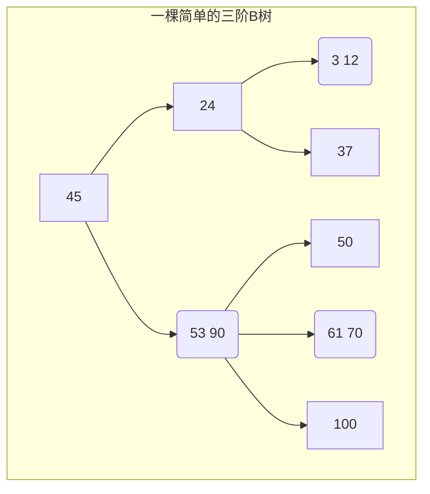
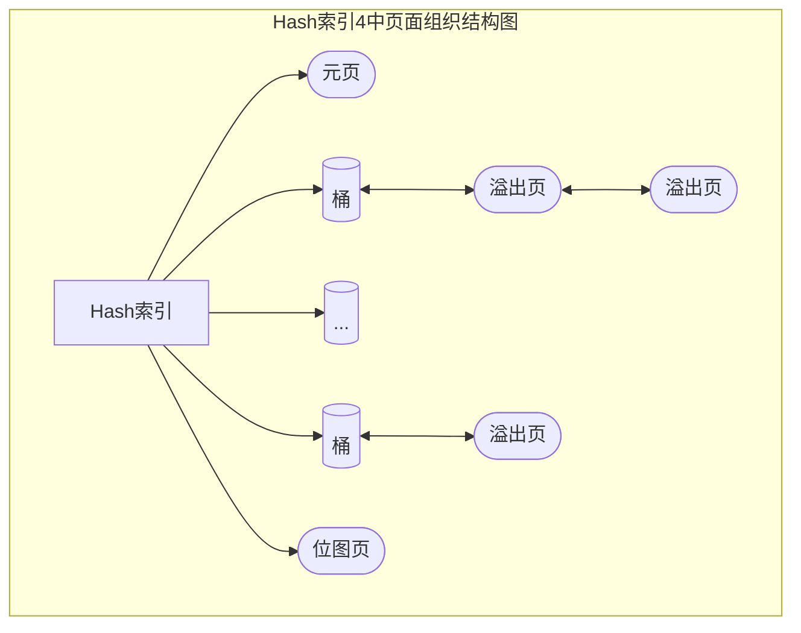

# 1. 索引方式

- 唯一索引
- 主键索引
- 多属性索引
- 部分索引
- 表达式索引

# 2. 索引类型

## 2.1 B-Tree

PG的B-Tree索引是在Lehman和Yao的论文基础上，结合应用要求来实现的，其结构类似于B+树。

### 2.1.1 B-Tree



**一棵m阶B树，或为空树，或为满足下列特性对的m叉树。**

- 树中每个结点最多含有m棵子树。
- 若根结点不是叶子结点，则至少有2个子树。
- 除根结点之外的所有非终端结点至少有⌈m/2⌉棵子树。
- 如果一个结点有n-1个关键字，则该结点有n个分支，且这n-1个关键字按照递增顺序排列。
- 所有的叶子节点都在同一层。

### 2.1.2 B+Tree

B+树是对B树的一种变形，与B树的差异在于：

1. 有n棵子树的结点中含有n个关键字，每个关键字不保存数据，只用来索引，所有数据都保存在叶子节点。
2. 所有的叶子结点中包含了全部关键字的信息，及指向含这些关键字记录的指针，且叶子结点本身依关键字的大小自小而大顺序链接。
3. 所有的非终端结点可以看成是索引部分，结点中仅含其子树（根结点）中的最大（或最小）关键字。
4. 为所有叶子结点增加一个链指针，便于区间查找和遍历。
5. 所有关键字都在叶子结点出现；

### 2.1.3 B*Tree

是B+树的变体。

1. 在B+树的非根和非叶子结点再增加指向兄弟的指针；
2. B*树定义了非叶子结点关键字个数至少为(2/3)xM，即块的最低使用率为2/3（代替B+树的1/2）；

### 2.1.4 B-link Tree(Lehman/Yao)

作为b*树的变种，其在每个page上添加了**high key**用来标识此页上的最大值。同时每个page添加了指向其兄弟节点的链接。

其主要思想是只对需操作节点加锁，操作完（读或写）解锁，减少加锁，那么必然会存在一个事务读取了页节点指针后解锁，另一事务在split页节点后，导致数据在其右节点。因此通过添加指向右兄弟节点的指针来找到正确数据位置。
Lehman/Yao的b-link tree 不会删除非页节点上数据，当树上数据太少通过reorganization. 

## 2.2 Hash

根据关键码值(Key value)而直接进行访问的数据结构。在Hash表中，有Hash函数h,它以查找键为参数，并计算出一个介于0到B-1的数值，其中B是桶的数目。如果记录键值为K，那么该记录将放在h(K)的桶中。




对于Block页的special space 空间，Hash索引使用HashPageOpaqueData结构填充

```c
typedef struct HashPageOpaqueData
{
	BlockNumber hasho_prevblkno;	/* see above 前一页桶/溢出块块号*/
	BlockNumber hasho_nextblkno;	/* see above 后一页桶/溢出块块号*/
	Bucket		hasho_bucket;	/* bucket number this pg belongs to */
	uint16		hasho_flag;		/* page type code + flag bits, see above */
	uint16		hasho_page_id;	/* for identification of hash indexes */
} HashPageOpaqueData;

typedef HashPageOpaqueData *HashPageOpaque;
```

### 2.2.1 元页

 每个Hash索引都有一个元页，它是该索引中的0号页。其HashPageOpaqueData.hasho_bucket为-1，表示它不属于任何桶。
元页中记录Hash的版本号、Hash索引记录的索引元组数目、桶的信息、位图等相关信息。通过元页可以了解该Hash索引在总体上的分配和使用情况，在索引元组的插入、溢出页的分配回收以及Hash表的扩展等过程中，都需要使用元页。

```c
typedef struct HashMetaPageData
{
	uint32		hashm_magic;	/* magic no. for hash tables */
	uint32		hashm_version;	/* version ID */
	double		hashm_ntuples;	/* number of tuples stored in the table */
	uint16		hashm_ffactor;	/* target fill factor (tuples/bucket) */
	uint16		hashm_bsize;	/* index page size (bytes) */
	uint16		hashm_bmsize;	/* bitmap array size (bytes) - must be a power
								 * of 2 */
	uint16		hashm_bmshift;	/* log2(bitmap array size in BITS) */
	uint32		hashm_maxbucket;	/* ID of maximum bucket in use */
	uint32		hashm_highmask; /* mask to modulo into entire table */
	uint32		hashm_lowmask;	/* mask to modulo into lower half of table */
	uint32		hashm_ovflpoint;	/* splitpoint from which ovflpage being
									 * allocated */
	uint32		hashm_firstfree;	/* lowest-number free ovflpage (bit#) */
	uint32		hashm_nmaps;	/* number of bitmap pages */
	RegProcedure hashm_procid;	/* hash function id from pg_proc */
	uint32		hashm_spares[HASH_MAX_SPLITPOINTS]; /* spare pages before each
													 * splitpoint */
	BlockNumber hashm_mapp[HASH_MAX_BITMAPS];	/* blknos of ovfl bitmaps */
} HashMetaPageData;

typedef HashMetaPageData *HashMetaPage;
```

### 2.2.2 桶页和溢出页

Hash表由多个桶组成，每个桶由一个或多个页组成。每个桶的第一页称为桶页，其他页称为溢出页。 

### 2.2.3 位图页

位图用与管理Hash索引的溢出页和位图页本身的使用情况。如果某个溢出页上的元组都被移除或删除，就要将此溢出页回收，但并不会还给操作系统，而是继续由PG管理，以便下次需要溢出页的时候使用。

```c
 /*位图格式*/
 * +----------------+---------------------------------+
 * | PageHeaderData | 1 | 1|0 |1 |0 |1 |0 |1 |0 | 0 |1|
 * +-----------+----+---------------------------------+
 * |                      ...                         |
 * +-------------+------------------+-----------------+
 * |1 | 1|0 |1 |0 |1 |0 |1 |0 | 0 |1| "special space" |
 * +--------------------------------+-----------------+
 *									                ^ pd_special 
```


## 2.3 GiST(Generalized Search Tree,通用搜索树) 

通用搜索树。和btree一样，也是平衡的搜索树。
和btree不同的是，btree索引常常用来进行例如大于、小于、等于这些操作中，而在实际生活中很多数据其实不适用这种场景，例如地理数据、图像等等。如果我们想要查询在某个地方是否存在某一点，即判断地理位置的"包含"那么我们就可以使用gist索引了。
因为gist索引允许定义规则来将任意类型的数据分布到一个平衡的树中，并且允许定义一个方法使用此表示形式来让某些运算符访问。例如，对于空间数据，GiST索引可以使用 R树，以支持相对位置运算符（位于左侧，右侧，包含等），而对于树形图，R树可以支持相交或包含运算符。 

Gist索引的结构可以简单概括为：

- 树结构，深度一致。Tree-structure
- 索引PAGE内的数据不按KEY的顺序排序。No order within pages
- 不同的索引PAGE的内容可能存在交叉，例如RANGE类型，值交叉。Key ranges of pages can overlap
- 由于第三条，所以搜索一条TUPLE时，可能会找到多个满足条件的PAGE。No single “correct” location for a particular tuple 

索引项形式为（key,tid） 如[100,150] (1,10) 表示100到150这个范围，1号块第10个元组。

 ```mermaid
 flowchart TB; 
 subgraph 两级索引结构 
 nd1("[1,200]
 [80,150]
 [10,15]
 ")-->nd2("[1,200] (0,2)
 [20,70] (5,1)
 [30,50] (4,3)
 [10,60] (4,2)
 ")
 nd1-->nd3("[100,150] (1,10)
 [110,120] (2,2)
 [105,115] (3,4)
 [80,90] (9,2)
 ")
 nd1-->nd4("[25,45] (8,1)
 [15,30] (2,1)
 [10,20] (1,7) 
 ")
 end
 ```


## 2.4 GIN(Generalized Inverted Index,倒排索引) 

GIN(Generalized Inverted Index, 通用倒排索引)是一个存储对(key, posting list)集合的索引结构，其中key是一个键值，而posting list 是一组出现过key的位置。如(‘hello’, ’14:2 23:4’)中，表示hello在14:2和23:4这两个位置出现过，在PG中这些位置实际上就是元组的tid。

在表中的每一个属性，在建立索引时，都可能会被解析为多个键值，所以同一个元组的tid可能会出现在多个key的posting list中。

通过这种索引结构可以快速的查找到包含指定关键字的元组，因此GIN索引特别适用于支持全文搜索，而PG的GIN索引模块也就是为了支持全文搜索而开发的。

## 2.5 SP-GiST(space partitioned GiST,空间分区GiST索引)  

可以理解为GiST的扩展。SP-GiST 与GiST 不一样的地方: 

- root node到不同的leaf node, 深度可能不一样, 是非平衡树. 

- 同级的node 与 node 之间不存在去值交叉. 

  通俗的讲, SP-Gist的node是通过递归方法切割得到. 每次切割得到的node都是上一层的分裂, 而且同级别的node 取值范围没有任何overlap. 

- SP-Gist的node层级特别深, 适合内存操作, 但是node太多, 写入数据会导致较大量IO, 因此不适合磁盘IO操作, 为了提高效率, sp-gist的node会组织后存储在index page中, 一个page可能存储多个node

## 2.6 BRIN(Block Range Indexes,块范围索引)

BRIN索引是块级索引，有别于B-TREE等索引，BRIN记录并不是以行号为单位记录索引明细，而是记录每个数据块或者每段连续的数据块的最大最小值和统计信息。因此BRIN索引空间占用特别的小，对数据写入、更新、删除的影响也很小。

BRIN索引的扫描原理很简单，扫描BRIN的元数据，根据元数据和用户输入的条件进行比较，过滤不符合条件的HEAPPAGE，只扫描需要扫描的HEAPPAGE.

如果数据排列的比较随机时，那么索引效果就非常差。达不到索引快速扫描的效果。