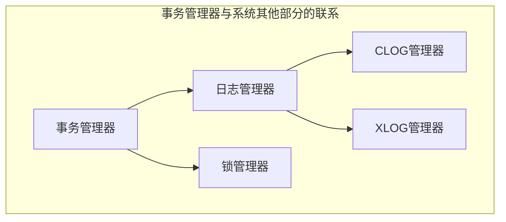

- 事务管理器

  通过接受外部系统的命令或信号（包括用户命令或操作系统信息），并根据当前事务所处的状态，决定事务的下一步执行过程。

- 锁管理器

  实现并发控制所需的各种锁。在PG中，事务执行的读阶段采用的多版本并发控制（MVCC），即对元组的读和写互不阻塞；而在事务执行的写阶段则需要由各种锁来保证事务的隔离级别。

- 日志管理器

  用来记录事务执行的状态及数据的变化。其中CLOG只用来记录事务执行的结果状态，而XLOG才是记录了数据的变化过程并保持了一定的冗余数据。