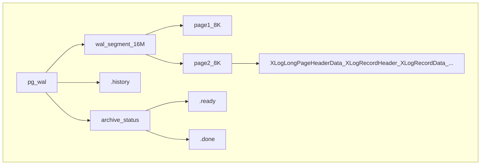

# PGDATA目录

| 文件                 | 类型 | 用途                                                                                                                                                                                                                                                                                                                                                                                       |
| -------------------- | ---- | ------------------------------------------------------------------------------------------------------------------------------------------------------------------------------------------------------------------------------------------------------------------------------------------------------------------------------------------------------------------------------------------ |
| base                 | 目录 | 包含每个数据库目录，数据库目录以OID编号命名，其中1的目录对应模版数据库template1.                                                                                                                                                                                                                                                                                                           |
| global               | 目录 | 包含整个cluster的全局表，如pg_database                                                                                                                                                                                                                                                                                                                                                     |
| g_commit_ts          | 目录 | 包含已提交事务的时间                                                                                                                                                                                                                                                                                                                                                                       |
| pg_dynshmem          | 目录 | 包含动态共享内存子系统使用的文件                                                                                                                                                                                                                                                                                                                                                           |
| pg_hba.conf          | 文件 | 文件负责客户端的连接和认证，起到防火墙的作用，格式是：TYPE / DATABASE / USER / ADDRESS / METHOD。                                                                                                                                                                                                                                                                                          |
| pg_ident.conf        | 文件 | 用户名映射文件，定义了os用户名和pg用户名之间的对应关系，这些关系会被pg_hba.conf 用到                                                                                                                                                                                                                                                                                                       |
| pg_logical           | 目录 | 包含逻辑解码的状态数据                                                                                                                                                                                                                                                                                                                                                                     |
| pg_multixact         | 目录 | 包含多重食物状态数据的子目录（等待锁定的并发事务、共享的行锁）                                                                                                                                                                                                                                                                                                                             |
| pg_notify            | 目录 | 包含LISTEN/NOTIFY状态数据                                                                                                                                                                                                                                                                                                                                                                  |
| pg_replslot          | 目录 | 包含复制槽数据                                                                                                                                                                                                                                                                                                                                                                             |
| pg_serial            | 目录 | 包含了已经提交的序列化事务的有关信息                                                                                                                                                                                                                                                                                                                                                       |
| pg_snapshots         | 目录 | 包含导出的快照                                                                                                                                                                                                                                                                                                                                                                             |
| pg_stat              | 目录 | 包含统计子系统的永久文件                                                                                                                                                                                                                                                                                                                                                                   |
| pg_stat_tmp          | 目录 | 包含统计子系统所需临时文件的子目录。                                                                                                                                                                                                                                                                                                                                                       |
| pg_subtrans          | 目录 | 包含子事物状态数据的子目录。                                                                                                                                                                                                                                                                                                                                                               |
| pg_tblspc            | 目录 | 包含指向表空间的符号连接的子目录。                                                                                                                                                                                                                                                                                                                                                         |
| pg_twophase          | 目录 | 包含用于预备事物的状态文件的子目录。                                                                                                                                                                                                                                                                                                                                                       |
| PG_VERSION           | 文件 | 包含postgresql 主版本号文件                                                                                                                                                                                                                                                                                                                                                                |
| pg_wal               | 目录 | WAL机制中的wal日志存储目录。PG10及之后的高版本改目录名为pg_wal，10之前目录名称是pg_xlog。                                                                                                                                                                                                                                                                                                  |
| pg_xact              | 目录 | 事务提交日志（Commit Log）的存储目录，事务提交日志默认256KB，文件名形如NNNN， 系统初始化后从0000开始递增至FFFF。PG 10及之后的高版本改目录名为pg_xact，10之前目录名称是pg_clog。 事务提交日志存储数据库的单个事务运行状态。Commit Log由共享内存中一组8KB的page组成， 每个page包含一列数组，每个数组元素包含XID和该事物的实时状态。当page不足时，创建新的page来存储新的事务。 |
| postgresql.auto.conf | 文件 | 用于存储由ALTER SYSTEM 设置的配置参数的文件用命令设置的配置文                                                                                                                                                                                                                                                                                                                              |
| postgresql.conf      | 文件 | 主要的配置文件                                                                                                                                                                                                                                                                                                                                                                             |
| postmaster.opts      | 文件 | 记录服务器上一次启动时使用的命令行参数                                                                                                                                                                                                                                                                                                                                                     |
| postmaster.pid       | 文件 | 一个锁文件，记录当前的守护即成postmaster进程号和共享内存段ID，服务器关闭后文件删除。                                                                                                                                                                                                                                                                                                       |

# global

| 文件             | 用途                                                                                                                                                               |
| ---------------- | ------------------------------------------------------------------------------------------------------------------------------------------------------------------ |
| pg_control       | 记录数据库集群控制信息，包括initdb初始化、WAL和checkpoint的信息。                                                                                                  |
| pg_filenode.map  | 用于将当前目录下系统表的OID与具体文件名进行硬编码映射(每个用户创建的数据库目录下也有同名文件)。                                                                    |
| pg_internal.init | 用于缓存系统表，加快系统表读取速度(每个用户创建的数据库目录下也有同名文件)                                                                                         |
| 全局系统表文件   | 数字命名的文件，用于存储系统表的内容。它们在pg_class里的relfilenode都为0， 是靠pg_filenode.map将OID与文件硬编码映射。(注：不是所有的系统表的relfilenode都为0) |

# pg_wal

## wal segment

wal段文件存储着数据库行记录明细，每一条记录明细都是服务于数据库恢复操作的，确保前后数据一致。首先针对数据的任意一次修改操作均被记录在wal段文件中，包括insert、update和delete，其次系统的一些管理行为也会被记录在wal段文件中，例如事务提交和vacuum等行为。

wal段文件命名形如00000001 00000001 00000092，文件名共24位，

* 前8位是时间线 (timeline)，由1开始
* 中8位是日志文件编号(logid)，由0开始
* 后8位是日志文件段编号(logseg)，由0开始

logseg的前6位始终是0，后2位是lsn的前2位。根据wal段文件名的最后2位，wal记录根据对应的LSN分别记录在不同的wal段文件中。

> LSN（日志序列号）数据，LSN 是一个指向 WAL 中的位置的指针。
> LSN是一个64位的整数，在日志中被打印成两个以斜线分隔的最高8位的十六[进制](https://so.csdn.net/so/search?q=%E8%BF%9B%E5%88%B6&spm=1001.2101.3001.7020)数，例如：16/B374D848。如果将两个LSN做减法操作，其结果为两个日志位置的字节数。

## .history

.history文件内容包括原.history文件，当前时间线切换记录和切换原因，作用于数据库的时间点恢复行为。当数据库引擎从多个时间线的备份中恢复时，数据库从.history文件中找到从pg_control的start_timeline到指定的recovery_target_timeline间的所有wal段文件进行恢复。

## archive_status

archive_status是wal段文件的备份目录，包括.ready和.done文件。超出wal_keep_segments数目限制的wal日志会在archive_status目录内被打标，归档操作完成后被进一步移除。

* .ready

  .ready是同名wal段文件在archive_status目录内的标记文件，代表该wal段文件可被归档。wal段文件在数据目录中的存储文件数量是有上限的，一般通过wal_keep_segments参数来约束，因此数据库引擎在wal段文件个数达到上限后会在archive_status目录内增加可移除的wal段文件的标记文件，文件名是原wal段文件名后增加.ready后缀，等待归档工具进行归档。
* .done

  .done是同名wal段文件在archive_status目录内的标记文件，代表该wal段文件已被归档，可以被清理。数据库引擎默认通过archive_command命令对.ready文件进行归档，归档成功与否取决于archive_command命令返回true还是false，当archive_command返回true时，代表与.ready文件同名的wal段文件已被归档，引擎再将该文件的扩展名重命名为.done，等待数据库引擎在下一次的checkpoint时进一步清理原wal段文件。
