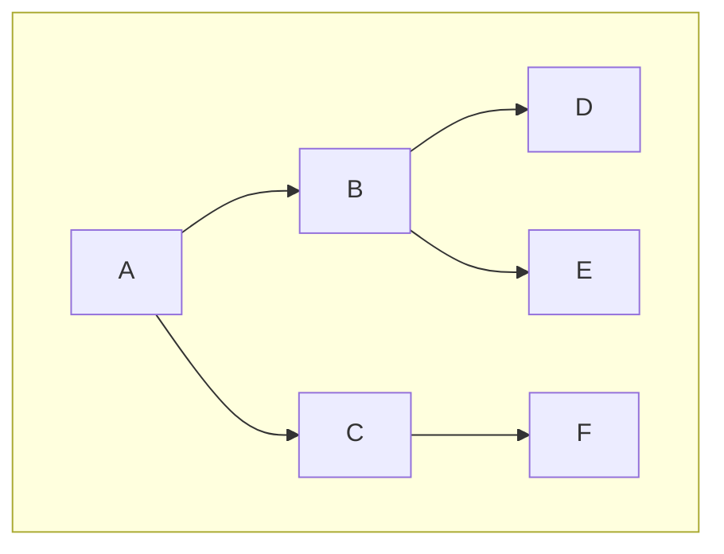
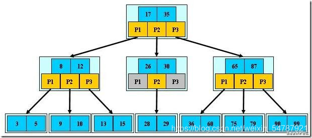
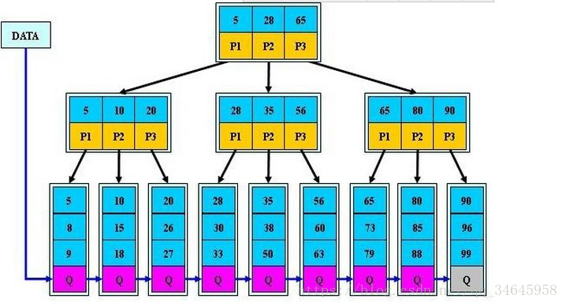
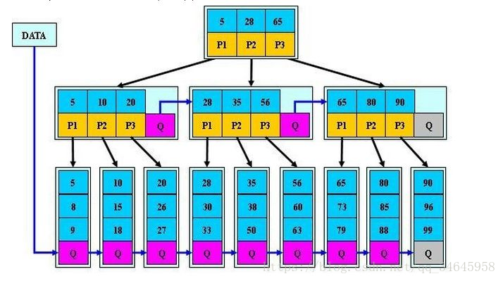

# 1 定义与构成

树（ *tree* ）是包含 n(n≥0)个节点，当 n=0 时，称为空树，非空树中!

条边的有穷集，在非空树中：

（1）每个元素称为节点（ *node* ）。

（2）有一个特定的节点被称为根节点或树根（ *root* ）。

（3）除根节点之外的其余数据元素被分为m(m>=0)个互不相交的集合$T_1$,$T_2$,...$T(_m-_1)$，其中每一个集合$T_i$(1<=i<=m)本身也是一棵树，被称作原树的子树（ *subtree* ）。

# 2 基本术语

**结点(node)** ——表示树中的元素，包括数据项及若干指向其子树的分支

**结点的度(degree)** ——结点拥有的子树数

**结点的阶(order)——**  结点拥有子节点数目的最大值

**叶子(leaf)** ——度为0的结点

**孩子(child)** ——结点子树的根称为该结点的孩子

**双亲(parents)** ——孩子结点的上层结点叫该结点的双亲

**兄弟(sibling)** ——同一双亲的孩子

**树的度** ——一棵树中最大的结点度数

**结点的层次(level)** ——从根结点算起，根为第一层，它的孩子为第二层……

**深度(depth)** ——树中结点的最大层次数

**森林(forest)** ——m(m>0)棵互不相交的树的集合

# 3 种类

无序树：树中任意节点的子结点之间没有顺序关系，这种树称为无序树,也称为自由树；

有序树：树中任意节点的子结点之间有顺序关系，这种树称为有序树；

二叉树：每个节点最多含有两个子树的树称为二叉树；

满二叉树：叶节点除外的所有节点均含有两个子树的树被称为满二叉树；

完全二叉树：除最后一层外，所有层都是满节点，且最后一层缺右边连续节点的二叉树称为完全二叉树；

哈夫曼树(最优二叉树)：带权路径最短的二叉树称为哈夫曼树或最优二叉树。

# 4 遍历表达法

遍历表达法有4种方法：先序遍历、中序遍历、后序遍历、层次遍历

先序遍历：（又称先根遍历）为ABDECF（根-左-右）

中序遍历：（又称中根遍历）为DBEAFC（左-根-右）（仅二叉树有中序遍历）

后序遍历：（又称后根遍历）为DEBFCA（左-右-根）

层次遍历： 为ABCDEF（同广度优先搜索）

# 5 B-Tree

1970年，R.Bayer和E.mccreight提出了一种适用于外查找的树，它是一种平衡的多叉树，称为B树，其定义如下

    阶为M的B-tree是一颗具有一下特征的树。

* 每个节点最多有m个子节点
* 每个非叶子节点（根节点除外）至少含有m/2个子节点
* 如果根节点不是叶子节点，那么根节点至少有2个子节点
* 每个节点上，所有的关键字都是有序的，从左到右，依次从小到大排序
* 每个关键字的左子树的值均小于当前关键字，右子树的值均大于当前关键字
* 每个节点都存有索引和数据
* 对于一个非叶子节点而言，它最多能存储m-1个关键字
* 所有叶子节点位于同一层

  

## 5.1 B-Tree插入

对于一个m阶B树，新节点一般是插在叶子层，但是需要根据实际的情况考虑是否需要裂变。

* 若该节点中关键码个数小于m-1,则直接插入
* 若该节点中关键字个数等于m-1,则将进行分裂，以中间关键字为界点将节点一分为2，产生一个新的节点，并把中间那个关键字插入到父节点中，继续判断父节点的关键字个数是否等于m-1，依次判断是否分裂，最坏情况下可一直分裂到根节点，整个树增加一层。

## 5.2 B-Tree删除

B树的删除也非常复杂

* 如果关键字所在节点的原关键树>=(m/2),说明删除后仍可满足B树的结构，可以直接pass掉。
* 如果被删除后不再满足B树的结构，则需要一定的调整过程
* 如果其左右节点中有多余的关键字，即与该节点相邻的节点中关键字的数目大于（m/2）-1,就会将节点中的最大（左）或者最小（右）移到夫节点上，然后将双方节点中小于（右节点上移）或者大于（左节点上移）关键字的关键字下移到被删关键字的节点中。
* 如果其左右都没有多余关键字的时候，情况将变得非常非常复杂；需把删除关键字节点与其左（或者右）节点中的关键字合并到（父节点指向该删除关键字节点的左（右）节点的指针）所指向的左右节点中去，如果因此父节点中的关键字个数小于规定值，则需要对父节点做同样的处理，最坏情况下会使得整个树减少一层。

# 6 B+Tree

* B+Tree中如果有N个关键字则会拥有n个分支，而B树中n个关键字的节点包含n+1个分支。
* B+Tree中，每个非根节点中的关键字个数是>=（ m / 2 ）且 < =m，而B树是 >=（m / 2）-1且< = (m-1)。
* B+Tree中根节点的关键字个数是>=1且<=m,而B树是>=1且<=(m-1)。
* B+树的非叶子节点不对关键字记录的指针进行保存，只进行数据索引，使得B+树非叶子节点能保存关键字的能力大大提升，而且树的层级会更少；
* B+树叶子节点保存了其父节点的关键字记录的指针，所以每次查询必须到叶子节点才能真正获取到相关数据，而且平衡多叉树的特点是所有子节点的层级相差不会超过一，所以查询速度相对是非常稳定的；
* B+Tree树叶子节点的关键字从小到大有序排列，左边结尾数据都会保存右边节点开始数据的指针；
* 非叶子节点的子节点树=关键字数。

B+树可以看作是B-树的一种变形，因为B+Tree非叶子节点不存储关键字记录的指针，所以其相对于B树来说B+树更充分的利用了节点的空间，让查找速度更加稳定，其速度完全接近于二分查找。在实现文件索引结构方面比B树使用得更普遍。

## 6.1 B+Tree插入

插入操作全部在叶子节点中进行

* 若为空树，创建一个叶子节点，然后将记录插入，同时这个叶子节点也是根节点
* 若被插入的关键字所在的节点，其含有的关键字数目小于m，则直接插入
* 若被插入关键字所在的节点的关键字数等于m的时候，则需要分裂为两个节点，并将m/2的关键字上移到父节点中，同时判断父节点的关键字个数是否大于m，如果需要分裂继续按照上面的流程进行分裂

## 6.2 B+Tree删除

* 如果要删除关键字所在节点的关键字个数，如果大于m/2，直接删除即可；
* 当删除关键字所在节点的关键字个数等于m/2的时候，若兄弟节点中含有多余的关键字，也可从兄弟节点中借用关键字完成删除操作；
* 若兄弟节点没有多余的关键字，则需要与其他兄弟进行合并；
* 如果合并后导致父节点不再符合B+树的结构，则需要按照上面的规律进行再次结构的调整；
* 注意B+树的结构（非叶子节点会存储索引信息，叶子节点才会存储数据指针），修改完后还需修改其父节点中的索引值。

# 7 B*Tree

* B*Tree是B+树的变体，在B+Tree的非根和非叶子结点再增加指向兄弟的指针；*
* *B*树定义了非叶子结点关键字个数至少为(2/3)*M，即块的最低使用率为2/3（代替B+树的1/2）；
* B+树的分裂：当一个结点满时，分配一个新的结点，并将原结点中1/2的数据复制到新结点，最后在父结点中增加新结点的指针；B+树的分裂只影响原结点和父结点，而不会影响兄弟结点，所以它不需要指向兄弟的指针；
* B*树的分裂：当一个结点满时，如果它的下一个兄弟结点未满，那么将一部分数据移到兄弟结点中，再在原结点插入关键字，最后修改父结点中兄弟结点的关键字（因为兄弟结点的关键字范围改变了）；如果兄弟也满了，则在原结点与兄弟结点之间增加新结点，并各复制1/3的数据到新结点，最后在父结点增加新结点的指针；

    所以，B*树分配新结点的概率比B+树要低，空间使用率更高；
