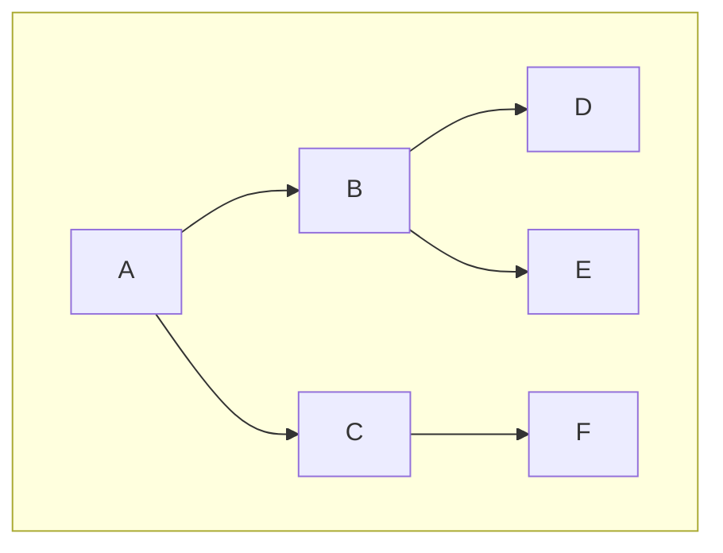

# 定义与构成

树（ *tree* ）是包含 n(n≥0)个节点，当 n=0 时，称为空树，非空树中!

条边的有穷集，在非空树中：

（1）每个元素称为节点（ *node* ）。

（2）有一个特定的节点被称为根节点或树根（ *root* ）。

（3）除根节点之外的其余数据元素被分为m(m>=0)个互不相交的集合$T_1$,$T_2$,...$T(_m-_1)$，其中每一个集合$T_i$(1<=i<=m)本身也是一棵树，被称作原树的子树（ *subtree* ）。

# 基本术语

**结点(node)** ——表示树中的元素，包括数据项及若干指向其子树的分支

**结点的度(degree)** ——结点拥有的子树数

**叶子(leaf)** ——度为0的结点

**孩子(child)** ——结点子树的根称为该结点的孩子

**双亲(parents)** ——孩子结点的上层结点叫该结点的双亲

**兄弟(sibling)** ——同一双亲的孩子

**树的度** ——一棵树中最大的结点度数

**结点的层次(level)** ——从根结点算起，根为第一层，它的孩子为第二层……

**深度(depth)** ——树中结点的最大层次数

**森林(forest)** ——m(m>0)棵互不相交的树的集合

# 种类

无序树：树中任意节点的子结点之间没有顺序关系，这种树称为无序树,也称为自由树；

有序树：树中任意节点的子结点之间有顺序关系，这种树称为有序树；

二叉树：每个节点最多含有两个子树的树称为二叉树；

满二叉树：叶节点除外的所有节点均含有两个子树的树被称为满二叉树；

完全二叉树：除最后一层外，所有层都是满节点，且最后一层缺右边连续节点的二叉树称为完全二叉树；

哈夫曼树(最优二叉树)：带权路径最短的二叉树称为哈夫曼树或最优二叉树。

# 遍历表达法

遍历表达法有4种方法：先序遍历、中序遍历、后序遍历、层次遍历

先序遍历：（又称先根遍历）为ABDECF（根-左-右）

中序遍历：（又称中根遍历）为DBEAFC（左-根-右）（仅二叉树有中序遍历）

后序遍历：（又称后根遍历）为DEBFCA（左-右-根）

层次遍历： 为ABCDEF（同广度优先搜索）
