# 1 JOIN类型

SQL 标准中定义了 INNER JOIN、LEFT JOIN、RIGHT JOIN、FULL OUTER JOIN 等四种类型，用集合论里的操作非常容易理解.

此外还有其中JOIN类型，譬如 SEMI JOIN ( exists )和 ANTI JOIN (not exists))。
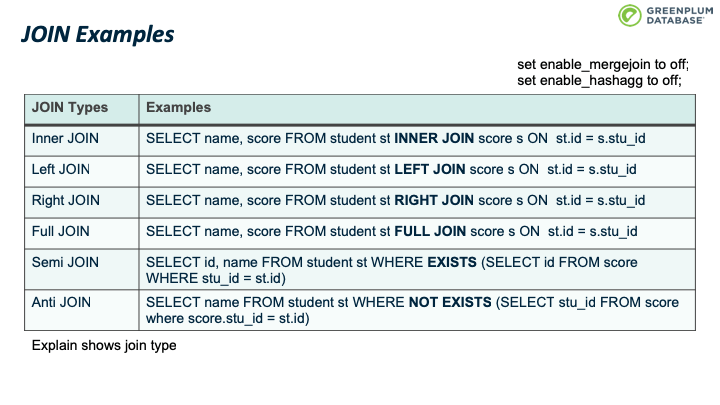
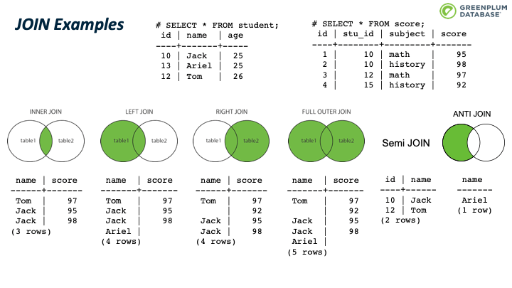

# 2 JOIN实现算法

* Nested Loop
* Merge JOIN
* Hash Join

## 2.1 Hash Join

Hashjoin 是一个经典算法，它包含2个phases，

* build phase：构建阶段，理想情况下对小表构建 hash table，该表通常也称为 inner table；
* probe phase：探测阶段，扫描关联的另一张表的内容，并通过hash table 探测是否有匹配的行/元组，该表通常称为 outer table。

### 2.1.1 INNER JOIN

让我们先从 inner join入手。下图有一个inner join的例子，左边是其查询计划，右边是图形化的计划树。 其中 inner table 通常也称为 right table；outer table 称为 left table。
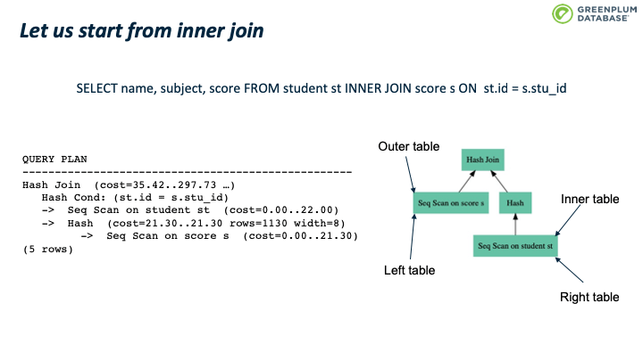
首先是 build phase，在这个阶段，对扫描 inner table 的每一个tuple，根据 join key 的值计算其hash值，并放到hash table的对应的桶中。扫描完inner table后，也完成了整个hash table 的构建。
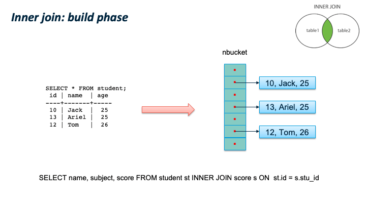
第二个阶段 probe phase，扫描outer table 的每一个元组（tuple），计算该元组的hash值，然后根据计算的 outer table 的哈希值，去hash table中查询是否有匹配元组，如果有并且满足所有查询条件，则输出该元组。依次处理outer table 的每一个元组。
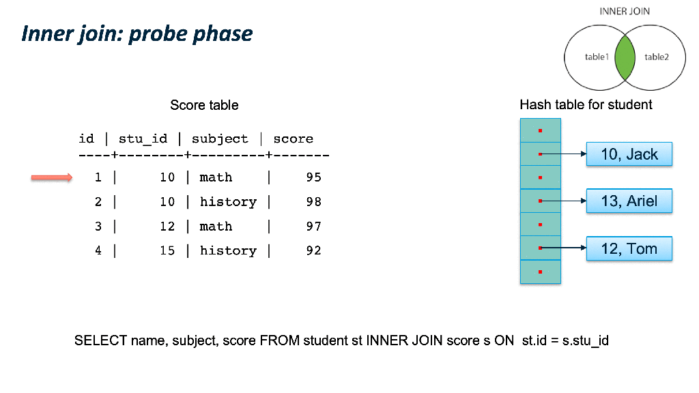

### 2.1.2 FULL OUTER JOIN

full outer join 与inner join 不同的是，如何处理没有匹配的tuple。 依然是先扫描 inner table 构建hash table，然后扫描 outer table。 如果join key 匹配且满足所有查询条件，则输出该tuple对应的关联结果。如果hashtable 中没有匹配的元组，则输出该tuple，并且使用 null 填充关联结果中 inner table 对应的column。  当扫描完outer table 后，再次扫描 hash table，找到所有未曾匹配过的 inner tuple，输出该tuple，并使用 null 填充关联结果中 outer table 对应的column。
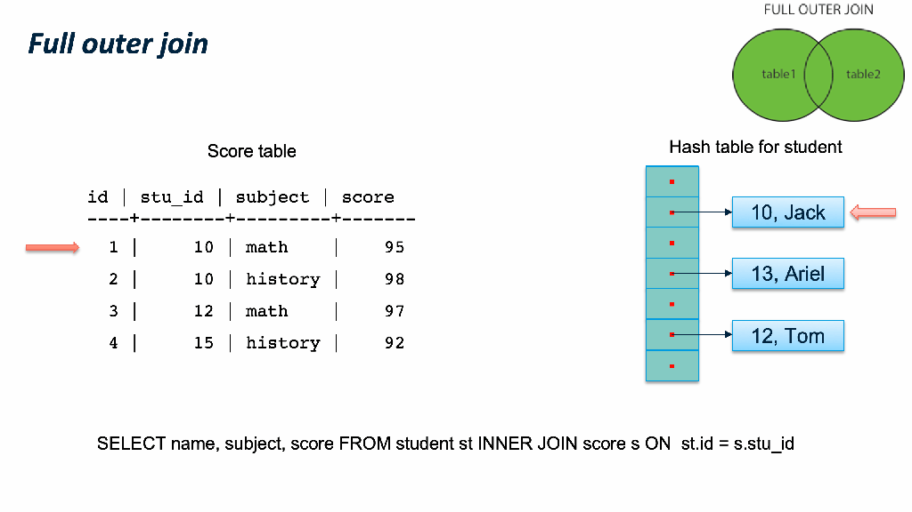

### 2.1.3 SQL语义和 JOIN的内部实现类型

JOIN 类型的SQL语义和 JOIN的内部实现类型。我们通过一个例子来看，同样是 LEFT JOIN的两个 SQL，内部可以使用 Hash Left JOIN 或者 Hash Right Join。 第一个例子是一张大表left join一张小表，它的内部是实现JOIN类型是 Left join；第二个例子是一张小表 left join一张大表，它的内部实现JOIN类型是 right join。 原因是优化器尽量选择小表做内表，在其上构建hashtable。
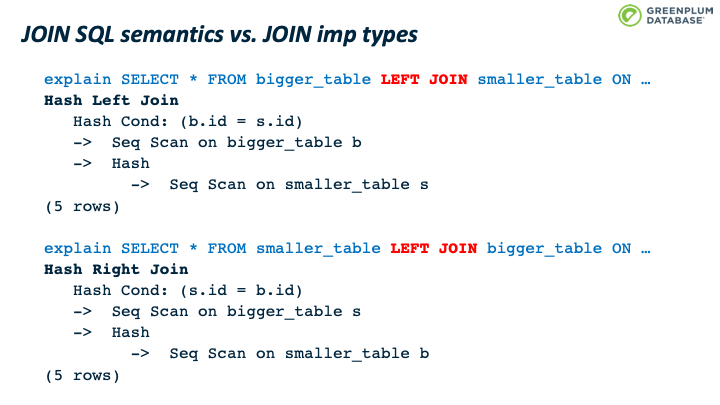

### 2.1.4 SEMI JOIN

Semi join 通常用来实现 EXISTS。它和 inner join类似，不同支持是 semi join 只关心有没有匹配，而不关心有多少元组匹配。
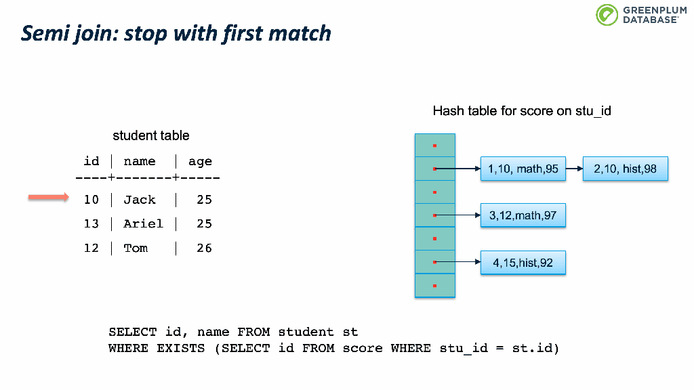

### 2.1.5 ANTI JOIN

Anti JOIN 则是在没有元组匹配时才输出结果，用来实现 NOT EXISTS。
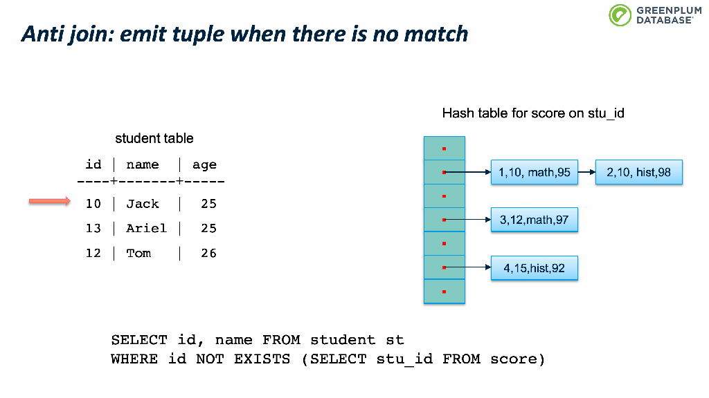

## 2.2 优雅Hash Join

前面的实现看起来非常直观优雅，却没有考虑一个问题：如果inner table 太大不能放到内存中怎么办？ 解决的思路很经典，分而治之。

 Grace hash join 是经典的解决这一个问题的算法：它把inner table 和outer table 按照关联键分成多个分区，每个分区保存到磁盘上，然后对每个分区应用前面提到的 hash join 算法。每个分区成为一个 batch（一次批处理）。 基本思路是根据join key 计算其hash value，然而计算该hash值对应的batchno和bucketno

算法为：

* *bucketno = hashvalue MOD nbuckets*
* batchno = (hashvalue DIV nbuckets) MOD nbatch
* *nbuckets 是buckets的个数，nbatch是batch的个数，两者都是2的幂，这样可以通过位运算获得 bucketno和batchno*

## 2.3 混合Hash Join

Hybrid hash join是 grace hash join之上的一个优化：第一个batch不必写入磁盘，可以避免第一个batch的磁盘io。
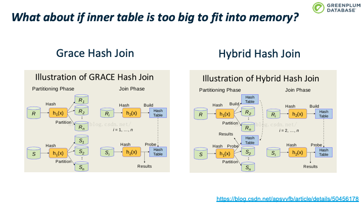

hybrid hash join首先对 inner table进行分区/分batch，根据前面计算的算法计算batchno，如果tuple属于batch 0，则加入内存中的hashtable中，否则则写入该batch对应的磁盘文件中。batch 0不用写入磁盘文件中。
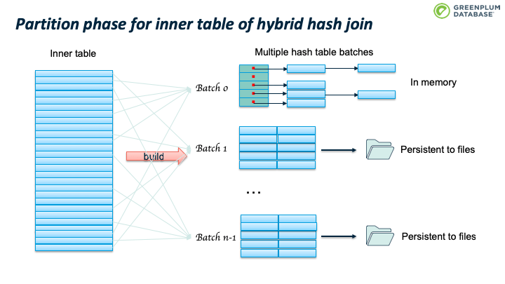
然后对 outer table 进行分区/分batch，如果outer table 的tuple属于 batch 0，则执行前面提到的hashjoin算法：判断hashtable中是否存在匹配该outer tuple的inner tuple，如果存在且满足所有where条件，则找到了一个匹配，输出结果，否则继续下一个tuple。如果outer tuple 不属于batch 0，则写入该batch对应的磁盘文件中。
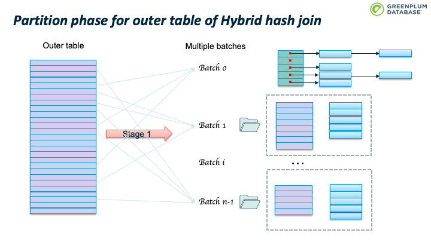
Outer table 扫描结束时， batch 0也处理完了。继续处理 batch 1：加载 batch 1 的inner table临时数据到内存中，构建hashtable，然后扫描batch 1 的outer table临时数据，执行前面跳到的probe 操作。完成batch 1 后，继续处理 batch 2，直到完成所有的batches。
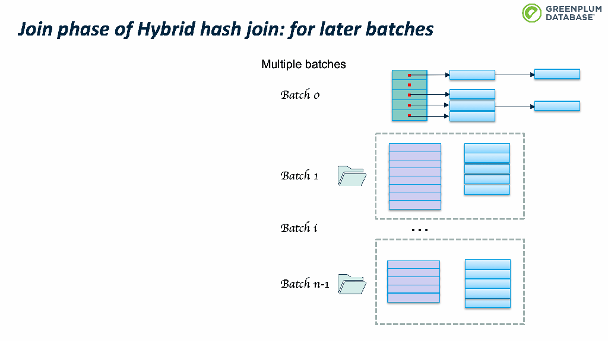

### 2.3.1 batches判断

如果inner table 的大小加上 buckets 的开销小于 work_mem，则使用单个batch；否则需要使用多个batches。
算法的输入：

* Plan_rows：预估的inner table 的行数
* Plan_width：预估的inner table 的平均行宽
* NTUP_PER_BUCKET：单个bucket的tuples数据，老版本这个数值是10，新的版本是1，假设hash冲突很少，平均一个bucket 含有一个 tuple
* Work_mem：为hashjoin分配的内存配额
  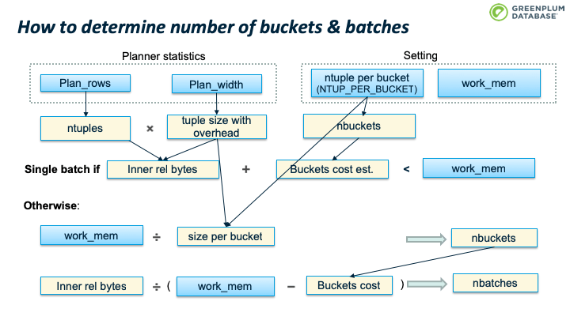
  那么如果 batch 0 仍然太大，内存不足以容纳怎么办？
  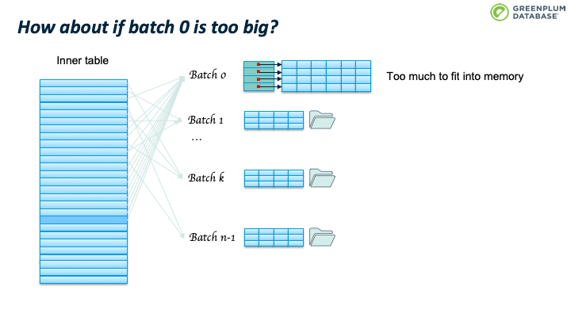
  办法是batches个数翻倍，从n变成2n。 这时会重新扫描 batch 0里面的tuples，根据2n重新计算其所属的batch，如果仍然属于batch 0，则保留在内存中，否则从内存中移除，写入到tuple对应的新batch中。
  此时不会移动 Batch 文件中的已有的tuple，当处理该 batch 时会进行处理。
  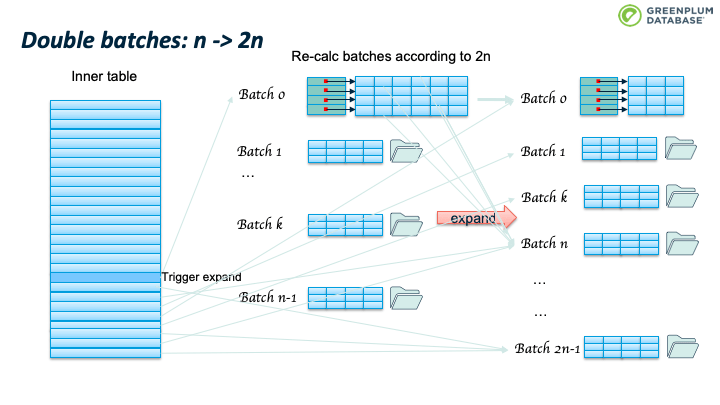
  由于 batch 数目发生了变化，那么有些batch 里面的tuple可能会不在属于当前batch。Hybrid hash join 算法（取模操作）确保，batch 数目翻倍后，tuple 所属 batch 只会向后，而不会向前。
  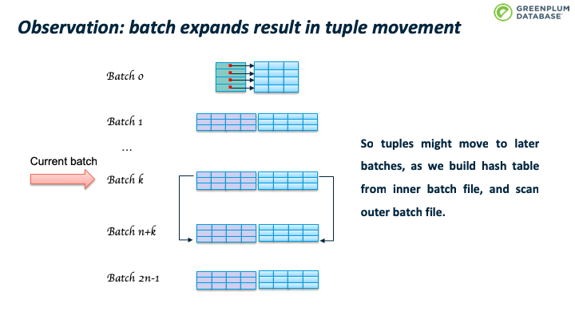
  处理 Batch i 时，如果该batch 的inner tuple太多，占用空间太大，那么有可能内存还是放不下。
  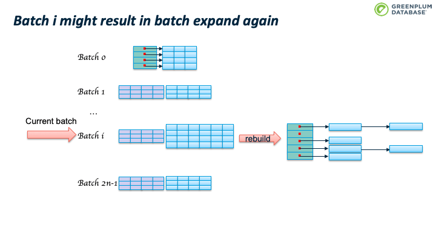
  这会造成 batch 数目继续翻番。如下图所示。
  当前batch里的tuple所属的batchno也会变化。 举一个具体例子，假设 Nbatch = 10;  2次翻番后，Nbatch = 40； batch 3 中已有的tuple满足 hashvalue % 10 = 3, 所以batch 3 中的tuple的hashvalue可能是  3, 13, 23, 33, 43, 53, … 当 nbatch从10变为40时，hashvalue % 40 可能的结果是3, 13, 23, 33.
  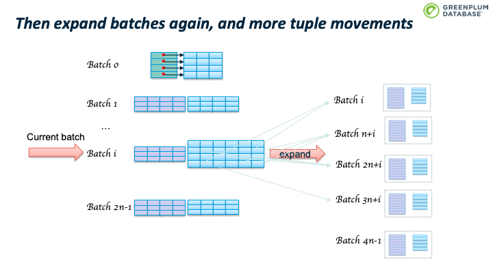

## 2.4 PG HASH Join Skew优化

PostgreSQL 的hashjoin实现在经典的 Hybrid hash join之上还做了一些优化，一个重要的优化是对倾斜数据的优化。现实中的数据很多是非正态分布的数据，譬如宠物，假设地球上每个人都有一个宠物，那么养猫或者养狗的人会占据大多数。

Skew优化的核心思想是尽量避免磁盘io：在 batch 0阶段处理outer table最常见的 （MCV，Most common value） 数据。选择 outer table 的MCV而不是inner table的 MCV的原因是优化器通常选择小表和正态分布的表做 inner table，这样outer table会更大，或者更大概率是非正态分布。
  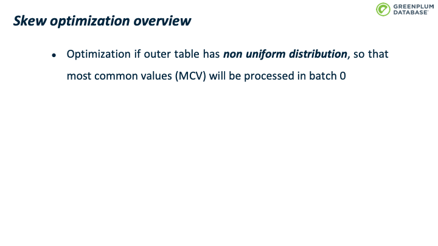
首先是准备 skew hash table，包括三个步骤：

* 确定 skew hash table 的大小。PostgreSQL 默认分配2% 的内存用户构建skew hash table，并计算能容纳多少 MCV tuples。
* 根据 pg_statistic syscache 数据，获得 outer table 的MCV 统计信息，对每个mcv，计算其hash值，并放到其对应skew hash bucket 中，现在还没有处理inner table，所以该 bucket 指向 NULL。hash冲突解决方案是线性增长，如果当前slot被占用了，则占用下一个。 计算skew buckets 大小的时候，会确保 skew hashtable 足够稀疏，避免转一圈也找不到空闲slot。
* 填充skew hash table：扫描inner table 构建main hashtable 时，如果当前tuple 属于skew hash table（对应的slot不为空），则加入到skew hashtable 而非main hash table。
  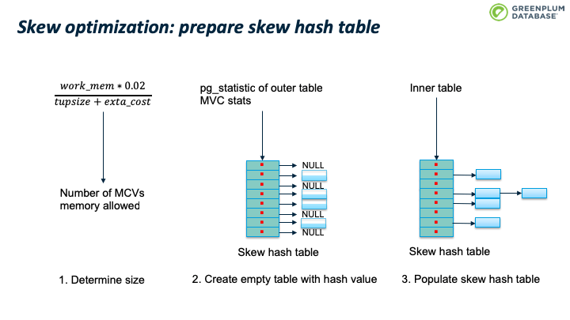
扫描outer table 时，如果是 MCV tuple，则使用skew hash table进行处理。 否则按照前面介绍的Hybrid hash join 算法处理。假设使用 skew 优化，50%的 MCVs 在 batch 0阶段就处理了，那么节约了大约 50% 的磁盘io。
  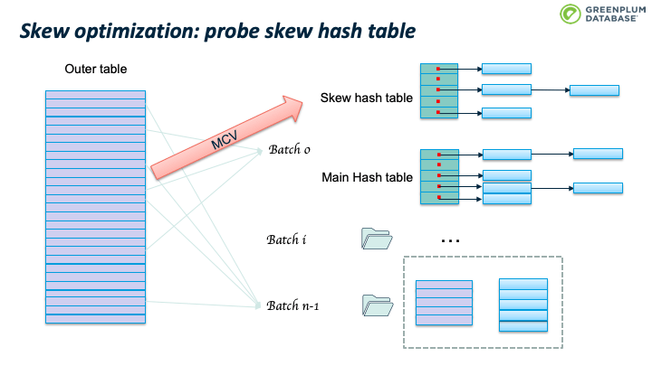
