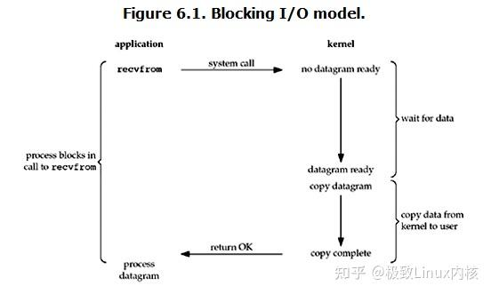
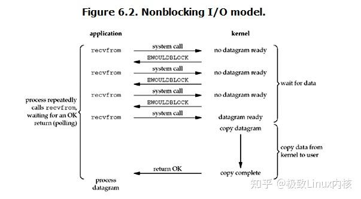
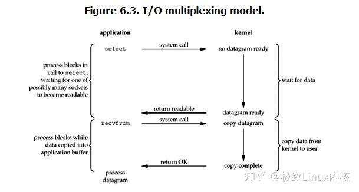
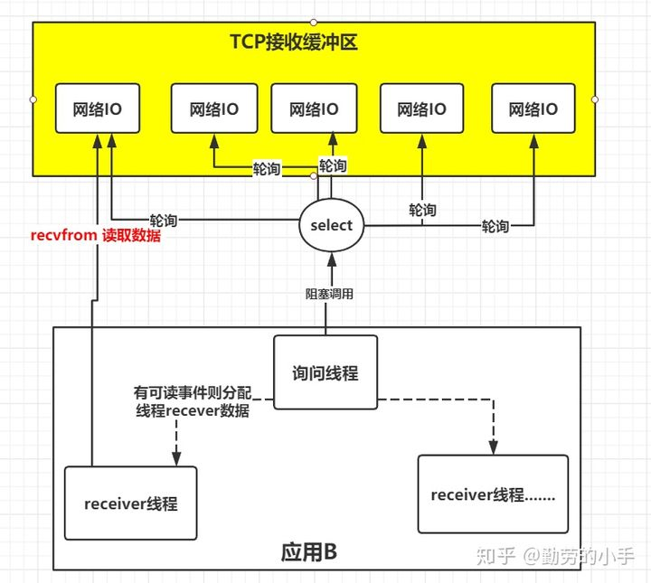
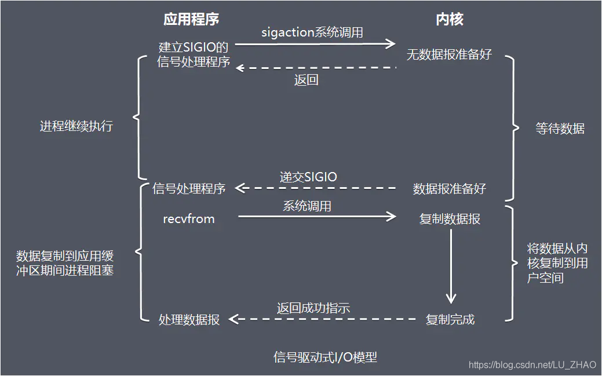
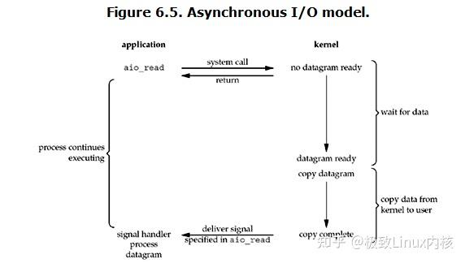

# 1 IO分类

通常用户进程中的一个完整IO分为两阶段：用户进程空间<-->内核空间、内核空间<- ->设备空间(磁盘、网络等)。IO有内存IO、 网络IO和磁盘IO三种，通常我们说的IO指的是后两者。

I/O按照设备来分的话，分为两种：一种是网络I/O，也就是通过网络进行数据的拉取和输出。一种是磁盘I/O,主要是对磁盘进行读写工作。

## 1.1 同步异步

由于CPU和内存的速度远远高于外设的速度，所以在IO编程中，就存在速度严重不匹配的问题。

同步请求：A调用B，B的处理是同步的，在处理完之前他不会通知A，只有处理完之后才会明确的通知A。
异步请求：A调用B，B的处理是异步的，B在接到请求后先告诉A我已经接到请求了，然后异步去处理，处理完之后通过回调等方式再通知A。
同步和异步最大的区别就是被调用方的执行方式和返回时机。同步指的是被调用方做完事情之后再返回，异步指的是被调用方先返回，然后再做事情，做完之后再想办法通知调用方。

## 1.2 阻塞非阻塞

阻塞请求：A调用B，A一直等着B的返回，别的事情什么也不干。
非阻塞请求：A调用B，A不用一直等着B的返回，先去忙别的事情了。
阻塞和非阻塞最大的区别就是在被调用方返回结果之前的这段时间内，调用方是否一直等待。阻塞指的是调用方一直等待别的事情什么都不做。非阻塞指的是调用方先去忙别的事情。

> I/O 是分为两个过程的：
>
> 1. 数据准备的过程
> 2. 数据从内核空间拷贝到用户进程缓冲区的过程
>
> **根据上面两个步骤的不同，IO操作可以进一步细分为下面五种**

# 2 IO模型

5种IO模型分别是：

* 阻塞IO模型
* 非阻塞IO模型
* IO复用模型
* 信号驱动的IO模型
* 异步IO模型

## 2.1 阻塞IO模型

进程发起IO系统调用后，进程被阻塞，转到内核空间处理，整个IO处理完毕后返回进程，操作成功则进程获取到数据。
  

## 2.2 非阻塞IO模型

和阻塞IO模型相比，非阻塞IO模型在内核数据没准备好，需要进程阻塞的时候，就返回一个错误，以使得进程不被阻塞。

* 进程发起IO系统调用后，如果内核缓冲区没有数据，需要到IO设备中读取，进程返回一个错误而不会被阻塞。
* 进程发起IO系统调用后，如果内核缓冲区有数据，内核就会把数据返回进程。

这种工作方式下需要不断轮询查看状态
  

## 2.3 IO多路复用模型

多个的进程的IO可以注册到一个复用器(select)上，然后用一个进程调用该select，select会监听所有注册进来的IO。

如果select监听的IO在内核缓冲区都没有可读数据，select调用进程会被阻塞；而当任一IO在内核缓冲区中有可读数据时，select调用就会返回；而后select调用进程可以自己或通知另外的进程(注册进程)来再次发起读取IO，读取内核中准备好的数据。
Linux中IO复用的实现方式主要有Select，Poll和Epoll：

* select：注册IO、阻塞扫描，监听的IO最大连接数不能多于FD_ SIZE（1024）。

  ```c
  int select(int nfds, fd_set *readfds, fd_set *writefds,fd_set *exceptfds, struct timeval *timeout);
  功能：监视并等待多个文件描述符的属性变化（可读、可写或错误异常）。成功：就绪描述符的数目，超时返回 0 出错：-1
  select()函数监视的文件描述符分 3 类，分别是writefds、readfds、和 exceptfds。调用后 select() 函数会阻塞，直到有描述符就绪（有数据可读、可写、或者有错误异常），或者超时（ timeout 指定等待时间），函数才返回。当 select()函数返回后，可以通过遍历 fdset，来找到就绪的描述符。
  参数：
  nfds: 要监视的文件描述符的范围，一般取监视的描述符数的最大值+1，如这里写 10， 这样的话，描述符 0，1, 2 …… 9 都会被监视，在 Linux 上最大值一般为1024。
  readfd: 监视的可读描述符集合，只要有文件描述符即将进行读操作，这个文件描述符就存储到这。
  writefds: 监视的可写描述符集合。
  exceptfds: 监视的错误异常描述符集合
  中间的三个参数 readfds、writefds 和 exceptfds 指定我们要让内核监测读、写和异常条件的描述字。如果不需要使用某一个的条件，就可以把它设为空指针（ NULL ）。
  timeout: 超时时间，它告知内核等待所指定描述字中的任何一个就绪可花多少时间。其 timeval 结构用于指定这段时间的秒数和微秒数。
  ```
* poll：原理和select相似，没有数量限制，但IO数量大，扫描线性性能下降。

  ```c
  int poll (struct pollfd *fds, unsigned int nfds, int timeout);
  ```
* epoll ：事件驱动不阻塞，mmap实现内核与用户空间的消息传递，数量很大，Linux2.6后内核支持。epoll由三个函数实现： epoll_create、epoll_ctl、epoll_wait

  ```c
  int epoll_create(int size);
  功能：该函数生成一个 epoll 专用的文件描述符（创建一个 epoll 的句柄）。成功：epoll 专用的文件描述符  失败：-1
  参数：
  size: 用来告诉内核这个监听的数目一共有多大，参数 size 并不是限制了 epoll 所能监听的描述符最大个数，只是对内核初始分配内部数据结构的一个建议。自从 linux 2.6.8 之后，size 参数是被忽略的，也就是说可以填只有大于 0 的任意值。需要注意的是，当创建好 epoll 句柄后，它就是会占用一个 fd 值，在 linux 下如果查看 /proc/ 进程 id/fd/，是能够看到这个 fd 的，所以在使用完 epoll 后，必须调用 close() 关闭，否则可能导致 fd 被耗尽。

  int epoll_ctl(int epfd, int op, int fd, struct epoll_event *event);
  功能：epoll 的事件注册函数，它不同于 select() 是在监听事件时告诉内核要监听什么类型的事件，而是在这里先注册要监听的事件类型。成功：0 失败：-1

  int epoll_wait( int epfd, struct epoll_event * events, int maxevents, int timeout );
  功能：等待事件的产生，收集在 epoll 监控的事件中已经发送的事件，类似于 select() 调用。成功：返回需要处理的事件数目，如返回 0 表示已超时。失败：-1
  ```

  

 **以TCP接收数据为例，图例如下：**
  

## 2.4 信号驱动的IO模型

复用IO模型解决了一个线程可以监控多个fd的问题，但是select是采用轮询的方式来监控多个fd的，通过不断的轮询fd的可读状态来知道是否有可读的数据，而无脑的轮询就显得有点暴力，因为大部分情况下的轮询都是无效的，所以有人就想，能不能不要我总是去问你是否数据准备就绪，能不能我发出请求后等你数据准备好了就通知我，所以就衍生了信号驱动IO模型。

当进程发起一个IO操作，会向内核注册一个信号处理函数，然后进程返回不阻塞；当内核数据就绪时会发送一个信号给进程，进程便在信号处理函数中调用IO读取数据。
  

## 2.5 异步IO模型

当进程发起一个IO操作，进程返回(不阻塞)，但也不能返回结果。内核把整个IO处理完后，会通知进程结果，如果IO操作成功则进程直接获取到数据。
注意：
此模型和前面模型最大的区别是：前4个从内核空间拷贝数据这一过程是阻塞的，需要自己把准备好的数据，放到用户空间。
而全异步不同，异步IO是「内核数据准备好」和「数据从内核态拷贝到用户态」这两个过程都不用等待。

用户线程完全不需要关心实际的整个IO操作是如何进行的，只需要先发起一个请求，当接收内核返回的成功信号时表示IO操作已经完成，可以直接去使用数据，它是最理想的模型。
  

# 3 再谈IO模型里面的同步异步

我们通常会说到同步阻塞IO、同步非阻塞IO，异步IO几种术语，通过上面的内容，那么我想你现在肯定已经理解了什么是阻塞什么是非阻塞了，所谓阻塞就是发起读取数据请求的时，当数据还没准备就绪的时候，这时请求是即刻返回，还是在这里等待数据的就绪，如果需要等待的话就是阻塞，反之如果即刻返回就是非阻塞。

我们区分了阻塞和非阻塞后再来分别下同步和异步，在IO模型里面如果请求方从发起请求到数据最后完成的这一段过程中都需要自己参与，那么这种我们就称为同步请求；反之，如果应用发送完指令后就不再参与过程了，只需要等待最终完成结果的通知，那么这就属于异步。

我们再看同步阻塞、同步非阻塞，他们不同的只是发起读取请求的时候一个请求阻塞，一个请求不阻塞，但是相同的是，他们都需要应用自己监控整个数据完成的过程。而为什么只有异步非阻塞 而没有异步阻塞呢，因为异步模型下请求指定发送完后就即刻返回了，没有任何后续流程了，所以它注定不会阻塞，所以也就只会有异步非阻塞模型了。
