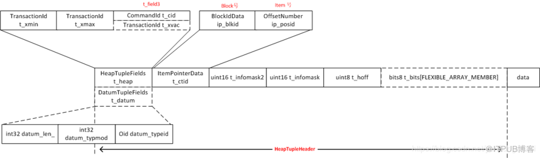

# 1 通过读取一个元组的流程，了解外存管理各个模块的功能

* 首先通过系统表获取表的基本信息（表的oid，索引信息，统计信息等）和元组的属性信息。
  * 一般这些信息都不会改变，所以每个进程使用cache机制快速实现这一过程
* 根据查询条件，找到对应的buffer块。ReadBuffer
* 再从buffer块中找到对应的元组数据，通过之前的元组属性信息，解析出元组的各个属性值。
* 如果没有找到对应的buffer块，则要通过smgr即存储介质管理器，把页面加载到缓冲区。
* smgr是外存管理的核心，封装了操作不同存储介质的接口，包括创建删除，读写等。
  * 目前只有一个实现，磁盘管理器。
* 在磁盘管理器和物理文件间还有一层VFD机制。防止进程打开的文件超过os限制。
  * VFD机制内部使用一个LRU池来管理FD，实现一个换入换出机制。
* 写元组的时候，需要找到具有合适空闲空间的缓冲块。
  * 如果遍历所有的块很低效，为了加速查找，实现了表的附属文件，FSM。
  * FSM还有一些优化机制，比如不同的进程尽量选择不同的块来提高效率。
* 元组用不到时，会标记死亡。但不会直接从存储空间中移除，这个过程是通过vacuum实现的。
  * vacuum遍历所有块找死亡元组也是很低效的，所以提供VM加速查找。
* 除了一般的数据类型，还支持大数据存储。
  * 对于变长字符串，一般写入时超过一定大小，会自动触发toast机制。
  * 而大对象机制则由用户来触发，手动调用。

# 2 表的存储设计

* 与os类似，采用分页存储。表文件是BLCKSZ的整数倍，可配置
* 采用传统的行式存储，表文件存的是一个个元组。不支持元组跨块存储。
  * 这样可以避免多余的IO。
  * 也可以减少代码复杂度，因为不用维护完整性
* 与os类似，也在内存中使用缓冲池保存页面。缓冲池每个buffer与page大小相同。

## 2.1 page结构

```c
 * +----------------+---------------------------------+
 * | PageHeaderData | linp1 linp2 linp3 ...           |
 * +-----------+----+---------------------------------+
 * | ... linpN |				      |
 * +-----------+--------------------------------------+
 * |		^ pd_lower			      |
 * |					              |
 * |	        v pd_upper		  	      |
 * +-------------+------------------------------------+
 * |		| tupleN ...                          |
 * +-------------+------------------+-----------------+
 * |	   ... tuple3 tuple2 tuple1 | "special space" |
 * +--------------------------------+-----------------+
 *				    ^ pd_special 
 
```

### 2.1.1 PageHeaderData页面头的内容

```c
typedef struct PageHeaderData
{
	/* XXX LSN is member of *any* block, not only page-organized ones */
	PageXLogRecPtr pd_lsn;		/* LSN: next byte after last byte of xlog
								 * record for last change to this page 
        				最后一次修改页面的xlog的lsn。回放的时候会用到这个，判断是否回放某条xlog*/
	uint16		pd_checksum;	/* checksum 校验页面是否损坏。之前说过的半页问题。可以用这个检测*/
	uint16		pd_flags;		/* flag bits, see below 
						页面的一些flag，特殊功能使用
						PD_HAS_FREE_LINES 是否有空闲的元组指针，hint
							在PageAddItem添加新元组时，可以快速判断是否有空闲slot，有的话优先使用这个slot
						PD_PAGE_FULL：是否有空闲空间，hint
							快速判断能不能使用hot进行更新
							快速判断是否需要进行prune
						PD_ALL_VISIBLE：是否全部可见。
						* 全部可见有两层意思
  						  1.元组只有一个版本，旧版本都被vacuum了，或者没有旧版本。
  						  2.元组的xmin被frozen了，或者比OldestXmin小，这意味着当前以及未来的事务，一定能看到这个元组。
						* 全部可见的作用？
 						  用于快速检查。比如元组扫描的时候，直接返回可见，不需要做可见性检查。
						* 设置时机
  						  一般是做了vaccum以后，他会检查每个表的每个页面，发现某个页面的元组都可见，就会设置全部可见。
						* 取消时机
  						   执行增删改的时候取消。redo增删改的时候也取消。
						*/
	LocationIndex pd_lower;		/* offset to start of free space 空闲空间的上边界*/
	LocationIndex pd_upper;		/* offset to end of free space 空闲空间的下边界*/
	LocationIndex pd_special;	/* offset to start of special space 索引专用*/
	uint16		pd_pagesize_version;
	TransactionId pd_prune_xid; /* oldest prunable XID, or zero if none */
	ItemIdData	pd_linp[FLEXIBLE_ARRAY_MEMBER]; /* line pointer array 元组指针的起始位置*/
} PageHeaderData;
```

### 2.1.2 元组指针

* 也叫line pointer，或ItemId。
* 实际上，定位一个元组的位置，不是直接使用元组的物理位置。
  * 因为元组的大小可能不同，做不到规范。而元组指针可以设计成相同的数据结构，指向具体的元组物理位置即可。
  * 同时也方便HOT的实现

```c
typedef struct ItemIdData
{
	unsigned	lp_off:15,		/* offset to tuple (from start of page) tuple的位置，也就是本页面上的偏移*/
			lp_flags:2,		/* state of line pointer, see below 元组状态 
						   LP_UNUSED：表示没有使用，可用作新元组的元组指针。空闲slot，下次添加新元组的时候，优先使用这些。
						   LP_NORMAL：表示正在使用，指向元组。
						   LP_REDIRECT：表示HOT的重定向。
						   LP_DEAD：标记为dead，表示一个悬空的指针。要回收但暂时不能被回收，因为索引还没清理呢
						*/
			lp_len:15;		/* byte length of tuple 元组的长度*/
} ItemIdData;
```

## 2.2 HeapTuple元组



### 2.2.1 元组头

```c
typedef struct HeapTupleFields
{
	TransactionId t_xmin;		/* inserting xact ID 创建元组的事务id*/
	TransactionId t_xmax;		/* deleting or locking xact ID 删除元组的事务id*/

	union
	{
		CommandId	t_cid;		/* inserting or deleting command ID, or both 
						创建或删除的命令id，删除是cmax，创建是cmin，vacuum是vacuum xid*/
		TransactionId t_xvac;	/* old-style VACUUM FULL xact ID */
	}			t_field3;
} HeapTupleFields;

typedef struct DatumTupleFields
{
	int32		datum_len_;		/* varlena header (do not touch directly!) */

	int32		datum_typmod;	/* -1, or identifier of a record type */

	Oid		datum_typeid;	/* composite type OID, or RECORDOID */

	/*
	 * datum_typeid cannot be a domain over composite, only plain composite,
	 * even if the datum is meant as a value of a domain-over-composite type.
	 * This is in line with the general principle that CoerceToDomain does not
	 * change the physical representation of the base type value.
	 *
	 * Note: field ordering is chosen with thought that Oid might someday
	 * widen to 64 bits.
	 */
} DatumTupleFields;
typedef struct ItemPointerData
{
	BlockIdData ip_blkid;
	OffsetNumber ip_posid;
}
struct HeapTupleHeaderData
{
	union
	{
		HeapTupleFields t_heap;
		/*记录对元组执行插入/删除操作的事物ID和命令ID，主要用于并发控制时检查元组对事务的可见性*/
		DatumTupleFields t_datum;
		/*当一个新元组在内存中形成的时候，并不关心事务的可见性，因此在t_choice中只需用DatumTupleFields来记录元组的长度等信息。
		但在把该元组插入到表文件时，需要在元组头信息中记录插入该元组的事物ID命令ID，故此时会把t_choice所占用的内存转换为HeapTupleFields结构
		并填充相应数据后在进行元组的插入。*/
	}	t_choice;

	ItemPointerData t_ctid;	    /* current TID of this or newer tuple  元组位置，块号 + 元组指针的位置。
	                            (or a speculative insertion token) */
       /* Fields below here must match MinimalTupleData! */

  #define FIELDNO_HEAPTUPLEHEADERDATA_INFOMASK2 2
	uint16		t_infomask2;	/* number of attributes + various flags 
					t_infomask2使用其低11位表示当前元组的属性个数，其他位则用于包括用于HOT技术及元组可见性的标志位。
					*/
  #define FIELDNO_HEAPTUPLEHEADERDATA_INFOMASK 3
	uint16		t_infomask;	/* various flag bits, see below 
					t_infomask用于标识元组当前的状态，比如元组是否具有OID、是否有空属性等。
					*/
  #define FIELDNO_HEAPTUPLEHEADERDATA_HOFF 4
	uint8		t_hoff;		/* sizeof header incl. bitmap, padding 
					元组头长度。包含固定元组头的大小以及标记null列的bitmap，以及padding。用于确定元组头和元组内容*/
  /* ^ - 23 bytes - ^ */
  #define FIELDNO_HEAPTUPLEHEADERDATA_BITS 5
	bits8		t_bits[FLEXIBLE_ARRAY_MEMBER];	/* bitmap of NULLs 标识null列的bitmap*/
  /* MORE DATA FOLLOWS AT END OF STRUCT */
};
typedef HeapTupleHeaderData *HeapTupleHeader;

```

### 2.2.2 元组数据

```c
typedef struct HeapTupleData
{
	uint32		t_len;		/* length of *t_data */
	ItemPointerData t_self;		/* SelfItemPointer */
	Oid		t_tableOid;	/* table the tuple came from */
#define FIELDNO_HEAPTUPLEDATA_DATA 3
	HeapTupleHeader t_data;		/* -> tuple header and data */
} HeapTupleData;

typedef HeapTupleData *HeapTuple;

typedef struct TupleDescData
{
	int		natts;			/* number of attributes in the tuple */
	Oid		tdtypeid;		/* composite type ID for tuple type */
	int32		tdtypmod;		/* typmod for tuple type */
	int		tdrefcount;		/* reference count, or -1 if not counting */
	TupleConstr *constr;		        /* constraints, or NULL if none */
	/* attrs[N] is the description of Attribute Number N+1 */
	FormData_pg_attribute attrs[FLEXIBLE_ARRAY_MEMBER];
} TupleDescData;
typedef struct TupleDescData *TupleDesc;
```

## 2.3 HOT机制

HOT是“Heap Only Tuple”（仅元组堆）的缩写（与Overflow Update CHaining相比，它的缩写更好）。PG对于元组采用多版本技术存储，即使没有更新索引属性，也会在索引中产生新版本。HOT此功能克服了PostgreSQL处理UPDATE 效率低下的问题。

```c
当更新满足如下条件时称为HOT元组
1.所有索引属性都没有被修改（索引键是逐行判读的，若update修改了某属性，但前后值相同则认为没有修改）
2.更新的元组新旧版本在同一文件块内（限制同一文件块目的是为了通过版本链向后找时不产生额外的I/O操作而影响性能）
  HOT元组会被打上HEAP_ONLY_TUPLE标，HOT元组的上一个版本则被打上HEAP_HOT_UPDATE标志。更新一条HOT元组将不会在索引中引入新版本，
  当通过索引获取元组时首先会找到同一块中最老的版本，然后顺着版本链向后找，直到遇到HOT元组为止。
  HOT消除了拥有完全相同键值的索引记录，减少了索引大小
```

## 2.4 pageinspect插件

```sql
SELECT * FROM page_header(get_raw_page('tb2', 0));
SELECT * FROM heap_page_items(get_raw_page('tb2', 0));
SELECT * FROM heap_page_item_attrs(get_raw_page('tb2', 0), 'tb2'::regclass);
SELECT tuple_data_split('tb2'::regclass, t_data, t_infomask, t_infomask2, t_bits) FROM heap_page_items(get_raw_page('tb2', 0));


select pg_relation_filepath('t2');
```

# 3 表操作

## 3.1 打开表

    返回RelationData结构，并不是打开具体的物理文件。

- OID打开

  调用Relation relation_open(Oid relationId, LOCKMODE lockmode)
- 表名打开

  调用Relation relation_openrv(const RangeVar *relation, LOCKMODE lockmode)

## 3.2 顺序扫描表

基本与同步扫描策略

思路：a,b,c三个对t表的扫描，a最快b其次c最慢。都从0块开始扫描。理论上a扫描的文件块都应该缓存在缓冲池中，b,c 访问的都可以在缓冲池中命中，但实际上因为大量并发进程，缓冲池大小有限。a缓冲的缓冲块可能已经被替换出去。b,c 无法命中。同步扫描的思路就是，a 从0 块开始扫描，b,c 从a 扫描的当前位置扫描。这样a被换出的可能性就极小，可以有效降低IO开销。
由于b,c不是从第0块开始，所以b,c扫描到N块时，需要回转到第0块，将第0块到起始位置之间的文件块继续扫完。这是虽然b,c不能在共享a的缓冲区数据，但b,c之间仍然能攻共享。

PG通过在共享内存放置ss_scan_locations_t结构来存放对于某个表的当前扫描位置，每个进程都有一个全局指针指向ss_scan_locations_t结构。目前PG中只有在建立B-tree,Hash和GisT三种索引时才可能用到同步扫描。（需判断需要扫描的文件块总数是否超过缓冲区总数的1/4 重设rs_allow_sync和rs_syncscan）

```c
typedef struct ss_scan_location_t
{
	RelFileNode relfilenode;	/* identity of a relation */
	BlockNumber location;		/* last-reported location in the relation */
} ss_scan_location_t;

typedef struct ss_lru_item_t
{
	struct ss_lru_item_t *prev;
	struct ss_lru_item_t *next;
	ss_scan_location_t location;
} ss_lru_item_t;
typedef struct ss_scan_locations_t
{
	ss_lru_item_t *head;
	ss_lru_item_t *tail;
	ss_lru_item_t items[FLEXIBLE_ARRAY_MEMBER]; /* SYNC_SCAN_NELEM items */
} ss_scan_locations_t;
```

## 3.3 扫描描述符HeapScanDescData

```c
typedef struct TableScanDescData
{
	/* scan parameters */
	Relation	rs_rd;			/* heap relation descriptor */
	struct SnapshotData *rs_snapshot;	/* snapshot to see */
	int			rs_nkeys;		/* number of scan keys */
	struct ScanKeyData *rs_key; /* array of scan key descriptors */
	/* Range of ItemPointers for table_scan_getnextslot_tidrange() to scan. */
	ItemPointerData rs_mintid;
	ItemPointerData rs_maxtid;
	/*
	 * Information about type and behaviour of the scan, a bitmask of members
	 * of the ScanOptions enum (see tableam.h).
	 */
	uint32		rs_flags;
	struct ParallelTableScanDescData *rs_parallel;	/* parallel scan
													 * information */
} TableScanDescData;
typedef struct TableScanDescData *TableScanDesc;
typedef struct HeapScanDescData
{
	TableScanDescData rs_base;	/* AM independent part of the descriptor */
															/* state set up at initscan time */
	BlockNumber rs_nblocks;			/* total number of blocks in rel */
	BlockNumber rs_startblock;	/* block # to start at */
	BlockNumber rs_numblocks;		/* max number of blocks to scan */
															/* rs_numblocks is usually InvalidBlockNumber, meaning "scan whole rel" */
															/* scan current state */
	bool		rs_inited;					/* false = scan not init'd yet */
	BlockNumber rs_cblock;			/* current block # in scan, if any */
	Buffer		rs_cbuf;					/* current buffer in scan, if any */
															/* NB: if rs_cbuf is not InvalidBuffer, we hold a pin on that buffer */
															/* rs_numblocks is usually InvalidBlockNumber, meaning "scan whole rel" */
	BufferAccessStrategy rs_strategy;	/* access strategy for reads */
	HeapTupleData rs_ctup;		/* current tuple in scan, if any */
	/*
	 * For parallel scans to store page allocation data.  NULL when not
	 * performing a parallel scan.
	 */
	ParallelBlockTableScanWorkerData *rs_parallelworkerdata;
	/* these fields only used in page-at-a-time mode and for bitmap scans */
	int			rs_cindex;		/* current tuple's index in vistuples */
	int			rs_ntuples;		/* number of visible tuples on page */
	OffsetNumber rs_vistuples[MaxHeapTuplesPerPage];	/* their offsets */
}			HeapScanDescData;
typedef struct HeapScanDescData *HeapScanDesc;
```

## 3.4 扫描调用步骤

 heap_beginscan-->initscan-->heap_getnext-->heap_endscan

## 3.5 创建表

    创建之前先判读目录是否存在，不存在则创建相应目录。然后调用mdcreate函数立即申请创建文件。

## 3.6 关闭表

   关闭表就是一个内存释放和将脏数据写回磁盘的过程。

## 3.7 删除表

  释放物理内存，删除表文件。PG将要删除的表加入到PendingRelDelete链表中，SMGR管理器调用smgrDoPendingDeletes函数将表删除。

```c
typedef struct PendingRelDelete
{
	RelFileNode relnode;		/* relation that may need to be deleted */
	BackendId	backend;		/* InvalidBackendId if not a temp rel */
	bool		atCommit;		/* T=delete at commit; F=delete at abort */
	int			nestLevel;		/* xact nesting level of request */
	struct PendingRelDelete *next;	/* linked-list link */
} PendingRelDelete;
/*注意:在新创建一个表时,该表也会被记录到PendingRelDelete链表,atCommit为true表示事物提交则删除,false新创建的表,事务失败就删除*/
```

# 4 元组操作

## 4.1 插入

调用HeapTuple heap_form_tuple(TupleDesc tupleDescriptor,Datum *values,bool *isnull)构建内存结构

调用void heap_insert(Relation relation, HeapTuple tup, CommandId cid,int options, BulkInsertState bistate)向表中插入元组。

## 4.2 删除

TM_Result heap_delete(Relation relation, ItemPointer tid,CommandId cid, Snapshot crosscheck, bool wait,TM_FailureData *tmfd, bool changingPart)，被删除的元组会通过VACUMM收回。

## 4.3 更新

TM_Result heap_update(Relation relation, ItemPointer otid, HeapTuple newtup,CommandId cid, Snapshot crosscheck, bool wait, TM_FailureData *tmfd, LockTupleMode *lockmode)
