# 1 图的定义

图( Graph)是由顶点的**有穷非空集合**和顶点之间边的集合组，

通常表示为: G(V,E),其中，G表示一个图，V是图G中顶点的集合，E是图G中边的集合。

**图中数据元素，称之为顶点(Vertex）**

## 1.1 各种图的定义

无向边：若顶点V~i~到V~j~ 的边没有方向，则称这条边为无向边（Edge）,用无序偶数对（V~i~，V~j~）来表示。

有向边：若顶点V~i~到V~j~ 的边有方向，则称这条边为有向边，也称弧（Arc）,用无序偶数对 <V~i~，V~j~>来表示。V~i~称为弧尾（Tail），V~j~ 称为弧头（Head）

无向图：图中任意两个顶点间的边都为无向边。

有向图：图中任意两个顶点间的边都为有向边。

简单图：不存在顶点到其自身的边，且同一条边不重复出现。

无向完全图：无向图中，任意两个顶点都存在边。 n个顶点的图，有n*(n-1)/2 条边。

有向完全图：有向图中，任意两个顶点都存在方向互为相反的两条弧。n个顶点的图，有n*(n-1) 条边。

稀疏图：有很少条边或弧的图。反之称为稠密图。

权（Weight）：图的边或弧相关的数。

网（Network)：带权的图通常称为网。

子图：假设有两个图G=（V , { E } ） 和G~1~=（V~1~, { E~1~ } ）,V~1~$\subseteq$V且E~1~$\subseteq$E，则称G~1~为G的子图（Subgraph）。

> 如A含于B，记作A$\subseteq$B,表示集合A包含于集合 B内，或A是B的子集（Subset）的意思。

## 1.2 图的顶点和边的关系

无向图：G=（V , { E } ）如果边（V~i~，V~j~）$\in$E 则称顶点V~i~和V~j~ 互为邻接点（Adjacent)。即V~i~和V~j~相**邻接**。

    边（V~i~，V~j~）依附于（incident）顶点V~i~和V~j~。或者说 边（V~i~，V~j~）与顶点V~i~和V~j~相**关联**。

    顶点V的**度**（degree）是和V相关联的边的数目。记为TD（V）。

    各顶点度的和e=$\dfrac{1}{2} \sum_1^n TD(Vi)$

有向图：G=（V , { E } ）如果边<V~i~，V~j~> $\in$E 则称顶点V~i~**邻接到**顶点V~j~，顶点V~j~**邻接自**顶点V~i~。

    **入度**：以顶点V为头的弧数目（indegree）。记为ID（V）

    **出度**：以顶点V为尾的弧数目（outdegree）。记为OD（V）

    顶点V的度：TD（V）=ID（V）+    OD（V）

    各顶点的出度和=各顶点的入度和。e  =$\sum_1^n ID(Vi)$    =    $\sum_1^n OD(Vi)$

**路径的长度**：路径上边或弧的数目。

**回路或环（cycle）**：第一个顶点和最后一个顶点相同的路径。

**简单路径**：除路径起点和终点可以相同外，其余顶点均不相同的路径。

## 1.3 连通图相关术语

无向图G：如果从顶点V~~i~~到顶点V~j~有路径，则称V~i~和V~j~是连通的。对于图中任意两个顶点都是连通的，则称G是**连通图**。

无向图G的**极大连通子图称为G的连通分量。**

**极大连通子图是指顶点的个数已经是最大的了，在添加顶点的话子图不能形成连通了**

有向图G：如果对每一对顶点V~i~和V~j~，从V~~i~~到V~~j~~和从V~~j~~到V~~i~~都存在路径，则称G为**强连通图**。

有向图的极大连通子图称为**有向图的强连通分量**。

**生成树**：是连通图的一个极小的连通子图，它包含**全部**的N个顶点和**足以**构成一棵树的N-1条边。

# 2 五种存储结构

## 2.1 领接矩阵(**Adjacency Matrix**)

图的邻接矩阵是用两个数组来表示图。一个一维数组存储图中顶点信息，一个二维数组(称为邻接矩阵)存储图中的边或弧的信息。

```c
#define MaxInt 32767	//表示极大值，即∞
#define MVNum 100	//最大顶点数
typedef char VerTexType;//设顶点的数据类型为字符型
typedef int ArcType;	//假设边的权值类型为整型

typedef struct{
    VerTexType vexs{MVNum];	//顶点表
    ArcType arcs[MVNum][MVNum]; //邻接矩阵
    int vexnum, arcnum;		//图的当前点数和边数。
}AMGraph;	 // Adjacency Matrix Graph
```

### 2.1.1 无向图的邻接矩阵

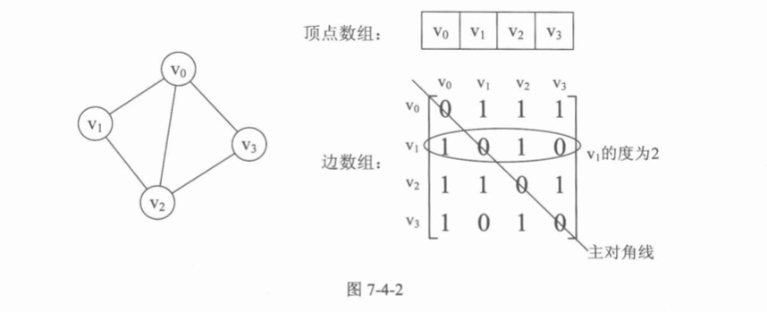
分析：
    1 无向图的邻接矩阵是对称的。
    2 顶点i 的度=第i行或列中1的个数。

### 2.1.2 有向图的邻接矩阵

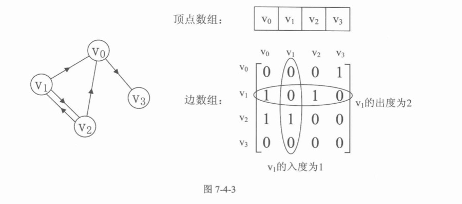
分析:
    1 有向图的邻接矩阵可能是不对称的。
    2 顶点的度=第i行元素之和+第j元素之和
       顶点的出度=第i行元素之和
       顶点的入度=第i列元素之和

### 2.1.3 网(即有权图)的邻接矩阵

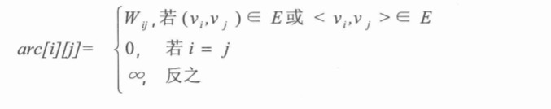
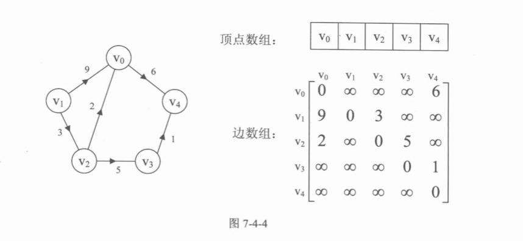

## 2.2 邻接表（Adjacency List）

邻接表：数组和链表相结合的存储方法。

```c
typedef char VertexType;	//顶点类型应由用户定义
typedef int EdgeType;		//边上的权值类型应由用户定义

typedef struct EdgeNode		//边表结点
{
	int adjvex;		//邻接点域、存储改结点对应的下标
	EdgeType weight;	//存储权重，对于非网图可以不需要
	struct EdgeNode *next;	//指向下一个邻接点的指针
} EdgeNode;

typedef struct VertexNode 	//顶点表结点
{
	VertexType data;	//顶点域、存储顶点信息
	EdgeNode *firstedge;	//边表头指针
}VertextNode,AdjList[MAXVEX];

typedef struct
{
	AdjList adjList;
	int numVertexes,numEdges;//图中当前顶点数和变数。
}
```

邻接表的处理办法：

```
1.图中顶点用一个一维数组存储，当然，顶点也可以用单链表来存储，不过数组可以较容易地读取顶点信息，更加方便。另外，对于顶点数组中，每个数据元素还需要存储指向第一个邻接点的指针，以便于查找该顶点的边信息。
2.图中每个顶点Vi的所有邻接点构一个线性表，由于邻接点的个数不定,所以用单链表存储，无向图称为顶点Vi的边表，有向图则称为顶点Vi作为弧尾的出表。
```

### 2.2.1 无向图邻接表

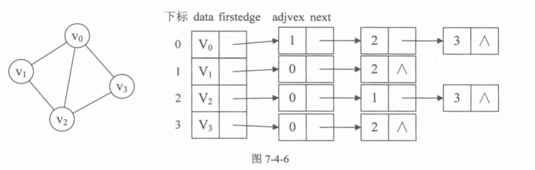

### 2.2.2 有向图邻接表

需注意方向，如下图邻接表以弧尾存储边表，逆邻接表以弧头存储边表。
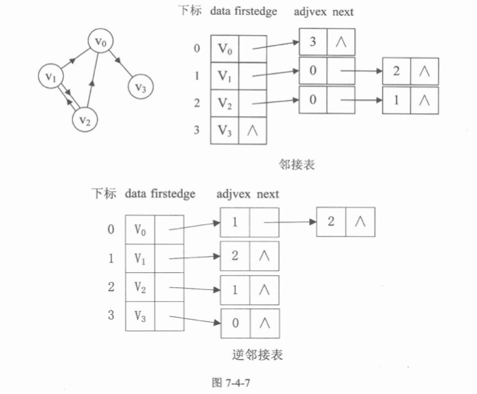

### 2.2.3 带权值的网图

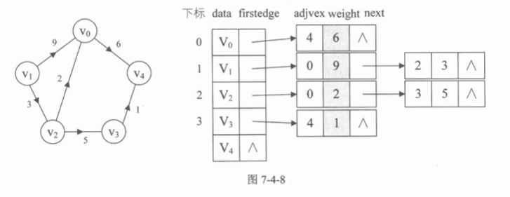

## 2.3 十字链表(**Orthogonal List**)

那么对于**有向图**来说，邻接表是有缺陷的。关心了出度问题，想了解入度就必须要遍历整个图才能知道，反之，逆邻接表解决了入度却不了解出度的情况。

十字链表将邻接表与逆邻接表整合在一起。

```c

typedef char VertexType;	//顶点类型应由用户定义
typedef int EdgeType;		//边上的权值类型应由用户定义

typedef struct EdgeNode		//边表结点
{
	int tailvex;		//弧起点在顶点表的下标
	int headvex;		//弧终点在顶点表的下标
	EdgeType weight;	//存储权重，对于非网图可以不需要
	struct EdgeNode *headlink;//指入边表指针，指向终点相同的下一条边；
	struct EdgeNode *taillink;//边表指针，指向起点相同的下一条边。
} EdgeNode;

typedef struct VertexNode 	//顶点表结点
{
	VertexType data;	//顶点域、存储顶点信息
	EdgeNode *firstin;	//入边表头指针，指向改顶点的入边表中的第一个结点
	EdgeNode *firstout;	//出边表头指针，指向改顶点的出边表中的第一个结点
}VertextNode,AdjList[MAXVEX];

typedef struct
{
	AdjList adjList;
	int numVertexes,numEdges;//图中当前顶点数和变数。
}
```

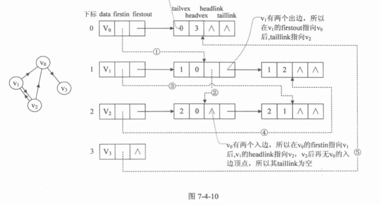

图中实线部分同[2.2.2]部分

虚线解释：

    对V$_0$ 来说，他有两个顶点V$_1$和V$_2$的入边。因此V$_0$的fristin指向顶点V$_1$的边表结点中headvex为0的结点，如图虚线1。

    接着由入边结点的headlink指向下一个入边顶点V$_2$，如虚线2。

    对于顶点V$_1$，它有一个入边顶点V$_2$，所以它的firstin指向顶点V$_2$的边表结点中headvex为1的结点，如虚线3。

    顶点V$_2$和V$_3$也是同样有一个入边顶点，如虚线4和5。

## 2.4 邻接多重表

十字链表对有向图的存储结构进行了优化

在**无向表**的应用中，关注的重点是顶点，邻接表是好的选择

如果关注的是边的操作，就需要更简单的方式.

邻接多重表与邻接表的差别，仅仅是在于同一条边在邻接表中用两个结点表示，而在邻接多重表中只有一个结点。 这样对边的操作就方便多了，

```c
typedef char VertexType;	//顶点类型应由用户定义
typedef int EdgeType;		//边上的权值类型应由用户定义

typedef struct EdgeNode		//边表结点
{
	EdgeType weight;	//存储权重，对于非网图可以不需要
	int ivex;
	struct EdgeNode *ilink;
	int jvex;
	struct EdgeNode *jlink;
	/*
	ivex和jvex是与某条边依附的两个顶点在顶点表中下标
	ilink 指向依附顶点ivex的下一条边
	jlink 指向依附顶点jvex的下一条边
	*/
} EdgeNode;

typedef struct VertexNode 	//顶点表结点
{
	VertexType data;	//顶点域、存储顶点信息
	EdgeNode *firstedge;	//边表头指针
}VertextNode,AdjList[MAXVEX];

typedef struct
{
	AdjList adjList;
	int numVertexes,numEdges;//图中当前顶点数和变数。
}
```

下图告诉我们它有4个顶点和5条边，显然，我们就应该先将4个顶点和5条边的边表结点画出来。
由于是无向图，所以ivex是0、jvex是1还是反过来都是无所谓的,不过为了绘图方便,都将ivex值设置得与一旁的顶点下标相同。
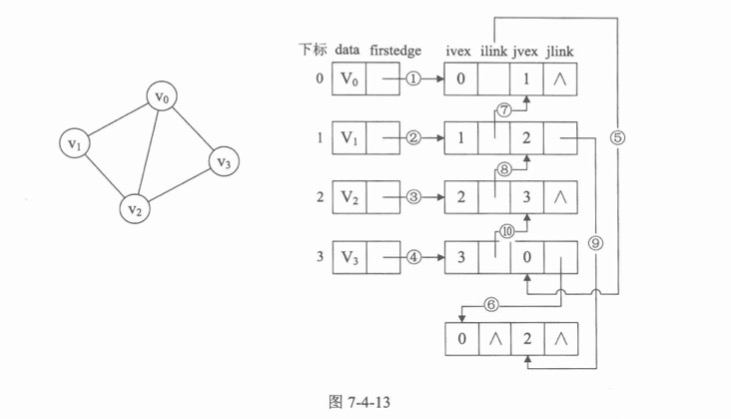

看上面的连线，firstedge指向一条边，顶点下标和ivex的值相同，继续，顶点V0有三个边跟它有关v0v1,v0v2,v0v3

所以连线5,6满足指向下一条依附于顶点的v0的边的目标，ilink指向的结点的jvex一定要和它本身的ivex值相同。

连线7就是指v1，v0这条边，它是相当于顶点v1指向v1，v2边后的下一条。

v2有三条依附，所以在连线3后就有了8跟9.连线10的就是顶点v3在连线4后下一条边。

图上共5条边所以有10条连线，符合预期.

## 2.5 边集数组

边集数组是由两个一维数组构成。一个是存储顶点的信息;另一个是存储边的信息，这个边数组每个数据元素由一条边的起点下标(begin)、终点下标(end) 和权(weight)组成
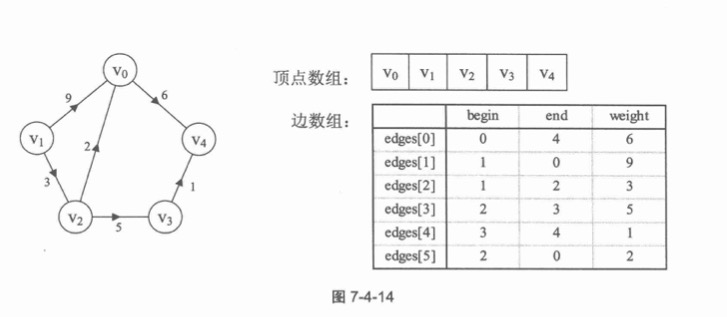

# 3 图的遍历(Traversing Graph)

图的遍历是和树的遍历类似，我们希望从图中某一顶点出 发访遍图中其余顶点，且使每一个顶点仅被访问一次，这一过程就叫做图的遍历。

* 深度优先遍历（Deep_First_Search）简称DFS
* 广度优先遍历(Breadth_ First Search) 简称BFS
* DFS 一般是解决连通性问题，而 BFS 一般是解决最短路径问题

## 3.1 深度优先遍历

主要思路是从图中一个未访问的顶点 V 开始，沿着一条路一直走到底，然后从这条路尽头的节点回退到上一个节点，再从另一条路开始走到底…，不断递归重复此过程，直到所有的顶点都遍历完成.

## 3.2 广度优先遍历

指的是从图的一个未遍历的节点出发，先遍历这个节点的相邻节点，再依次遍历每个相邻节点的相邻节点,它这个遍历类似图中的层序遍历.

# 4 最小生成树

## 4.1 生成树的定义

一个连通图的生成树是一个极小的连通子图，它包含图中全部的n个顶点，但只有构成一棵树的n-1条边。
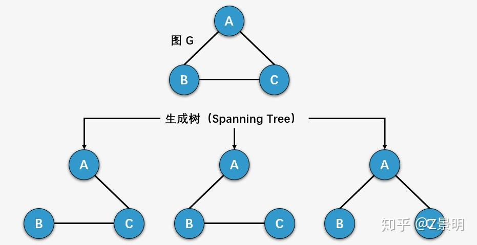

## 4.2 生成树的属性

* 一个连通图可以有多个生成树；
* 一个连通图的所有生成树都包含相同的顶点个数和边数；
* 生成树当中不存在环；
* 移除生成树中的任意一条边都会导致图的不连通， 生成树的边最少特性；
* 在生成树中添加一条边会构成环。
* **对于包含n个顶点的连通图，生成树包含n个顶点和n-1条边；**
* **对于包含n个顶点的无向完全图最多包含$n^{n-2}$颗生成树。**

## **4.3 最小生成树**

所谓一个**带权图** 的最小生成树，就是原图中**边的权值最小的生成树** ，所谓最小是指边的权值之和小于或者等于其它生成树的边的权值之和。
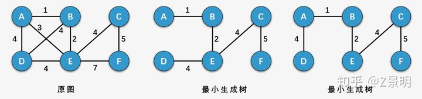

## 4.4 最小生成树算法

最小生成树算法有很多，其中最经典的就是克鲁斯卡尔（Kruskal）算法和 普里姆（Prim）算法。

克鲁斯卡尔（Kruskal）算法主要是针对边来展开，边数少时效率高，对稀疏图有很大优势。

普里姆（Prim）算法对于稠密图，即边数非常多的情况会更好些。

## **4.4.1 Kruskal算法**

### 4.4.1.1 Kruskal算法简介

克鲁斯卡尔算法（Kruskal）是一种使用贪婪方法的最小生成树算法。该算法初始将图视为森林，图中的每一个顶点视为一棵单独的树。

一棵树只与它的邻接顶点中权值最小且不违反最小生成树属性（不构成环）的树之间建立连边。

贪心算法一般按如下步骤进行：

①建立数学模型来描述问题

②把求解的问题分成若干个子问题

③对每个子问题求解，得到子问题的局部最优解

④把子问题的解局部最优解合成原来解问题的一个解

### 4.4.1.2 Kruskal算法图例

第一步：将图中所有的边按照权值进行非降序排列；
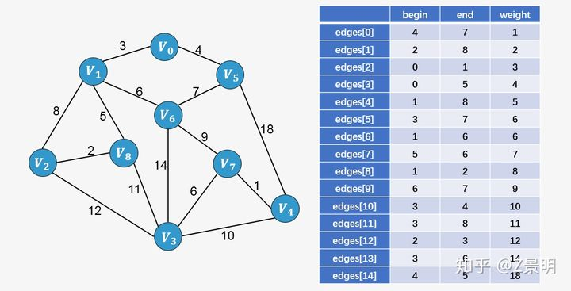

第二步：从图中所有的边中选择可以构成最小生成树的边。没有环形成，则添加。

    如何判断是否形成环：

    要判断添加一条边 X-Y 是否形成环，可以判断顶点X在最小生成树中的终点与顶点Y在最小生成树中的**终点是否相同** 。如果相同则说明存在环路，否则不存在。

    所谓**终点** ，就是将所有顶点按照从小到大的顺序排列好之后；某个顶点的终点就是"与它连通的最大顶点"。

    看下图，我们可以对图中顶点进行排序，排序后的顶点存放在一个数组中，每一个顶点则对应一个下标，

    同样的我们针对排序后的数组创建一个顶点的终点数组，初始时图中的每一个顶点是一棵树，每一个顶点的终点初始化为自身，我们用0来表示。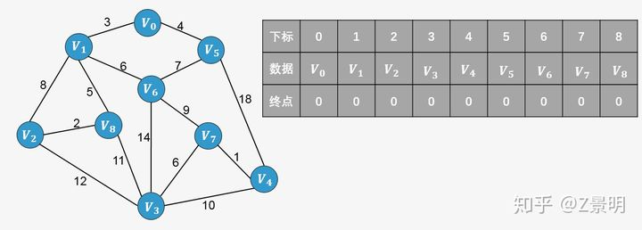

1. 选择权值最小的边V4−V7：V4终点4，V7终点7，没有环形成，则添加，将终点数组4的终点更新为7；
   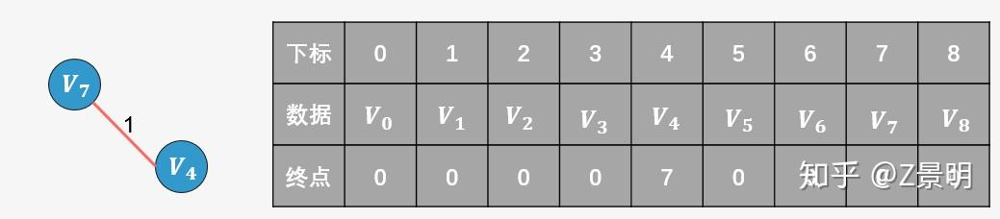
2. 选择边V2−V8：V2终点2，V8终点8，没有形成环，则添加，将终点数组2的终点更新为8；
   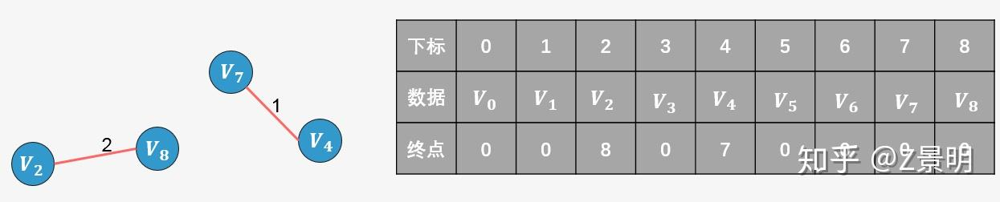
3. 选择边V0−V1：V0终点0，V1终点1，没有形成环，则添加,将终点数组0的终点更新为1；
   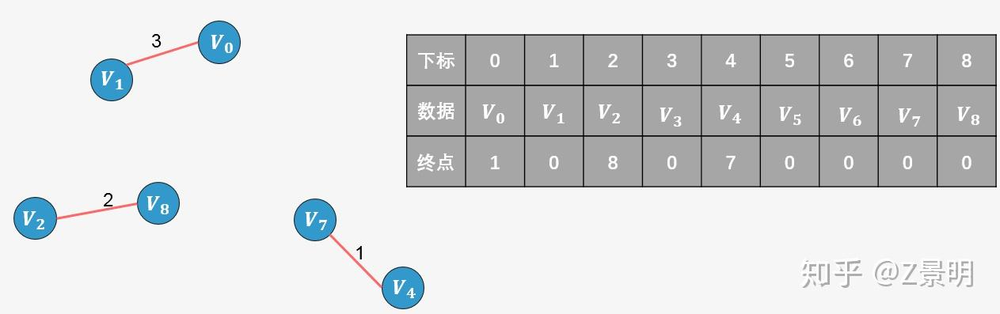
4. 选择边V0−V5：V0终点1，V5终点5，没有形成环，则添加,将终点数组1的终点更新为5 ；
   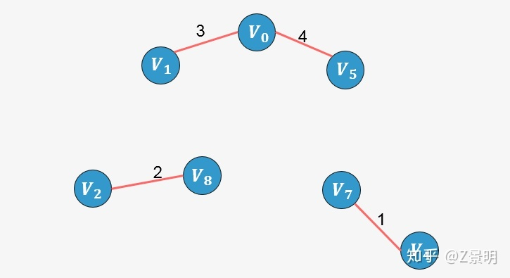
5. 选择边V1−V8：V1终点5，V8终点8，没有形成环，则添加,将终点数组5的终点更新为8；
   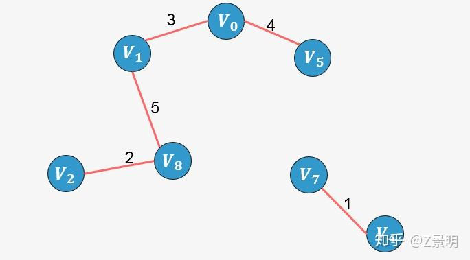
6. 选择边V3−V7：V3终点3，V7终点7，没有形成环，则添加,将终点数组3的终点更新为7；
   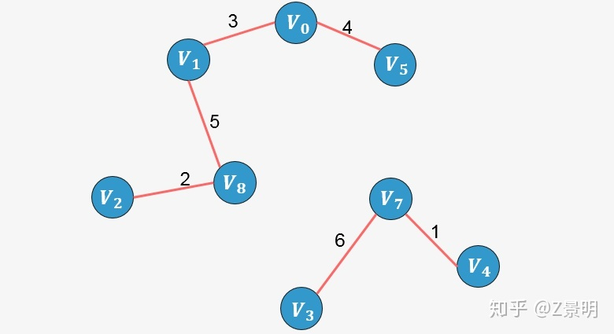
7. 选择边V1−V6：V1终点8，V6终点6，没有形成环，则添加，将终点数组8的终点更新为6；
   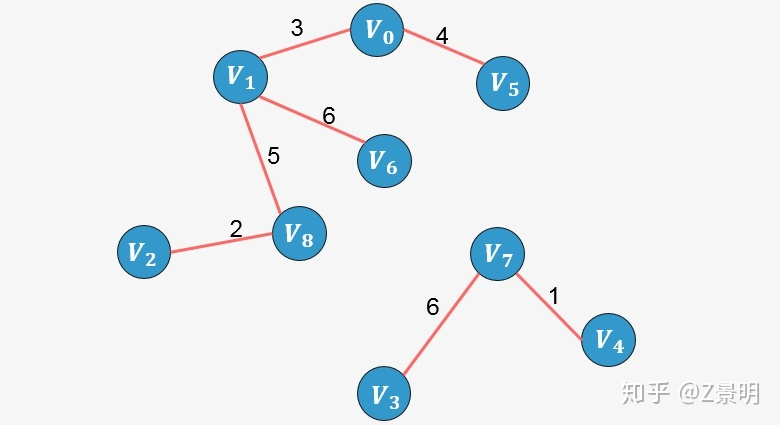
8. 选择边V5−V6：V5终点6，V6终点6，两个顶点的终点相同则说明添加后会形成环，舍弃，不添加；
9. 选择边V1−V2：V1终点6，V1终点6，两个顶点的终点相同则说明添加后会形成环，舍弃，不添加；
10. 选择边V6−V7：V6终点6，V7终点7，没有形成环，添加。将终点数组 6的终点更新为7；
    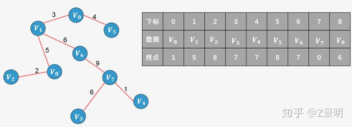
11. 此时已经包含了图中顶点个数9减1条边，算法停止

## 4.4.2 Prim算法

### 4.4.2.1 Prim算法简介

普里姆算法在找最小生成树时，将顶点分为两类，一类是在查找的过程中已经包含在生成树中的顶点（假设为 A 类），剩下的为另一类（假设为 B 类）。

对于给定的连通网，起始状态全部顶点都归为 B 类。在找最小生成树时，选定任意一个顶点作为起始点，并将之从 B 类移至 A 类；

然后找出 B 类中到 A 类中的顶点之间权值最小的顶点，将之从 B 类移至 A 类，如此重复，直到 B 类中没有顶点为止。所走过的顶点和边就是该连通图的最小生成树。

### 4.4.2.2 Prim算法图例

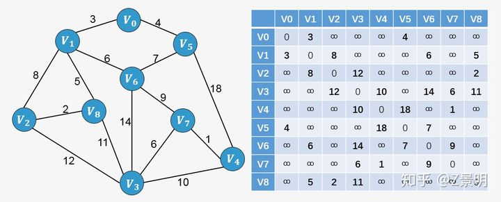

假如从顶点 V0 出发，顶点 V1 、V5 的权值分别为3、4，所以对于顶点 V0 来说，到顶点 V1 的权值最小，将顶点 V1 加入到生成树中：
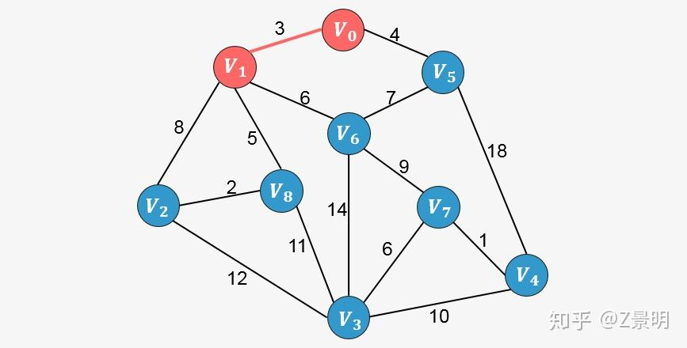

继续分析与顶点 V0 和 V1 相邻的所有顶点（包括 V2 、V5、V6、V8 ），其中权值最小的为 V5， 将 V5 添加到生成树当中：
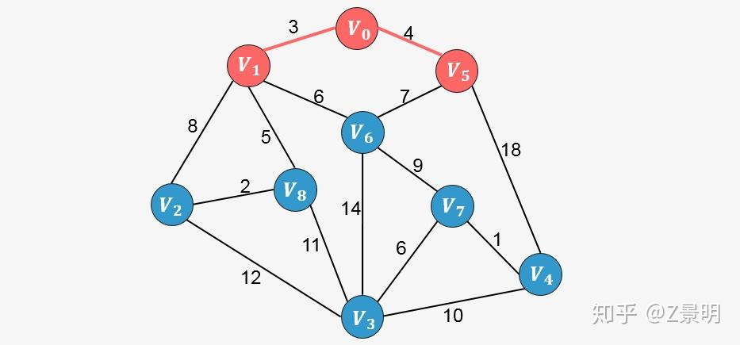

继续分析与顶点 V0 和 V1 、V5 相邻的所有顶点中权值最小的顶点，发现为 V8 ，则添加到生成树当中。
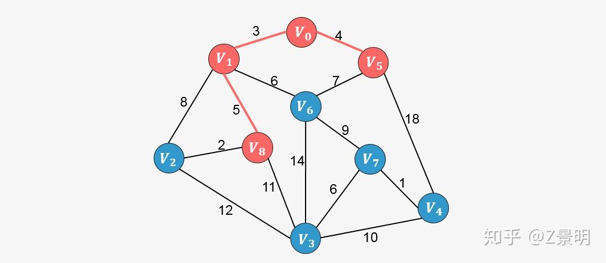

继续分析与生成树中已添加顶点相邻的顶点中权值最小的顶点，发现为 V2 ，则添加到生成树中：
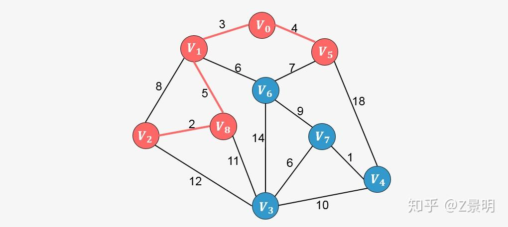

重复上面的过程，直到生成树中包含图中的所有顶点，我们直接看接下来的添加过程
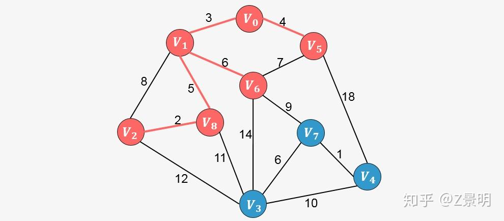
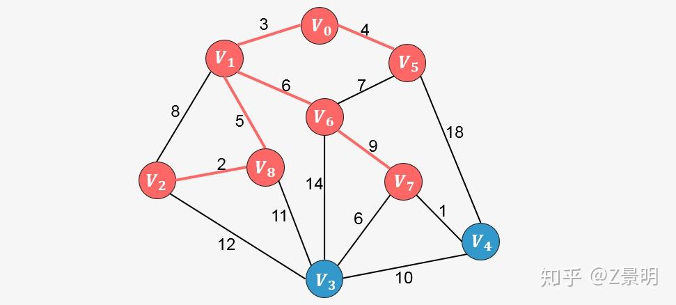
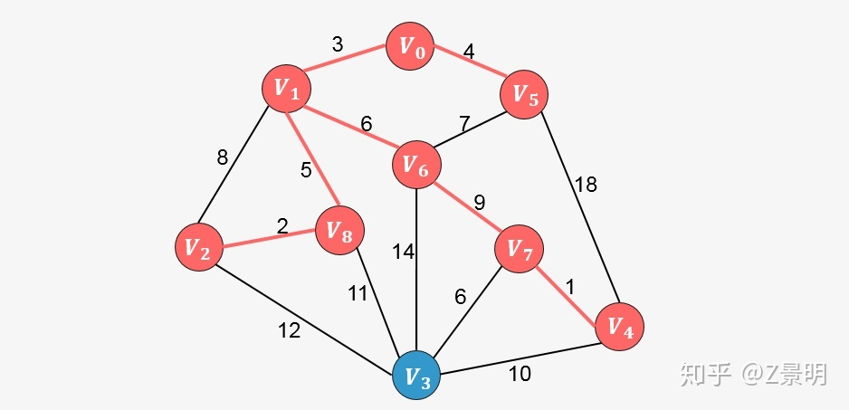
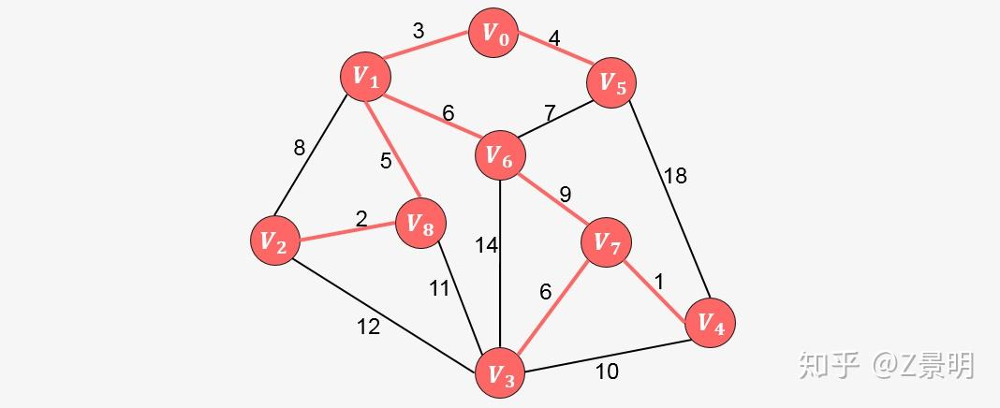
此时算法结束，我们找出了图中的最小生成树。

# 5 最短路径

在网图和非网图中，最短路径含义是不一样的。

* 非网图中：最短路径指两顶点之间经过**边数最少**的路径。
* 网图中   ：最短路径指两顶点之间经过的边上**权值之和最小**的路径。并且称第一个顶点为源点，最后一个顶点为终点。

## **5.1 迪杰斯特拉(Dijkstra)算法**

### 5.1.1 Dijkstra算法简介

迪杰斯特拉(Dijkstra)算法是典型最短路径算法，用于计算一个节点到其他节点的最短路径。它的主要特点是以起始点为中心向外层层扩展(广度优先遍历思想)，直到扩展到终点为止。

**基本思想**

> 1. 通过Dijkstra计算图G中的最短路径时，需要指定一个起点D(即从顶点D开始计算)。
> 2. 此外，引进两个数组S和U。S的作用是记录已求出最短路径的顶点(以及相应的最短路径长度)，而U则是记录还未求出最短路径的顶点(以及该顶点到起点D的距离)。
> 3. 初始时，数组S中只有起点D；数组U中是除起点D之外的顶点，并且数组U中记录各顶点到起点D的距离。如果顶点与起点D不相邻，距离为无穷大。
> 4. 然后，从数组U中找出路径最短的顶点K，并将其加入到数组S中；同时，从数组U中移除顶点K。接着，更新数组U中的各顶点到起点D的距离。
> 5. 重复第4步操作，直到遍历完所有顶点。

### 5.1.2 Dijkstra算法图例

以下图为例，来对迪杰斯特拉进行算法演示(以顶点D为起点)
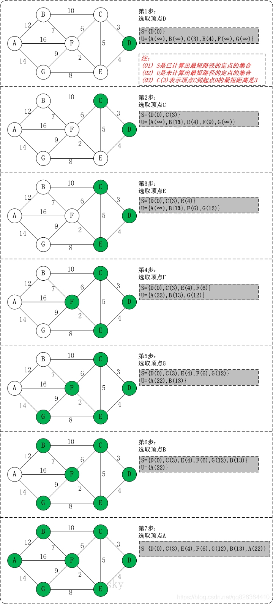

## 5.2 弗洛伊德( Floyd)算法

### 5.2.1 Floyd算法简介

Floyd算法可以给出网络中任意两个节点之间的最短路径，因此它是比Dijkstra更一般的算法。

**基本思想:**

将n个节点的网络表示为n行n列的矩阵，而矩阵中的元素(i,j)表示从节点i到节点j的距离dij，如果两点直接没有边相连，则相应的元素就是无穷(∞).

**步骤:**

1. 第0步：定义初始距离矩阵$D_0$、节点序列矩阵$S_0$，如下表。对角线上用”—“表示不需要从自身到自身。
   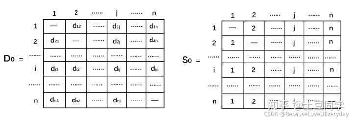
   这里的节点序列矩阵相当于路线表，如下表，$S_{ij}$=j表示，从节点i到节点j只需经过节点j即可。令k=1.
2. 一般的第k步：令第k行为枢轴行，第k列为枢轴列。对于矩阵$D_{k−1}$（上一步完成后的矩阵）中对的每一个元素做三重操作。

   如果满足条件：$d_{ik}$ + $d_{kj}$ < $d_{ij}$，其中(i≠k,j≠k,i≠j),则进行下面的操作：

   a. 用$d_{ik}$+$d_{kj}$代替矩阵$D_{k−1}$中的元素$d_{kj}$，从而得到矩阵$D_k$.
   b. 用k代替矩阵$S_{k−1}$中的元素$s_{ij}$，从而得到矩阵$S_k$.
   c. 令k=k+1，如果k=n+1，停止，否则重复2.

### 5.2.1 Floyd算法图例

对下图中的网络，求任意两个节点之间的最短路径，图中弧上给出了相应节点间的距离。弧<3,5>是有向的，其他边都是双边。
   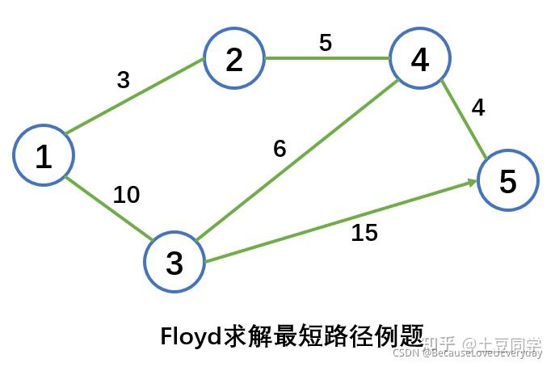
**迭代0** ：矩阵$D_0$和$S_0$代表初始的网络。可以看到矩阵$D_0$除了$d_{53}$=$\infty$外(因为弧<3,5>是单向弧)，$D_0$是对称的。
   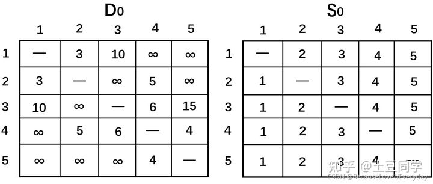
**迭代1** ：令k=1.$D_0$矩阵中的黄色阴影表示的第1行和第1列为枢轴行和枢轴列。根据三重操作发现可以改进的元素是$d_{23}$和$d_{32}$，即
   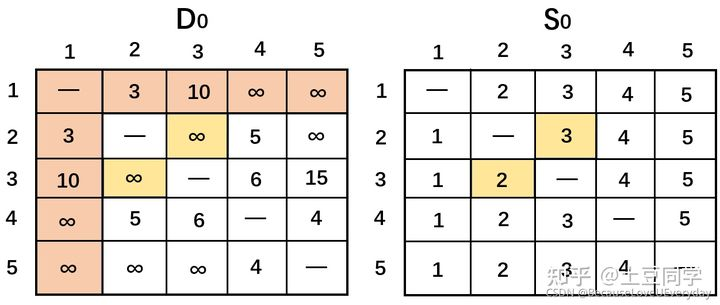

1. $d_{21}$+$d_{13}$=3+10<$\infty$，则在$d_{23}$中用13代替$\infty$，并令$s_{23}$=1.
2. $d_{31}$+$d_{12}$=10+3<$\infty$，则在$d_{32}$中用13代替$\infty$，并令$s_{32}$=1.

此时得到$D_1$和$S_1$，得到下表
   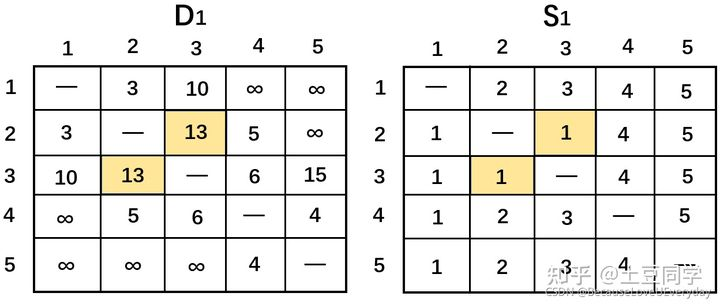
**迭代2** ：令k=2.$D_0$矩阵中的黄色阴影表示的第2行和第2列为枢轴行和枢轴列。根据三重操作发现可以改进的元素是$d_{14}$和$d_{41}$，即
   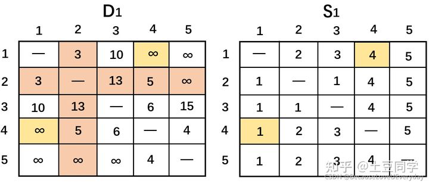

1. $d_{21}$+$d_{42}$=3+5=8<$\infty$，则在$d_{41}$中用8代替$\infty$，并令$s_{41}$=2.
2. $d_{12}$+$d_{24}$=3+5=8<$\infty$，则在$d_{14}$中用8代替$\infty$，并令$s_{14}$=2.

此时得到$D_2$和$S_2$，得到下表
   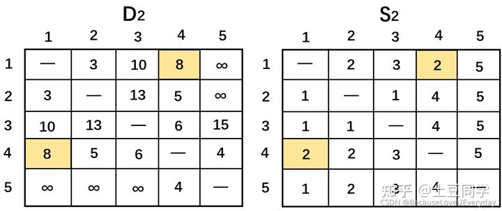

**迭代3** ：令k=3.$D_0$矩阵中的黄色阴影表示的第3行和第3列为枢轴行和枢轴列。根据三重操作发现可以改进的元素是$d_{15}$和$d_{25}$，即
   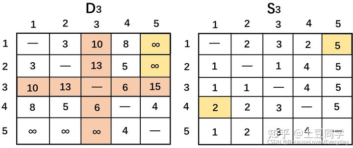

1. $d_{13}$+$d_{35}$=10+15=25<$\infty$，则在$d_{15}$中用25代替$\infty$，并令$s_{15}$=3.
2. $d_{23}$+$d_{34}$=13+15=28<$\infty$，则在$d_{25}$中用28代替$\infty$，并令$d_{21}$=3.

此时得到$D_3$和$S_3$，得到下表
   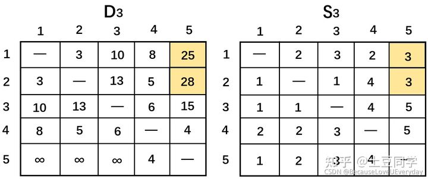

**迭代4** ：令k=4.$D_0$矩阵中的黄色阴影表示的第4行和第4列为枢轴行和枢轴列。根据三重操作发现可以改进的元素是$d_{15}$、$d_{23}$、$d_{25}$、$d_{32}$、$d_{35}$、$d_{51}$、$d_{52}$、$d_{53}$，即
   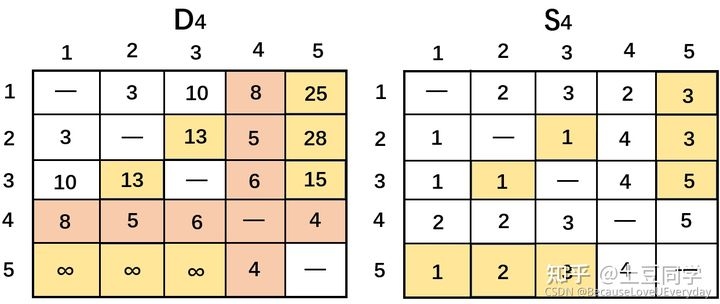

1. $d_{14}$+$d_{45}$=8+4=12<25，则在$d_{15}$中用12代替25，并令$s_{15}$=4.
2. $d_{24}$+$d_{43}$=5+6=11<13，则在$d_{23}$中用11代替13，并令$s_{23}$=4.
3. $d_{24}$+$d_{45}$=5+4=9<28，则在$d_{25}$中用9代替28，并令$s_{25}$=4.
4. $d_{34}$+$d_{42}$=6+5=11<13，则在$d_{25}$中用11代替13，并令$s_{32}$=4.
5. $d_{34}$+$d_{45}$=6+4=10<15，则在$d_{35}$中用10代替15，并令$s_{35}$=4.
6. $d_{41}$+$d_{54}$=8+4=12<$\infty$，则在$d_{51}$中用12代替$\infty$，并令$s_{51}$=4.
7. $d_{42}$+$d_{54}$=5+4=9<$\infty$，则在$d_{52}$中用9代替$\infty$，并令$s_{52}$=4.
8. $d_{43}$+$d_{54}$=6+4=10<$\infty$，则在$d_{53}$中用10代替$\infty$，并令$s_{53}$=4.
   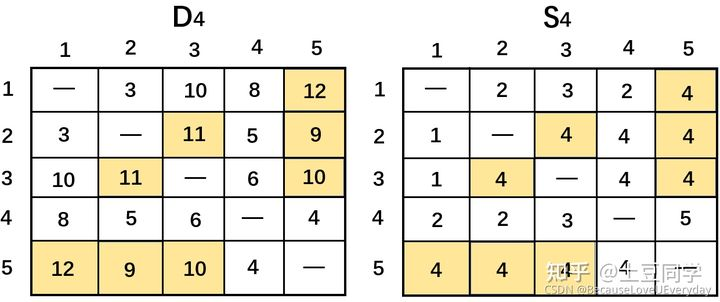

**迭代5** ：令k=5.$D_0$矩阵中的黄色阴影表示的第5行和第5列为枢轴行和枢轴列。根据三重操作发现没有可以改进的元素了。
   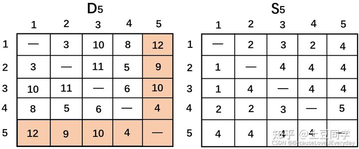
因此，最后得到的矩阵为：
   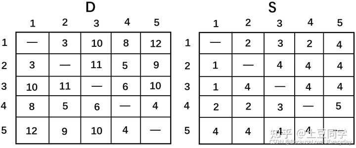

这两个矩阵包含了网络中任意两个节点最短路径的所有信息。如从矩阵D中可以看出节点1到节点5的最短路径长度为12.从矩阵S中发现，节点1到节点5的中间节点是节点4，即节点1→节点4→节点5，再看节点1→节点4中间是节点2，即节点1需要通过节点2到达节点4，即节点1→节点2→节点4；而节点4可以直接到节点5，中间没有节点，因此可以得到节点1到节点5的最短路径是节点1→节点2→节点4→节点5.

# 6 拓扑排序
