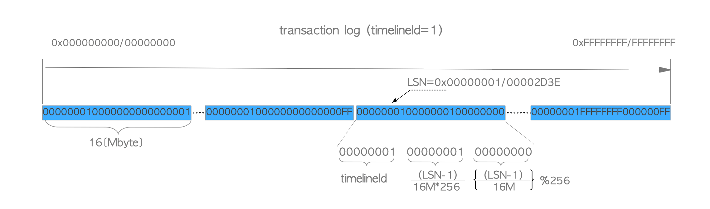
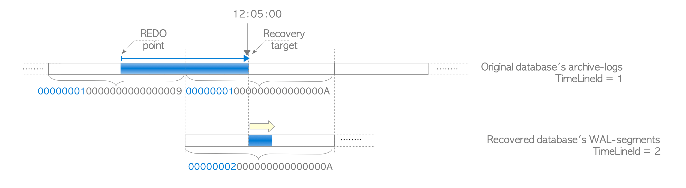
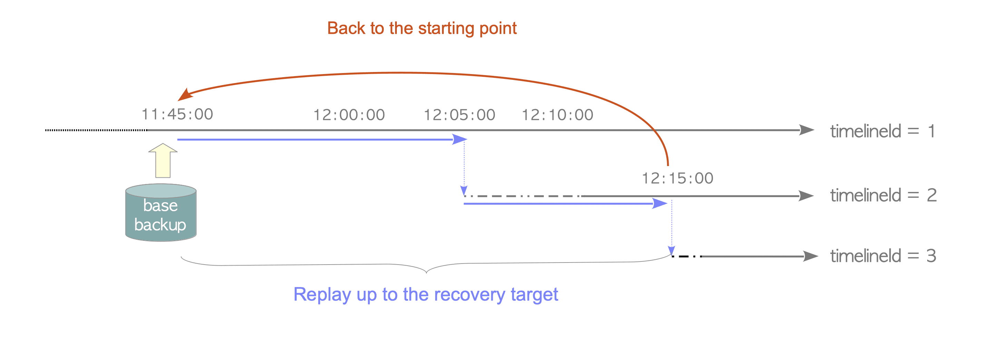
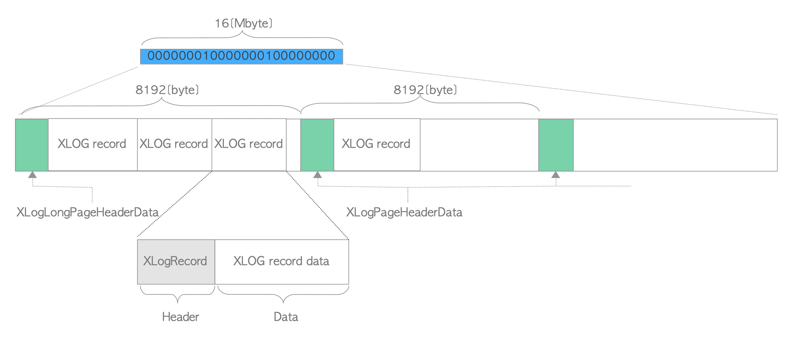
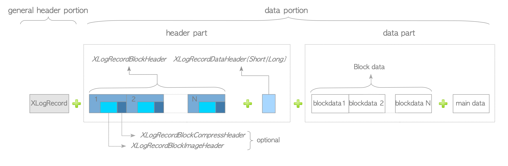
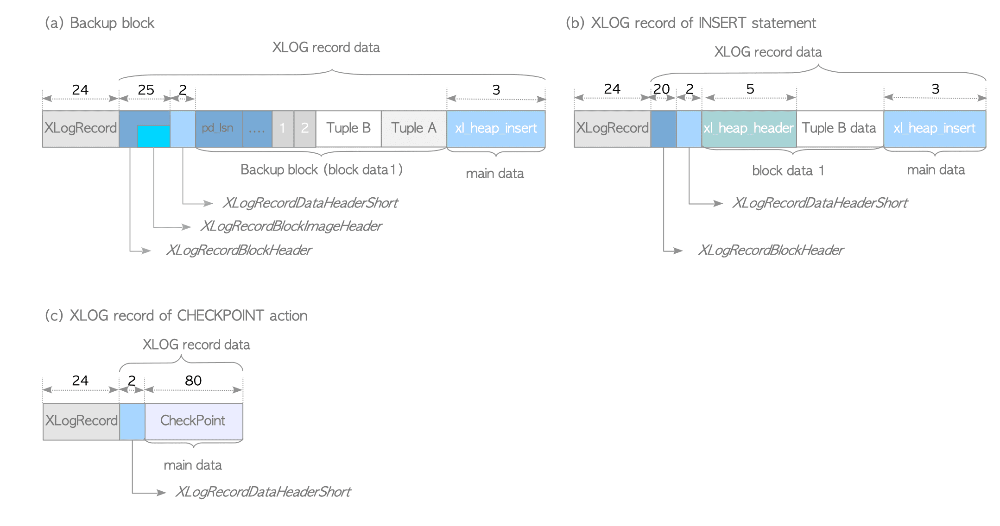
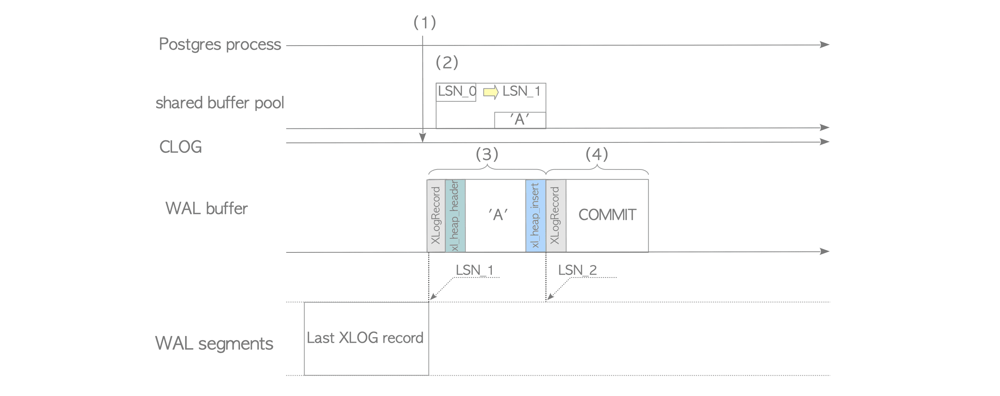
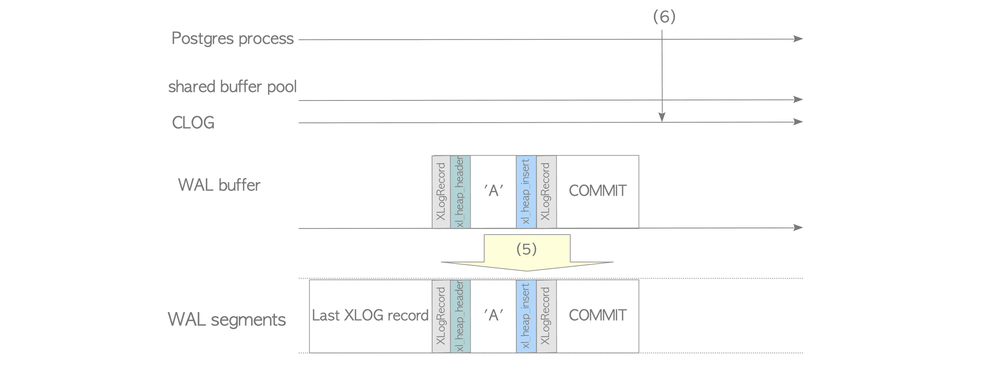
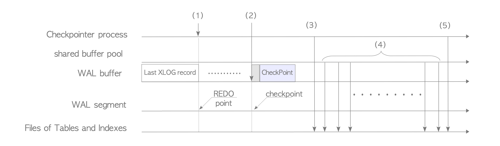
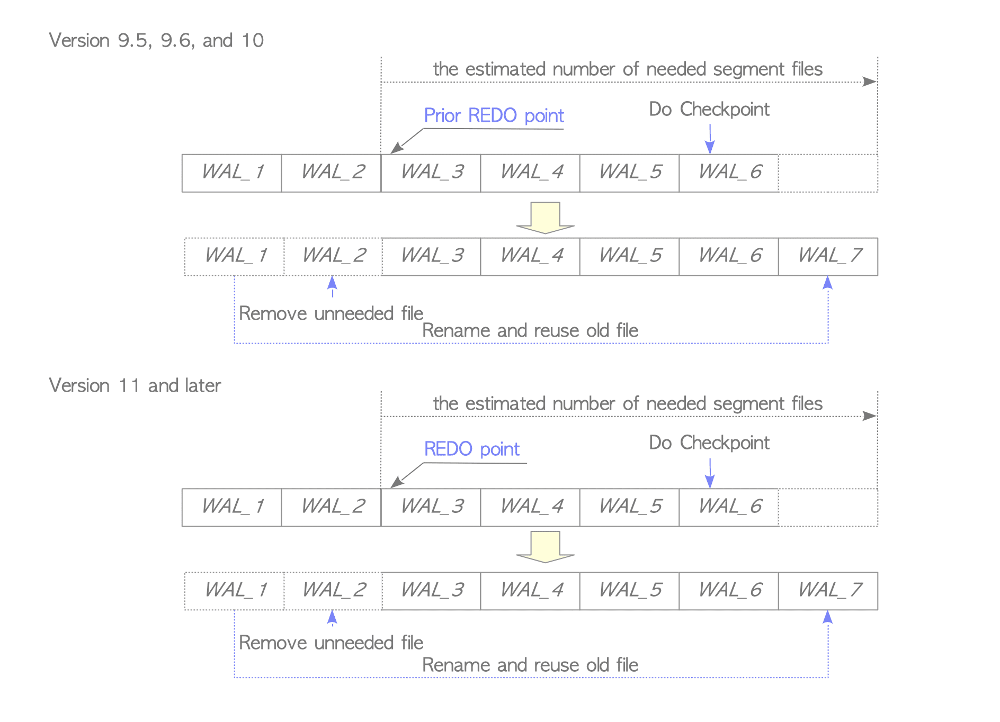

# 1 LSN

LSN（Log Sequence Number） XLOG记录/WAL数据的日志序列号。标识了事务在事务日志中的位置。记录的LSN被用作XLOG记录的唯一标识。

LSN是一个64位整数。这个64位整数被分成两个段(高32位和低32位)。格式为两个十六进制数，中间用斜杠(XXXXXXXX/YYZZZZZZ)隔开。

“X”代表LSN的高32位，“Y”是低32位部分的高8位。“Z”表示文件中的偏移位置。'X’和’Y’值在默认PostgreSQL部署的WAL文件名的第二部分中使用。

LSN 用8byte长度可以表示16EB的地址空间（$2^{64}$）。

# 2 WAL段

虽然事务日志的容量实际上应该是无限的，但8byte长度的地址空间已经足够大了，目前不可能处理8byte长度的单个文件。PG 默认把日志文件划分成大小16M的文件，这些文件称为WAL段。initdb 建库时，可以通过--wal-segsize选项调整WAL段大小。


### 2.1 WAL相关文件

#### 2.1.1 WAL段文件名

WALsegment file name$=timelineId+(uint32)\dfrac{LSN−1}{16M*256}+(uint32)(\dfrac{LSN−1}{16M})\%256$

256 是因为，这里只用了LSN低32位中的高8位，所以$2^8=256$

WAL的文件名格式为 TTTTTTTTXXXXXXXX000000YY。这里’T’是时间线，'X’是LSN的高32位，'Y’是LSN的低32位。


#### 2.1.2 `timelineId`时间线

 pg中的时间线时用于区分原始数据库集簇和恢复生成的数据库集簇。`timelineId`时间线标识是一个4Byte的无符号整数，从1开始计数。

由initdb创建的数据库集簇，其 `timelineId为1，每当数据库集簇恢复时，其`timelineId增加1。且WAL 段文件名也随之变化。


#### 2.1.3 .history  时间线历史文件

```
"8-digit new timelineId".history
```

该文件记录了当前时间线是从那条时间线分叉出来的，以及分叉的时间。

时间线历史文件至少一行，每行由以下三项组成。

* 时间线标识（timelineId）--用于恢复的WAL时间线
* LSN         			 --发生WAL段切换的LSN位置
* 原因 （reason）		 --时间线变化发生的原因解释。

```
postgres> cat /home/postgres/archivelogs/00000002.history
1	  0/A000198	before 2023-9-512:05:00.861324+00
解释：数据库集簇（时间线2）基于时间线标识1的基础备份，并在2023-9-512:05:00.861324+00之前，通过重放日志，恢复至0/A000198位置。
```

#### 2.1.4 PITR与.history



1. PostgreSQL从 `backup_label`文件中读取 `CHECKPOINT LOCATION`的值。
2. 从 `recovery.conf`中读取一些参数值；在此示例中为 `restore_command`，`recovery_target_time`和 `recovery_target_timeline`。
3. PostgreSQL读取时间线历史文件 `00000002.history`，该文件对应参数 `recovery_target_timeline`的值。

   ```
   restore_command = 'cp /mnt/server/archivedir/%f %p'
   recovery_target_time = "2018-7-16 12:15:00 GMT"
   recovery_target_timeline = 2
   ```
4. PostgreSQL通过以下步骤重放WAL数据：

   1. 对于从重做点到 `LSN 0/A000198`（该值写在 `00000002.history`文件中）之间的WAL数据，PostgreSQL会（从合适的归档日志中）读取并重放 `TimelineID=1`的WAL数据。
   2. 对于从 `LSN 0/A000198`，到时间戳 `2018-7-9 12:15:00`之间的WAL数据，PostgreSQL会（从合适的归档日志中）读取并重放 `TimelineID=2`的WAL数据。
5. 当恢复过程完成时，当前的时间线标识将增加到3，并在 `pg_wal`目录和归档目录中创建名为 `00000003.history`的新时间线历史文件。

   ```yaml
   postgres> cat /home/postgres/archivelogs/00000003.history
   1         0/A000198     before 2018-7-9 12:05:00.861324+00
   2         0/B000078     before 2018-7-9 12:15:00.927133+00
   ```

  当你进行过超过一次的PITR时，应明确设置时间线标识，以便使用合适的时间线历史文件。因此，时间线历史文件不仅仅是数据库集簇的历史日志，还是PITR过程的参考恢复指令。

#### 2.1.5 archive_status

archive_status是wal段文件的备份目录，包括.ready和.done文件。超出wal_keep_segments数目限制的wal日志会在archive_status目录内被打标，归档操作完成后被进一步移除。

* .ready

  .ready是同名wal段文件在archive_status目录内的标记文件，代表该wal段文件可被归档。wal段文件在数据目录中的存储文件数量是有上限的，一般通过wal_keep_segments参数来约束，因此数据库引擎在wal段文件个数达到上限后会在archive_status目录内增加可移除的wal段文件的标记文件，文件名是原wal段文件名后增加.ready后缀，等待归档工具进行归档。
* .done

  .done是同名wal段文件在archive_status目录内的标记文件，代表该wal段文件已被归档，可以被清理。数据库引擎默认通过archive_command命令对.ready文件进行归档，归档成功与否取决于archive_command命令返回true还是false，当archive_command返回true时，代表与.ready文件同名的wal段文件已被归档，引擎再将该文件的扩展名重命名为.done，等待数据库引擎在下一次的checkpoint时进一步清理原wal段文件。

## 2.2 WAL段文件内部布局

WAL段文件文件内部被分为多个8K的页。第一个页面包含了由XLogLongPageHeaderData定义的首部，其他的页面包含由XLogPageHeaderData定义的首部。每个页面的首部之后，紧接着就是以降序写入的XLOG记录。


### 2.2.1 PageHeader页头

```c
typedef struct XLogPageHeaderData
{
	uint16		xlp_magic;	/* magic value for correctness checks 魔数*/
	uint16		xlp_info;	/* flag bits, see below 标记为*/
	TimeLineID	xlp_tli;	/* TimeLineID of first record on page 页面第一条记录的时间线*/
	XLogRecPtr	xlp_pageaddr;	/* XLOG address of this page 当前页面XLOG的地址*/
	/*
	 * When there is not enough space on current page for whole record, we
	 * continue on the next page.  xlp_rem_len is the number of bytes
	 * remaining from a previous page; it tracks xl_tot_len in the initial
	 * header.  Note that the continuation data isn't necessarily aligned.
	 */
	uint32		xlp_rem_len;	/* total len of remaining data for record 记录所有剩余数据的长度*/
} XLogPageHeaderData;
#define SizeOfXLogShortPHD	MAXALIGN(sizeof(XLogPageHeaderData))
typedef XLogPageHeaderData *XLogPageHeader;
/*
 * When the XLP_LONG_HEADER flag is set, we store additional fields in the
 * page header.  (This is ordinarily done just in the first page of an
 * XLOG file.)	The additional fields serve to identify the file accurately.
 */
typedef struct XLogLongPageHeaderData
{
	XLogPageHeaderData std;		/* standard header fields */
	uint64		xlp_sysid;	/* system identifier from pg_control */
	uint32		xlp_seg_size;	/* just as a cross-check */
	uint32		xlp_xlog_blcksz;/* just as a cross-check */
} XLogLongPageHeaderData;
```

### 2.2.2 RecodeHeader记录头

```c
typedef struct XLogRecord
{
	uint32		xl_tot_len;	/* total len of entire record 整条记录的总长度*/
	TransactionId xl_xid;		/* xact id 事务xid*/
	XLogRecPtr	xl_prev;	/* ptr to previous record in log 指向日志中前一条记录的指针*/
	uint8		xl_info;	/* flag bits, see below 标记位*/
	RmgrId		xl_rmid;	/* resource manager for this record 当前记录对应的资源管理器，涉及日志如何重放*/
	/* 2 bytes of padding here, initialize to zero */
	pg_crc32c	xl_crc;		/* CRC for this record */

	/* XLogRecordBlockHeaders and XLogRecordDataHeader follow, no padding */

} XLogRecord;
```

xl_rmid和xl_info都是与资源管理器相关的变量，资源管理器个数随着版本变化，V10包含如下。

|                | 资源管理器                                                 |
| -------------- | ---------------------------------------------------------- |
| 堆元组操作     | RM_HEAP, RM_HEAP2                                          |
| 索引操作       | RM_BTREE, RM_HASH, RM_GIN, RM_GIST, RM_SPGIST, RM_BRIN     |
| 序列号操作     | RM_SEQ                                                     |
| 事务操作       | RM_XACT, RM_MULTIXACT, RM_CLOG, RM_XLOG, RM_COMMIT_TS      |
| 表空间操作     | RM_SMGR, RM_DBASE, RM_TBLSPC, RM_RELMAP                    |
| 复制与热备操作 | RM_STANDBY, RM_REPLORIGIN, RM_GENERIC_ID, RM_LOGICALMSG_ID |

### 2.2.3 记录数据部分

XLOG记录的数据部分可以分为两类：备份区块（完整的页面）和非备份区块（不通的操作对应的数据不同）。V9.5之后引入通用结构化格式。


首部部分包含零个或多个XLogRecordBlockHeader，以及零个或一个XLogRecordDataHeaderShort（或XLogRecordDataHeaderLong）它必须至少包含其中之一。当记录存储整页镜像时（备份区块）XLogRecordBlockHeader包含XLogRecordBlockImageHeader，如果启用压缩还会包含XLogRecordBlockCompressHeader。

数据部分则由零个或多个区块数据与零个或一个主数据组成，区块数据与XLogRecordBlockHeader对应，主数据则与XLogRecordDataHeader对应。下图为V9.5后XLOG记录示例。


### 2.2.4 pg_waldump

```sql
postgres=# begin;
BEGIN
postgres=*# select pg_current_wal_lsn();
 pg_current_wal_lsn
--------------------
 0/1804AF0
(1 row)

postgres=*# insert into t3 values(3,'c');
INSERT 0 1
postgres=*# end;
COMMIT
postgres=#
```

```shell
[postgres@localhost pg_wal]$ pg_waldump 000000010000000000000001
rmgr: Standby     len (rec/tot):     50/    50, tx:          0, lsn: 0/01804840, prev 0/018047C8, desc: RUNNING_XACTS nextXid 771 latestCompletedXid 770 oldestRunningXid 771
rmgr: Heap        len (rec/tot):     54/   474, tx:        771, lsn: 0/01804878, prev 0/01804840, desc: INSERT off 11 flags 0x00, blkref #0: rel 1663/5/16423 blk 0 FPW
rmgr: Standby     len (rec/tot):     54/    54, tx:          0, lsn: 0/01804A58, prev 0/01804878, desc: RUNNING_XACTS nextXid 772 latestCompletedXid 770 oldestRunningXid 771; 1 xacts: 771
rmgr: Transaction len (rec/tot):     34/    34, tx:        771, lsn: 0/01804A90, prev 0/01804A58, desc: ABORT 2023-09-18 22:15:39.159685 EDT
rmgr: Standby     len (rec/tot):     50/    50, tx:          0, lsn: 0/01804AB8, prev 0/01804A90, desc: RUNNING_XACTS nextXid 772 latestCompletedXid 771 oldestRunningXid 772
rmgr: Heap        len (rec/tot):     61/    61, tx:        772, lsn: 0/01804AF0, prev 0/01804AB8, desc: INSERT off 12 flags 0x00, blkref #0: rel 1663/5/16423 blk 0
rmgr: Transaction len (rec/tot):     34/    34, tx:        772, lsn: 0/01804B30, prev 0/01804AF0, desc: COMMIT 2023-09-18 22:17:23.866351 EDT
rmgr: Standby     len (rec/tot):     50/    50, tx:          0, lsn: 0/01804B58, prev 0/01804B30, desc: RUNNING_XACTS nextXid 773 latestCompletedXid 772 oldestRunningXid 773
```

## 2.3 WAL记录的写入

> testdb=# INSERT INTO tbl VALUES ('A');




> 上图的XLOG格式是9.4版本的

1. 函数ExtendCLOG()将当前事务的状态IN_PROGRESS写入内存中的CLOG。
2. 函数 `heap_insert()`向共享缓冲池的目标页面中插入堆元组，创建当前页面的XLOG记录，并执行函数 `XLogInsert()`。
3. 函数 `XLogInsert()`会将 `heap_insert()`创建的XLOG记录写入WAL缓冲区 `LSN_1`处，并将被修改页面的 `pd_lsn`从 `LSN_0`更新为 `LSN_1`。
4. 函数 `finish_xact_command()`会在该事务被提交时被调用，用于创建该提交动作的XLOG记录，而这里的 `XLogInsert()`函数会将该记录写入WAL缓冲区 `LSN_2`处。
5. 函数 `XLogWrite()`会冲刷WAL缓冲区，并将所有内容写入WAL段文件中。如果 `wal_sync_method`参数被配置为 `open_sync`或 `open_datasync`，记录会被同步写入，因为函数会使用带有 `O_SYNC`或 `O_DSYNC`标记的 `open()`系统调用。如果该参数被配置为 `fsync`，`fsync_writethrough`，`fdatasync`，相应的系统调用就是 `fsync()`，带有 `F_FULLSYNC`选项的 `fcntl()`，以及 `fdatasync()`。无论哪一种情况，所有的XLOG记录都会被确保写入存储之中。
6. 函数 `TransactionIdCommitTree()`将提交日志clog中当前事务的状态从 `IN_PROGRESS`更改为 `COMMITTED`

## 2.4 WAL段文件写入时机

* 一个运行中的事务提交或中止
* WAL缓冲区被写入的元组填满（WAL缓冲区的大小由参数 `wal_buffers`控制）
* WAL写入者进程周期性执行写入

如果出现上述情况之一，无论其事务是否已提交，WAL缓冲区上的所有WAL记录都将写入WAL段文件中。

DML操作写XLOG记录是理所当然的，但非DML操作也会产生XLOG。如上所述，`COMMIT`操作会写入包含着提交的事务ID的XLOG记录。另一个例子是 `Checkpoint`操作会写入关于该检查点概述信息的XLOG记录。此外，尽管不是很常见，`SELECT`语句在一些特殊情况下也会创建XLOG记录。例如在SELECT语句处理的过程中，如果因为HOT（Heap Only Tuple）需要删除不必要元组并拼接必要的元组时，修改对应页面的XLOG记录就会写入WAL缓冲区。

## 2.5 Checkpoint检查点

### 2.5.1 Checkpoint检查点触发时机

* 距离上次检查点已经过去了由参数 `checkpoint_timeout`配置的时间间隔（默认间隔为300秒）
* 在9.4及以前的版本中，自上一次检查点以来消耗的WAL段文件超出了参数 `checkpoint_segments`的数量（默认值为3）
* 在9.5及以后的版本，`pg_xlog`（10之后是 `pg_wal`）中的WAL段文件总大小超过参数 `max_wal_size`配置的值（默认值为1GB，64个段文件）。
* PostgreSQL服务器以 `smart`或 `fast`模式关闭。
* 当超级用户手动执行 `CHECKPOINT`命令时，该进程也会启动。

### 2.5.2 Checkpoint检查点工作流程概述



1. 当检查点进程启动时，会将**重做点（REDO Point）** 存储在内存中；**重做点** 是上次检查点开始时刻时XLOG记录的写入位置，也是数据库恢复的开始位置。
2. 该检查点相应的XLOG记录（即检查点）会被写入WAL缓冲区，该记录的数据部分是由 `CheckPoint`结构体定义的，包含了一些变量，比如第一步中重做点的位置。另外，写入检查点记录的位置，也按照字面意义叫做**检查点（checkpoint** ）。
3. 共享内存中的所有数据（例如，CLOG的内容）都会被刷入持久存储中。
4. 共享缓冲池中的所有脏页都会被逐渐刷写到存储中。
5. 更新 `pg_control`文件，该文件包含了一些基础信息。

### 2.5.3 pg_control控制文件

`pg_control`文件包含了检查点的基本信息，因此它对于数据库恢复肯定是必不可少的。如果它被破坏或不可读，因为系统不知道从哪里开始恢复，则恢复过程就无法启动。`pg_control`文件存储在数据目录中 `global`子目录内；可以使用 `pg_controldata`程序显示其内容。

## 2.6 WAL段切换时机

* WAL段已写满
* 函数 `pg_switch_xlog()`（10以后为 `pg_switch_wal()`）被调用
* 启用archive_mode归档，且已经超过archive_timeout配置的时间

## 2.7 WAL段管理

每当检查点过程启动时，PostgreSQL都会估计并准备下一个检查点周期所需的WAL段文件数。这种估计基于前一个检查点周期中消耗的文件数量，即从包含上一个重做点的段文件开始计数，而这个值应当在 `min_wal_size`（默认80MB，5个文件）与 `max_wal_size`之间（默认1GB，64个文件）。如果检查点过程启动，必需的段文件会被保留或回收，而不必要的段文件会被移除。

配置参数 `wal_keep_segments`以及**复制槽（Replication Slot）** 功能都会影响WAL段文件的数量。

一个具体的例子如下图所示，假设在检查点开始前有六个文件，`WAL_3`包含了上一个重做点，PostgreSQL估计会需要五个文件。

