# 1 TCP/IP协议族

## 1.1 TCP/IP协议族的四个层次

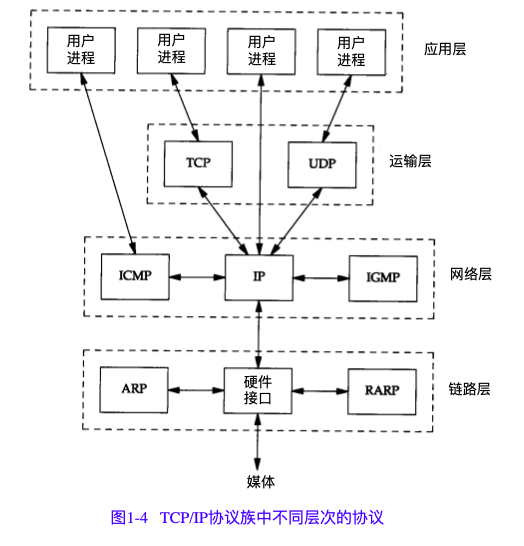

* **应用层**，负责处理特定的应用程序细节。几乎各种不同的TCP/IP实现都会提供下面这些通用的应用程序:Telnet、FTP、SMTP、SNMP
* **运输层**，主要为两台主机上的应用程序提供端到端的通信。在TCP/IP协议族中 ,有两个互不相同的传输协议 : TCP ( 传输控制协议 ) 和UDP ( 用户数据报协议 )。*
  * TCP 为两台主机提供高可靠性的数据通信。它所做的工作包括把应用程序交给它的数据分
    成合适的小块交给下面的网络层，确认接收到的分组，设置发送最后确认分组的超时时钟
    等。由于运输层提供了高可靠性的端到端的通信，因此应用层可以忽略所有这些细节。
  * 而另一方面， U D P 则 为 应 用 层 提 供 一 种 非 常 简 单 的 服 务 。 它 只 是 把 称 作 数 据 报 的 分 组
    从一台主机发送到另一台主机，但并不保证该数据报能到达另一端。任何必需的可靠
    性必须由应用层来提供。
* **网络层**，处理分组在网络中的活动,例如分组的选路.在TCP/IP协议族中,网络层协议包括
  * IP协议(网际协议)
  * ICMP协议(Internet互联网控制报文协议 )。ICMP是IP协议的附属协议。IP层用它来与其他主机或路由器交换错误报文和其他重要信息。ping和traceroute都使用了icmp.
  * IGMP协议(Internet组管理协议).它用来把一个UDP数据报多播到多个主机。
* **链路层**，通常包括操作系统中的设备驱动程序和计算机中对应的网络接口卡。它们一起处理与电缆(或其他任何传输媒介)的物理接口细节。
  * ARP(地址解析协议)和RARP(逆地址解析协议)是某些网络接口(如以太网和令牌环网)使用的特殊协议，用来转换IP层和网络接口层使用的地址。

大多数的网络应用程序都被设计成**客户—服务器模式**。应用程序通常是一个用户进 程 ，**而下三层则一般在内核中执行**。尽管这不是必需的，但通常都是这样处理的。

顶层与下三层之间还有另一个关键的不同之处 。应用层关心的是应用程序的细节，而不是数据在网络中的传输活动。**下三层对应用程序一无所知，但它们要处理所有的
通信细节。**

## 1.2 IPV4 地址结构

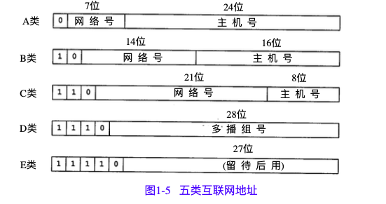

| 类型 | 范围                       |
| ---- | -------------------------- |
| A类  | 0.0.0.0到127.255.255.255   |
| B类  | 128.0.0.0到191.255.255.255 |
| C类  | 192.0.0.0到223.255.255.255 |
| D类  | 224.0.0.0到239.255.255.255 |
| E类  | 240.0.0.0到247.255.255.255 |

**有三类IP地址:单播地址(目的为单个主机)、广播地址(目的端为给定网络上的所有主机)以及多播地址(目的端为同一组内的所有主机)**

**所有基于TCP的都是单播，广播与组播主要是用于UDP**

## 1.3 封装

当应用程序用TCP传送数据时 ，数据被送入协议栈中，然后逐个通过每一层直到被当作一串比特流送入网络。其中每一层对收到的数据都要增加一些首部信息(有时还要增加尾部信息 ) 。

以太网数据帧的物理特性是其长度必须在46~1500字节之间

TCP传给IP的数据单元称作TCP段( **TCP segment**)。 IP传给网络接口层的数据单元称作IP数据报 ( **IP datagram**) 。 通过以太网传输的比特流称作帧 (**Frame**) 。

UDP数据与TCP数据基本一致。唯一的不同是UDP传给IP的信息单元称作UDP数据报( **UDP datagram** )，而且UDP的首部长为8字节.
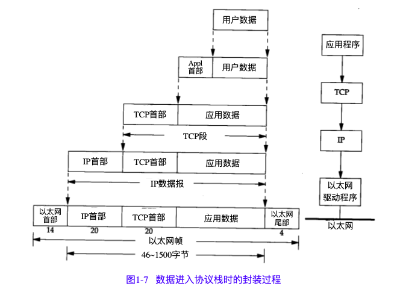

由于TCP、UDP、ICMP和IGMP都要向IP传送数据，因此IP必须在生成的IP首部中加入某种标识，以表明数据属于哪一层。为此，IP在首部中存入一个长度为8bit的数值，称作**协议域**。1表示为ICMP协议，2表示为IGMP协议，6表示为TCP协议，17表示为UDP协议。

类似地，许多应用程序都可以使用TCP或UDP来传送数据。运输层协议在生成报文首部时要存入一个应用程序的标识符。TCP和UDP都用一个16bit的端口号来表示不同的应用程序。TCP和UDP把源端口号和目的端口号分别存入报文首部中。

网络接口分别要发送和接收IP、ARP和RARP数据，因此也必须在以太网的帧首部中加入某种形式的标识，以指明生成数据的网络层协议。为此，以太网的帧首部也有一个16bit的帧类型域。

## 1.4 分用Demultiplexing

当目的主机收到一个以太网数据帧时，数据就开始从协议栈中由底向上升，同时去掉各层协议加上的报文首部。每层协议盒都要去检查报文首部中的协议标识，以确定接收数据的上层协议。这个过程称作分用。
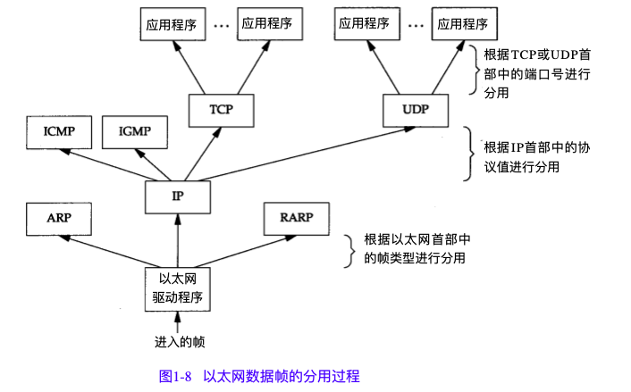

# 2 链路层

从图1-4中可以看出，在TCP/IP协议族中，链路层主要有三个目的:(1)为IP模块发送和接收IP数据报;(2)为ARP模块发送ARP请求和接收ARP应答;(3)为RARP发送RARP请求和接收RARP应答。TCP/IP支持多种不同的链路层协议，这取决于网络所使用的硬件，如以太网、令牌环网、FDDI(光纤分布式数据接口)及RS-232串行线路等.

## 2.1 RFC 894以太网和IEEE 802封装

最常使用的封装格式是RFC894定义的格式。

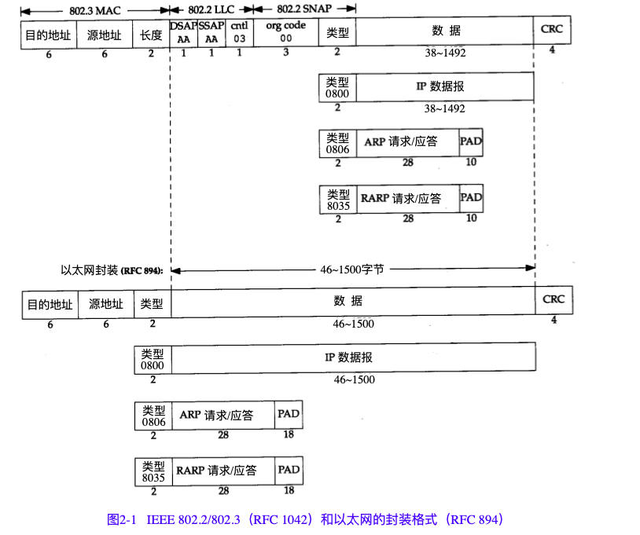

两种帧格式都采用48bit(6字节)的目的地址和源地址(802.3允许使用16bit的地址，但一般是48bit地址)。即硬件地址。ARP和RARP协议对32bit的IP地址和48bit的硬件地址进行映射。

接下来的2个字节在两种帧格式中互不相同。在802标准定义的帧格式中，长度字段是指它后续数据的字节长度，但不包括CRC检验码。

以太网的类型字段定义了后续数据的类型。在802标准定义的帧格式中，类型字段则由后续的子网接入协议(Sub-network Access Protocol，SNAP)的首部给出。

幸运的是，802定义的有效长度值与以太网的有效类型值无一相同，这样，就可以对两种帧格式进行区分。

在以太网帧格式中，类型字段之后就是数据;而在802帧格式中，跟随在后面的是3字节的802.2LLC(Logical Link Control LLC)和5字节的802.2SNAP。

目的服务访问点(DestinationServiceAccessPoint,DSAP)和源服务访问点(SourceServiceAccessPoint,SSAP)的值都设为0xaa。Ctrl字段的值设为3。随后的3个字节orgcode都置为0。再接下来的2个字节类型字段和以太网帧格式一样

CRC字段用于帧内后续字节差错的循环冗余码检验(检验和)(它也被称为FCS或帧检验序列)。

802.3标准定义的帧和以太网的帧都有最小长度要求。802.3规定数据部分必须至少为38字节，而对于以太网，则要求最少要有46字节。为了保证这一点，必须在不足的空间插入填充(pad)字节。

## 2.2 环回接口Loopback Interface

大多数的产品都支持环回接口，以允许运行在同一台主机上的客户程序和服务器程序通过TCP/IP进行通信。根据惯例大多数系统把IP地址127.0.0.1分配给这个接口，并命名为localhost。

环回接口可以被看作是网络层下面的另一个链路层。网络层把一份数据报传送给环回接口，就像传给其他链路层一样，只不过环回接口把它返回到IP的输入队列中。

## 2.3 最大传输单元MTU

以太网和802.3对数据帧的长度都有一个限制，其最大值分别是1500和1492字节。链路层的这个特性称作MTU，最大传输单元。

如果IP层有一个数据报要传，而且数据的长度比链路层的MTU还大，那么IP层就需要进行分片(fragmentation)，把数据报分成若干片，这样每一片都小于MTU。

## 2.4 路径MTU

当在同一个网络上的两台主机互相进行通信时，该网络的MTU是非常重要的。但是如果两台主机之间的通信要通过多个网络，那么每个网络的链路层就可能有不同的MTU。重要的不是两台主机所在网络的MTU的值，重要的是两台通信主机路径中的最小MTU。它被称作路径MTU。

## 2.5 地址解析协议

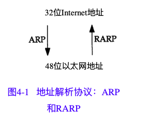

* ARP(地址解析协议)
  * ARP为IP地址到对应的硬件地址之间提供动态映射。我们之所以用动态这个词是因为这个过程是自动完成的，一般应用程序用户或系统管理员不必关心。
  * 作为内核的TCP/IP实现的一部分。
* RARP(逆地址解析协议)--略
  * RARP是被那些没有磁盘驱动器的系统使用(一般是无盘工作站或X终端)，它在当前已很少使用,并需要系统管理员进行手工设置。
  * RARP服务器的功能就由用户进程来提供，而不是作为内核的TCP/IP实现的一部分。

**ARP高速缓存**

ARP高效运行的关键是维护每个主机和路由器上的ARP缓存(或表)。该缓存使用地址解析为每个接日维护从网络层地址到硬件地址的最新映射。当IPv4地址映射到硬件地址
时,它对应于高速缓存中的一个条目,其正常到期时间是条目创建开始后的20分钟,以用arp命令来检查ARP高速缓存.

**ARP帧格式**

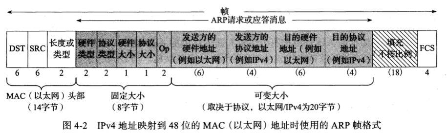

# 3 网络层

IP是TCP/IP协议族中最为核心的协议。所有的TCP、UDP、ICMP及IGMP数据都以IP数据报格式传输(见图1-4)。

**不可靠(unreliable)**的意思是它不能保证IP数据报能成功地到达目的地。IP仅提供最好的传输服务。如果发生某种错误时，如某个路由器暂时用完了缓冲区，IP有一个简单的错误处理算法:丢弃该数据报，然后发送ICMP消息报给信源端。任何要求的可靠性必须由上层来提供(如TCP)。

**无连接(connectionless)**这个术语的意思是IP并不维护任何关于后续数据报的状态信息。每个数据报的处理是相互独立的。这也说明，IP数据报可以不按发送顺序接收。如果一信源向相同的信宿发送两个连续的数据报(先是A，然后是B)，每个数据报都是独立地进行路由选择，可能选择不同的路线，因此B可能在A到达之前先到达。

RFC791[Postel1981a]是IP的正式规范文件。

## 3.1 IP4首部

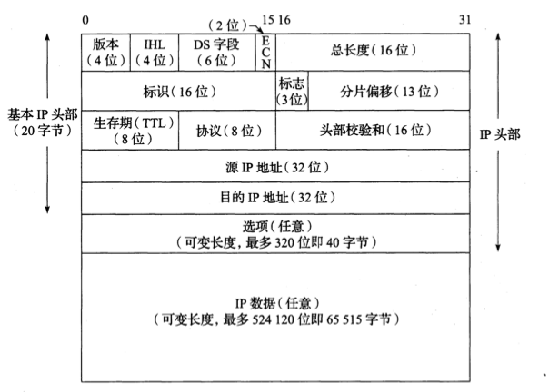

> *****TCP/IP首部中所有的二进制整数在网络中传输时都要求big  endian字节序，因此它又称作**网络字节序**。以其他形式存储二进制整数的机器，如little endian格式，则必须在传输数据之前把首部转换成网络字节序。

* 协议版本号是4，因此IP有时也称作IPv4。
* 首部长度指的是头部中32bit字的数目，包括任何选项。由于它是一个4比特字段，因此头部最长为60字节（15*32bit）。
* DS 区分服务字段 ENC显示拥塞通知 主要用于数据报转发处理。
* 总长度字段是指整个IP数据报的长度，以字节为单位。利用首部长度字段和总长度字段，就可以知道IP数据报中数据内容的起始位置和长度。总长度字段是IP首部中必要的内容，因为一些数据链路(如以太网)需要填充一些数据以达到最小长度。尽管以太网的最小帧长为46字节，但是IP数据可能会更短。如果没有总长度字段，那么IP层就不知道46字节中有多少是IP数据报的内容
* 标识字段唯一地标识主机发送的每一份数据报。通常每发送一份报文它的值就会加1。分片和重组时会涉及。同样涉及标志字段和片偏移字段。
* TTL(time-to-live)生存时间字段设置了数据报可以经过的最多路由器数。它指定了数据报的生存时间。TTL的初始值由源主机设置(通常为32或64)，一旦经过一个处理它的路由器，它的值就减去1。当该字段的值为0时，数据报就被丢弃，并发送ICMP报文通知源主机。
* 协议字段，表示数据报有效载荷部分的数据类型。最常用的值为17 (UDP)和6 (TCP)。
* 首部检验和字段是根据IP首部计算的检验和码。它不对首部后面的数据进行计算。ICMP、IGMP、UDP和TCP在它们各自的首部中均含有同时覆盖首部和数据检验和码。

## 3.2 IP路由hop-by-hop逐跳

IP转发是很简单的,特别是对于一个主机。如果目的地是直接相连的主机(例如点到点链接)或共享网络(例如以太网), IP数据报直接发送到目的地,不需要或者不使用路由器。否则,主机将数据报发送到一台路由器(称为默认路由器),由该路由器将数 据报交付到目的地。

在一般的体制中，IP可以从TCP、UDP、ICMP和IGMP接收数据报(即在本地生成的数据报)并进行发送，或者从一个网络接口接收数据报(待转发的数据报)并进行发送。IP层在内存中有一个路由表。当收到一份数据报并进行发送时，它都要对该表搜索一次。当数据报来自某个网络接口时，IP首先检查目的IP地址是否为本机的IP地址之一或者IP广播地址。如果确实是这样，数据报就被送到由IP首部协议字段所指定的协议模块进行处理。如果数据报的目的不是这些地址，那么(1)如果IP层被设置为路由器的功能，那么就对数据报进行转发;否则(2)数据报被丢弃。

**路由表**每个条目包含以下字段信息:

* 目的地:用于与一个掩码操作结果 相匹配(见下文)。针对涵盖所有目的地的“默认路由”的情况,目的地可简单地设为零;对于仅描述一个目的地的“主机路由”的情况,目的地可设为完整长度的IP地址。
* 掩码   :用作数据报目的IP地址按位与操作的掩码,其中的目的IP地址是要在转发表中查找的地址。掩码结果与转发表条目中的多个目的地进行比较。
* 下一跳:它是下一个IP实体(路由器或主机)的IP地址,数据报将被转发到该地址。
* 接口   :它包含一个由IP层使用的标识符,以确定将数据报发送到下一跳的网络接口。

## 3.3 ICMP:Internet控制报文协议

ICMP经常被认为是IP层的一个组成部分。它传递差错报文以及其他需要注意的信息。ICMP报文通常被IP层或更高层协议(TCP或UDP)使用。一些ICMP报文把差错报文返回给用户进程。**ICMP报文是在IP数据报内部被传输的**，如下图。

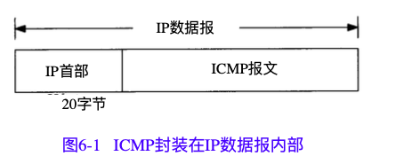
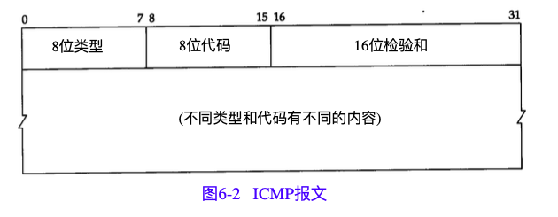

## 3.4 IGMP:Internet组管理协议

用于支持主机和路由器进行多播的IGMP。它让一个物理网络上的所有系统知道主机当前所在的多播组。多播路由器需要这些信息以便知道多播数据报应该向哪些接口转发。

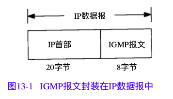
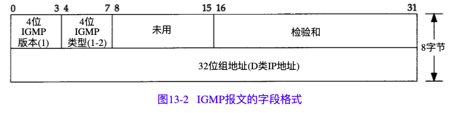

## 3.5 IP分片

物理网络层一般要限制每次发送数据帧的最大长度。任何时候IP层接收到一份要发送的IP数据报时，它要判断向本地哪个接口发送数据(选路)，并查询该接口获得其MTU。IP把MTU与数据报长度进行比较，如果需要则进行分片。**分片可以发生在原始发送端主机上，也可以发生在中间路由器上**。

把一份IP数据报分片以后，只有到达目的地才进行重新组装(这里的重新组装与其他网络协议不同，它们要求在**下一站就进行进行重新组装，而不是在最终的目的地**)。重新组装由目的端的IP层来完成，**其目的是使分片和重新组装过程对运输层(TCP和UDP)是透明的**，除了某些可能的越级操作外。已经分片过的数据报有可能会再次进行分片(可能不止一次)。IP首部中包含的数据为分片和重新组装提供了足够的信息。当IP数据报被分片后，每一片都成为一个分组，具有自己的IP首部，并在选择路由时与其他分组独立。这样，当数据报的这些片到达目的端时有可能会失序，但是在IP首部中有足够的信息让接收端能正确组装这些数据报片。

# 4 传输层UDP

## 4.1 UDP:用户数据报协议

UDP是一个简单的面向数据报的运输层协议:进程的每个输出操作都正好产生一个UDP数据报，并组装成一份待发送的IP数据报.
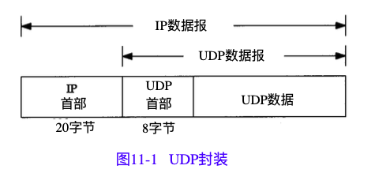
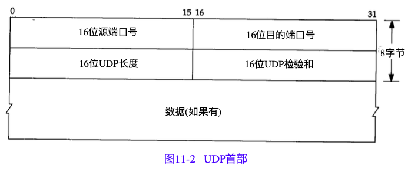

# 5 传输层TCP

尽管TCP和UDP都使用相同的网络层(IP)，TCP却向应用层提供与UDP完全不同的服务。TCP提供一种面向连接的、可靠的字节流服务。

TCP通过下列方式来提供可靠性:

* 应用数据被分割成TCP认为最适合发送的数据块。这和UDP完全不同，应用程序产生的数据报长度将保持不变。由TCP传递给IP的信息单位称为报文段或段.（确定报文段的长度）
* 当TCP发出一个段后，它启动一个定时器，等待目的端确认收到这个报文段。如果不能及时收到一个确认，将重发这个报文段。(自适应的超时及重传策略)
* 当TCP收到发自TCP连接另一端的数据，它将发送一个确认。这个确认不是立即发送，通常将推迟几分之一秒.
* TCP将保持它首部和数据的检验和。这是一个端到端的检验和，目的是检测数据在传输过程中的任何变化。如果收到段的检验和有差错，TCP将丢弃这个报文段和不确认收到此报文段(希望发端超时并重发)。
* 既然TCP报文段作为IP数据报来传输，而IP数据报的到达可能会失序，因此TCP报文段的到达也可能会失序。如果必要，TCP将对收到的数据进行重新排序，将收到的数据以正确的顺序交给应用层。
* 既然IP数据报会发生重复，TCP的接收端必须丢弃重复的数据。
* TCP还能提供流量控制。TCP连接的每一方都有固定大小的缓冲空间。TCP的接收端只允许另一端发送接收端缓冲区所能接纳的数据。这将防止较快主机致使较慢主机的缓冲区溢出。

## 5.1 TCP:传输控制协议

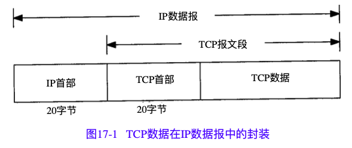
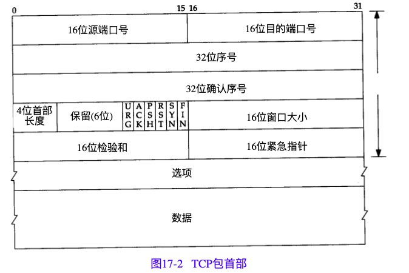

* 每个TCP段都包含源端和目的端的端口号，用于寻找发端和收端应用进程。这两个值加上IP首部中的源端IP地址和目的端IP地址唯一确定一个TCP连接。
* 序号用来标识从TCP发端向TCP收端发送的数据字节流，它表示在这个报文段中的的第一个数据字节。如果将字节流看作在两个应用程序间的单向流动，则TCP用序号对每个字节进行计数。序号是32bit的无符号数，序号到达$2^{32}-1$后又从0开始。
* 当建立一个新的连接时，SYN标志变1。序号字段包含由这个主机选择的该连接的初始序号ISN(Initial Sequence Number)。该主机要发送数据的第一个字节序号为这个ISN加1，因为SYN标志消耗了一个序号(将在下章详细介绍如何建立和终止连接，届时我们将看到FIN标志也要占用一个序号)。
* 既然每个传输的字节都被计数，确认序号包含发送确认的一端所期望收到的下一个序号。因此，确认序号应当是上次已成功收到数据字节序号加1。只有ACK标志(下面介绍)为1时确认序号字段才有效。发送ACK无需任何代价，因为32bit的确认序号字段和ACK标志一样，总是TCP首部的一部分。因此，我们看到一旦一个连接建立起来，这个字段总是被设置，ACK标志也总是被设置为1。
* TCP为应用层提供全双工服务。这意味数据能在两个方向上独立地进行传输。因此，连接的每一端必须保持每个方向上的传输数据序号。
* TCP可以表述为一个没有选择确认或否认的滑动窗口协议。我们说TCP缺少选择确认是因为TCP首部中的确认序号表示发方已成功收到字节，但还不包含确认序号所指的字节。当前还无法对数据流中选定的部分进行确认。例如，如果11024字节已经成功收到，下一报文段中包含序号从20493072的字节，收端并不能确认这个新的报文段。它所能做的就是发回一个确认序号为1025的ACK。它也无法对一个报文段进行否认。例如，如果收到包含1025~2048字节的报文段，但它的检验和错，TCP接收端所能做的就是发回一个确认序号为1025的ACK。在21.7节我们将看到重复的确认如何帮助确定分组已经丢失。
* 首部长度给出首部中32bit字的数目。需要这个值是因为任选字段的长度是可变的。这个字段占4bit，因此TCP最多有60字节的首部。然而，没有任选字段，正常的长度是20字节。
* 在TCP首部中有6个标志比特。它们中的多个可同时被设置为1。
  * URG 紧急指针(urgentpointer)有效
  * ACK	确认序号有效
  * PSH	接收方应该尽快将这个报文段交给应用层
  * RST	重建连接
  * SYN	同步序号用来发起一个连接
  * FIN 发端完成发送任务。
* TCP的流量控制由连接的每一端通过声明的窗口大小来提供。窗口大小为字节数，起始于确认序号字段指明的值，这个值是接收端正期望接收的字节。窗口大小是一个16bit字段，因而窗口大小最大为65535字节。（有新的窗口刻度选项，它允许这个值按比例变化以提供更大的窗口）。
* 检验和覆盖了整个的TCP报文段:TCP首部和TCP数据。这是一个强制性的字段，一定是由发端计算和存储，并由收端进行验证。
* 只有当URG标志置1时紧急指针才有效。紧急指针是一个正的偏移量，和序号字段中的值相加表示紧急数据最后一个字节的序号。TCP的紧急方式是发送端向另一端发送紧急数据的一种方式。
* 最常见的可选字段是最长报文大小，又称为MSS(Maximum Segment Size)。每个连接方通常都在通信的第一个报文段(为建立连接而设置SYN标志的那个段)中指明这个选项。它指明本端所能接收的最大长度的报文段。

## 5.2 TCP连接的建立与终止

一个TCP连接通常分为3个阶段..启动、数据传输(也称作“连接已建立”)和退出(关闭).

下图中的时间轴描绘了一个连接建立过程中的相关事宜。为了建立一个TCP连接, 需要完成以下步骤:

1. 主动开启者(通常称为客户端)发送一个SYN报文段(即一个在TCP头部的SYN位 字段置位的TCP/IP数据包),并指明自己想要连接的端口号和它的客户端初始序列号( 记为 IsN(c) )。通常,客户端还会借此发送一个或多个选项。客户端发送的这个SYN报文段称作段1
2. 服务器也发送自已的SYN报文段作为响应,并包含了它的初始序列号(记作 ISN(s))。该段称作段2.此外,为了确认客户端的SYN,服务器将其包含的ISN(C)数值加1 后作为返回的ACK数值。因此,每发送一个SYN,序列号就会自动加1这样如果出现丢 失的情况,该SYN段将会重传.
3. 为了确认服务器的SYN,客户端将ISN(S)的数值加1后作为返回的ACK数值。这称作段3

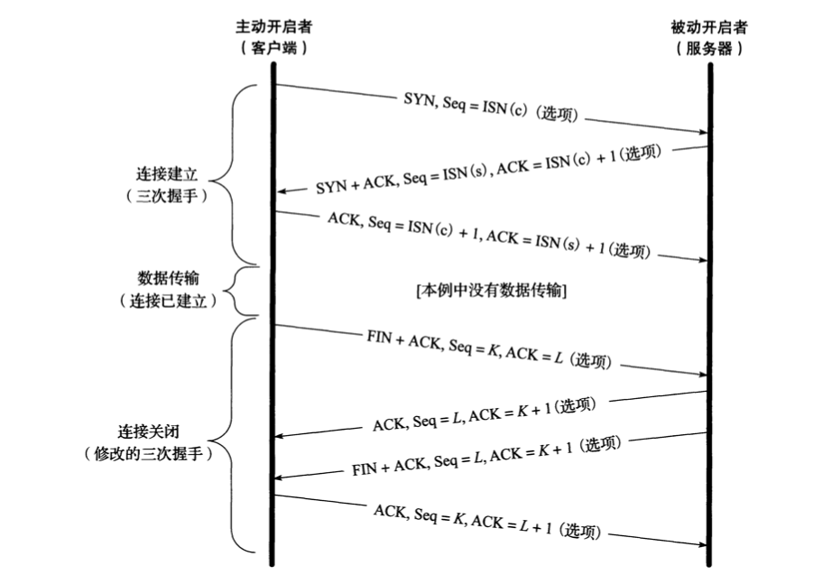

通过发送上述3个报文段就能够完成一个TCP连接的建立。它们也常称作三次握手。三次握手的目的不仅在于让通信双方了解一个连接正在建立,还在于利用数据包的选项来承载特殊的信息,交换初始序列号(Initial Sequence Number, ISN)。
