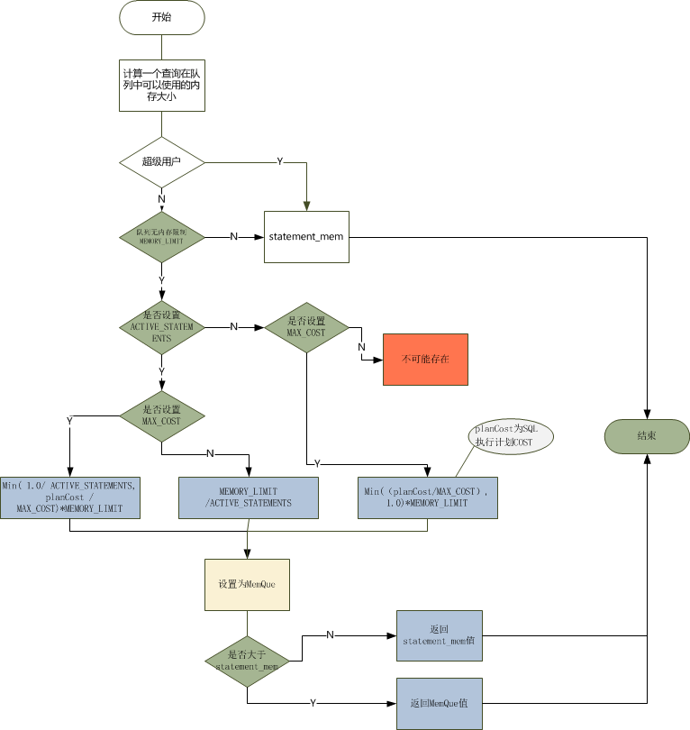
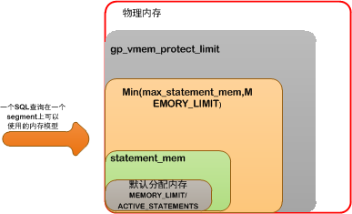

# 1 Greenplum资源队列

在Greenplum的4.x版本之后，加入了资源队列的概念，其主要作用就是限制用户或者单个SQL对资源的消耗。避免出现消耗过多资源，影响其他用户或者SQL计算。这里的资源限制主要是指系统内存资源。

**参数说明：**

* ACTIVE_STATEMENTS： 指运行同时运行的SQL数量，超过该数量的请求将会排队等待，默认为-1，表示不受限制。
* MAX_COST：该队列允许运行的单个SQL最大COST值，默认为-1，表示不受限制。。
* MIN_COST：低于该COST值的SQL直接运行，不受队列资源的限制，默认为0。
* PRIORITY： 队列中任务分配CPU资源的优先级，默认为MEDIUM。
* MEMORY_LIMIT：资源队列内存限制大小，单位为kB，MB，GB。默认为-1，表示不受限制。

**备注：**

1. 只有superuser 角色权限的用户才可以创建资源队列
2. ACTIVE_STATEMENTS 与 MAX_COST 必须二选一，不能都设置为-1。
3. 队列名不能为none，为保留标识符。

# 2 队列原理

Greenplum中的资源队列和Hadoop中资源队列实现原理和资源分配方式不太一样。在GP中，队列主要是对内存资源进行分配和限制。所有运行在队列上的SQL均分资源，不存在互相抢占的情况。

一个SQL运行时，真正能被分到的内存大小，受限的因素很多。和服务器内存，GreenPlum系统配置等有关。

## 2.1 内存参数配置

* **max_statement_mem** ： 设置每个查询最大使用的内存量，该参数是防止statement_mem参数设置的内存过大导致的内存溢出，默认为2GB。
* **statement_mem** ：设置每个查询在segment主机中可用的内存，该参数设置的值不能超过max_statement_mem设置的值，如果配置了资源队列，则不能超过资源队列设置的值MEMORY_LIMIT，默认125MB。									    推荐值计算方法：( gp_vmem_protect_limit * 0.9 ) / max_expected_concurrent_queries                                                       																						例如：gp_vmem_protect_limit 设置为 8192MB (8GB) ，查询的最大并发量为40，其中10%为缓存空间，则statement_mem计算如下：(8GB * 0.9) / 40 = 0.18GB = 184MB
* **gp_vmem_protect_limit** ：设置segment中所有的进程可用的内存，如果查询所使用的内存超过该内存值，则查询失败。该参数为本地参数，需要对所有的primary和mirror分别进行设置。默认为8192MB。

**备注：**

1. statement_mem设置必须小于max_statement_mem。否则报错。ERROR: Invalid input for statement_mem. Must be less than max_statement_mem 。
2. 理论上statement_mem也必须小于队列参数MEMORY_LIMIT。但是在创建MEMORY_LIMIT小于statement_mem默认值125MB时，也能够成功，不会出错。不过在该队列上运行SQL时，则会报错。ERROR:  deadlock detected, locking against self。

**思考：** 为啥创建队列时，不检查MEMORY_LIMIT 和statement_mem值的大小关系，而是在运行时再检查？

statement_mem是在会话中调整的变量，用于调整会话中单个sql计算在每个segment机器上可分配大小，因此不是一个固定的值，所以只好把大小检查放到任务运行时。

## 2.2 内存分配计算过程

当一个查询在资源队列上运行SQL计算任务时，将直接在每个segment分配使用固定内存，假设为X MB，即使实际使用的内存没有达到 X。

如果同时设置了statement_mem参数，为Y MB。 则SQL任务可以分配到的内存大小为MAX（X,Y）。因此会发生实际同时运行SQL还未达到ACTIVE_STATEMENTS，但是队列可用内存被耗尽的情况，当出现这种情况的时候，队列中的其他SQL查询会等待。直到由内存释放。

Greenplum为SQL计算任务分配内存大小计算过程如下图：

**内存分配要点**

1. 当只设置MAX_COST，则为Min(（planCost/MAX_COST）, 1.0)*MEMORY_LIMIT和statement_mem较大者。
2. 当只设置ACTIVE_STATEMENTS，则MEMORY_LIMIT/ACTIVE_STATEMENTS和statement_mem较大者。
3. 如果都设置，则Min( 1.0/ ACTIVE_STATEMENTS, planCost / MAX_COST)*MEMORY_LIMIT 和statement_mem较大者。
4. 没有设置MEMORY_LIMIT，则直接为statement_mem。

上图流程中，会计算出需要为该SQL任务计算出所分配的内存大小 X MB。并且会再次检查该内存大小必须小于MEMORY_LIMIT值，即statement_men也必须小于等于MEMORY_LIMIT，否则会报错。

## 2.3 内存大小模型

通过以上分析和内存分配计算过程的了解，我们可以清晰的知道各内存参数之间的关系，以及在Greenplum中起到的作用和各个参数需要配置为合适的值，避免出现内存过多或者过小的情况。

首先gp_vmem_protect_limit必须小于服务器物理内存，max_statement_mem和MEMORY_LIMIT必须小于gp_vmem_protect_limit。

其次statement_mem必须小于Min（max_statement_mem,MEMORY_LIMIT）。MEMORY_LIMIT可以大于max_statement_mem，但最好小于ACTIVE_STATEMENTS*max_statement_mem。

# 3 常见问题处理

1. 内存不足ERROR:  insufficient memory reserved for statement (execHHashagg.c:1314)  (seg0 slice6 10.0.15.16:40000 pid=13606) (cdbdisp.c:254)																	解决办法：
   * a)修改队列中MEMORY_LIMIT为更大的值。
   * b)通过SET statement_mem='xx MB'， 临时提高sql可分配的内存值。
