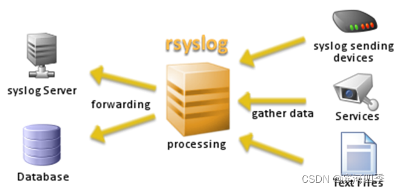
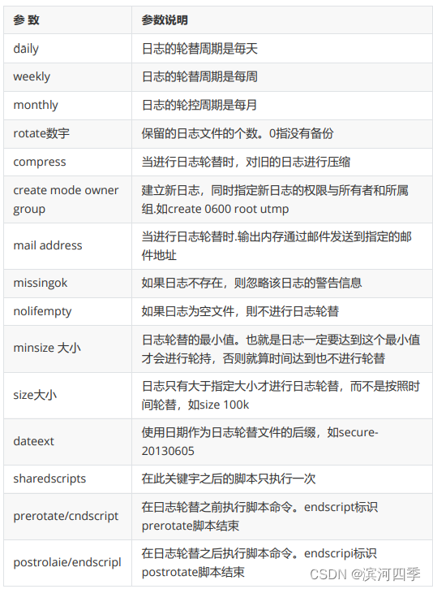
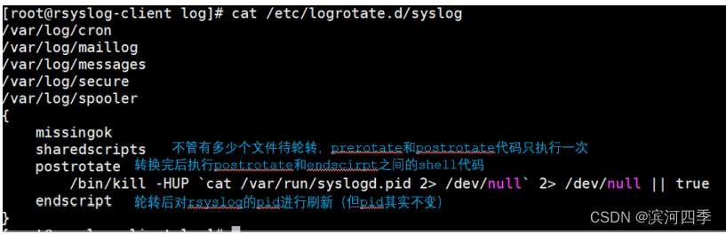

# 1 简介

**syslog**是Linux系统默认的日志守护进程。默认的主配置文件和辅助配置文件分别是/etc/syslog.conf和/etc/sysconfig/syslog文件。

    通常，syslog 接受来自系统的各种功能的信息，每个信息都包括重要级。/etc/syslog.conf 文件通知 syslogd 如何根据设备和信息重要级别来报告信息。

**rsyslog**是一个syslogd的多线程增强版。centos6以上的都是rsyslog。syslog服务器的配置文件为/etc/rsyslog.conf，

    syslog( )函数把想记录的日志信息都发送给日志服务器，但此日志最终是否记录到文件或发送给远程服务器，则是由此配置文件来决定的，该配置文件就是告诉日志服务器要记录那些类型和级别的日志，如何记录等信息。

只要是由日志服务 rsyslogd 记录的日志文件，它们的格式就都是一样的。所以我们只要了解了日志文件的格式，就可以很轻松地看懂日志文件。

日志文件的格式包含以下 4 列：

* 事件产生的时间。
* 产生事件的服务器的主机名。
* 产生事件的服务名或程序名。
* 事件的具体信息。

```shell
[root@localhost ~]# vi /var/log/secure
Jun 5 03：20：46 localhost sshd[1630]：Accepted password for root from 192.168.0.104 port 4229 ssh2
# 6月5日 03：20：46 本地主机 sshd服务产生消息：接收从192.168.0.104主机的4229端口发起的ssh连接的密码
Jun 5 03：20：46 localhost sshd[1630]：pam_unix(sshd：session)：session opened for user root by (uid=0)
#时间 本地主机 sshd服务中pam_unix模块产生消息：打开用户root的会话（UID为0）
Jun 5 03：25：04 localhost useradd[1661]：new group：name=bb，GID=501
#时间 本地主机 useradd命令产生消息：新建立bb组，GID为501
```

# 2 syslog

/etc/syslog.conf 文件按照以下格式进行配置

```c
facility.[=,!]level    action
说明 ：facility.level为选择条件，本身分为两个字段，之间用一个小数点（.）分隔。action和facility.level之间使用TAB隔开。
=和!为可选，只有点：输出大于等于某等级的日志; .=等于某等级; .!不等于某等级的所有
facility.level可以有多组,直接用分号;隔开，消息类型和日志级别也可以分别有多个，之间用逗号,隔开
```

facility 消息类型，指定 syslog 功能，主要包括：

```shell
kern     内核信息，首先通过 klogd 传递；
user     用户进程；
mail     邮件；
daemon   后台进程；
authpriv 授权信息；
syslog   系统日志；
lpr      打印信息；
news     新闻组信息；
uucp     由uucp生成的信息
cron     计划和任务信息。
mark     syslog 内部功能用于生成时间戳
local0----local7   与自定义程序使用，例如使用 local5 做为 ssh 功能
*        通配符代表除了 mark 以外的所有功能
```

level 消息级别，指定syslog优先级，主要包括：

```c
emerg 或 panic   该系统不可用（最紧急消息）
alert            需要立即被修改的条件（紧急消息）
crit             阻止某些工具或子系统功能实现的错误条件（重要消息）
err              阻止工具或某些子系统部分功能实现的错误条件（出错消息）
warning          预警信息（警告消息）
notice           具有重要性的普通条件（普通但重要的消息）
info             提供信息的消息（通知性消息）
debug            不包含函数条件或问题的其他信息（调试级-信息量最多）
none             没有重要级，通常用于排错（不记录任何日志消息）
*                所有级别，除了none
```

action 动作域

动作域支持三类：日志信息可以分别记录到多个文件里，还可以发送到命名管道、其他程序甚至另一台机器。

* file                指定文件的绝对路径
* terminal 或 print   完全的串行或并行设备标志符
* @host（@IP地址）    远程的日志服务器
* \*  所有用户,如：*.emery
* |/dev/console       通过管道发送到控制台

```c
/var/log/lastlog : 记录每个使用者最近签入系统的时间
/var/run/utmp : 记录每个使用者签入系统的时间, who, users, finger 等指令会查这个档案.
/var/log/wtmp : 记录每个使用者签入及签出的时间, last 这个指令会查这个档案. 这个档案也记录 shutdown 及 reboot 的动作.
/var/log/secure : 登录系统的信息
/var/log/maillog : 记录 sendmail 及 pop 等相关讯息.
/var/log/cron : 记录 crontab 的相关讯息 ，定时器的信息
/var/log/dmesg : /bin/dmesg 会将这个档案显示出来, 它是开机时的画面讯息.
/var/log/xferlog : 记录那些位址来 ftp 拿取那些档案.
/var/log/messages : 系统大部份的讯息皆记录在此, 包括 login, check password , failed login, ftp, su 等.
```

# 3 syslog API

Linux C中提供一套系统日记写入接口，包括三个函数：openlog，syslog和closelog。调用openlog是可选择的。如果不调用openlog，则在第一次调用syslog时，自动调用openlog。调用closelog也是可选择的，它只是关闭被用于与syslog守护进程通信的描述符。

其中openlog和closelog都是可选的。不过，通过调用openlog，我们可以指定ident参数。这样，ident将被加到每条日记记录中。ident一般设成程序的名字，如在下面例子中的"testsyslog"：

```c
#include <syslog.h>   
int main(int argc, char *argv[])   
{   
    openlog("testsyslog", LOG_CONS | LOG_PID, 0);   
    syslog(LOG_USER | LOG_INFO, "syslog test message generated in program %s \n", argv[0]);   
    closelog();   
    return 0;   
}
```

编译生成可执行文件后，每运行一次，程序将往/var/log/messages添加一条如下的记录：

```shell
Apr 23 17:15:15 lirong-920181 testsyslog[27214]: syslog test message generated in program ./a.out  
```

格式基本是：timestamp hostname ident[pid]：log message。其中ident就是我们调用openlog是指定的"testsyslog"，而之所以会打印出[27214]是openlog的option参数中指定了LOG_PID。

一般来说，我们希望能够为自己的应用程序指定特定的日记文件。这时候，我们就需要修改syslog.conf文件。假设我们现在要把调试（debug）日记记录写到文件/var/log/debug文件中。第一步要做的是，在syslog.conf文件添加如下消息规则作为第一条规则：

```c
user.debug                  /var/log/debug  
#要是添加的新规则生效，第二步我们需要重启syslogd和klogd：service syslog restart(ubuntu下为/etc/init.d/rsyslog restart)
#为了测试新规则是否生效，我们可以将testsyslog修改如下：

#include <syslog.h>   
  
int main(int argc, char *argv[])   
{   
    openlog("testsyslog", LOG_CONS | LOG_PID, 0);   
    syslog(LOG_USER | LOG_DEBUG, "syslog test message generated in program %s \n", argv[0]);   
    closelog();   
    return 0;   
}

编译生成执行文件后，每运行一次，/var/log/debug文件都会增加一条新的记录！
```

# 4 rsyslog

**日志记录位置**

* 日志文件的绝对路径。这是最常见的日志保存方法，如“/var/log/secure”就是用 来保存系统验证和授权信息日志的。
  系统设备文件。如“/dev/lp0”代表第一台打印机，如果日志保存位置是打印机设 备，当有日志时就会在打印机上打印。
* 转发给远程主机。因为可以选择使用 TCP 和 UDP 协议传输日志信息，所以有两 种发送格式：

  * 如果使用“@192.168.0.210：514”，就会把日志内容使用 UDP 协 议发送到192.168.0.210 的 UDP 514 端口上；
  * 如果使用“@@192.168.0.210： 514”，就会把日志内容使用 TCP 协议发送到 192.168.0.210 的 TCP 514 端口 上，其中 514 是日志服务默认端口。当然，只要 192.168.0.210 同意接收此日 志，就可以把日志内容保存在日志服务器上。
* 用户名。如果是“root”，就会把日志发送给 root 用户，当然 root 要在线，否则 就收不到日志信息了。发送日志给用户时，可以使用“*”代表发送给所有在线用 户，如“mail.**”就会把 mail 服务产生的所有级别的日志发送给所有在线用户。 如果需要把日志发送给多个在线用户，则用户名之间用“，”分隔。*
* *忽略或丢弃日志。如果接收日志的对象是“~”，则代表这个日志不会被记录，而 被直接丢弃。如“local3.* ~”代表忽略 local3 服务类型所有的日志都不记录。

**配置文件/etc/rsyslog.conf大概分为三个部分**

* MODULES                   定义了模块的选修,这个部分主要用来配置模板，模板的作用是指定 你希望在日志文件中保存的日志格式。
* GLOBAL DIRECTIVES 定义了全局的环境
* RULES                         这一部分是规则文件，每行配置分两个字段，第一字段是说明要记录哪类日志（包括消息类型和等级），第二字段是说明日志存放位置（action）

```shell
#查看配置文件的内容
#rsyslog v5 configuration file
# For more information see /usr/share/doc/rsyslog-
*/rsyslog_conf.html
# If you experience problems, see
http://www.rsyslog.com/doc/troubleshoot.html
*### MODULES ###
 
 
#加载模块
$ModLoad imuxsock # provides support for local system logging
(e.g. via logger command)
#加载imixsock模块，为本地系统登录提供支持
$ModLoad imklog # provides kernel logging support (previously
done by rklogd)
#加载imklog模块，为内核登录提供支持
#$ModLoad immark # provides --MARK-- message capability
#加载immark模块，提供标记信息的能力
# Provides UDP syslog reception
#$ModLoad imudp
#SUDPServerRun 514
#加载UPD模块，允许使用UDP的514端口接收采用UDP协议转发的日志
# Provides TCP syslog reception
#$ModLoad imtcp
#$InputTCPServerRun 514
#加栽TCP摸块,允许使用TCP的514编口接收采用TCP协议转发的日志
 
 
#### GLOBAL DIRECTIVES ####
#定义全局设置
#Use default timestamp format
#ActionFileDefaultTemplate RSYSLOG_TraditionalFileFormat #定义曰志的时间使用默认的时间戳格式
#File syncing capability is disabled by default. This feature is usually not required,
#not useful and an extreme performance hit
#$ActionFileEnableSync on
#文件同步功能。默认没有开启,是注释的
#Include all config files in /etc/rsyslog.d/
$IncludeConfig /etc/rsyslog.d/*.conf
#包含/etx/tsyslog.d/目录中所有的".conf"子配置文件。也就是说，这个目录中的所有子配置文件也同时生效
#### RULES ####
#日志文件保存规则
#Log all kernel messages to the console.
#Logging much else clutters up the screen.
#kern.* /dev/console
#kern服务.所有曰志级别 保存在/dev/console
#这个日志默认没有开启,如果需要，则取消注释
#Log anything (except mail) of level info or higher.
#Don't log private authentication messages!
*.info;mail.none;authpriv.none;cron.none /var/log/messages
#所有服务.info以上级到的日志保存在/var/log/messages日志文件中
#mail, authpriv、cron的日志不记录在/var/log/messages曰志文件中，因为它们部有自己的曰志文件
#所以/var/log/messages日志是最重要的系统日志文件，需要经常查看
#The authpriv file has restricted access.
authpriv.* /var/log/secure
#用户认证服务所有级别的日志保存在/vai/1og/secure日志文件中
#Log all the mail messages in one place.
mail.* -/var/log/maillog
#mail服务的所有级别的日志保存在/var/log/maillog 日志文件中
#"-"的含义是日志先在内存中保存.当曰志足够多之后.再向文件中保存
# Log cron stuff
cron.* /var/log/cron
#计対任务的所有日志保存在/var/log/cron日志文件中
# Everybody gets emergency messages
#所有日志服务的疼痛等级日志对所有在线用户广播
#Save news errors of level crit and higher in a special file.
uucp,news.crit /var/log/spooler
#uucp和news曰志服务的crit以上级别的日志保存在/var/log/sppoler曰志文件中
#Save boot messages also to boot.log
local7.* /var/log/boot.log
#loacl7 日志服务的所有日志写入/var/log/boot.log 日志文件中 #会把开机时的检测信息在显示到屏幕的同时写入/var/log/boot.log 日志文件中
# ### begin forwarding rule ###
#定义转发规到
#The statement between the begin ... end define a SINGLE
forwarding
#rule. They belong together, do NOT split them. If you create
multiple
# forwarding rules, duplicate the whole block!
# Remote Logging (we use TCP for reliable delivery)
#
# An on-disk queue is created for this action. If the remote host is
# down, messages are spooled to disk and sent when it is up again. 
#SWorkDirectory /var/lib/rsyslog # where to place spoolfiles 
#$ActionQueueFileName fwdRulel # unique name prefix for spool files
#$ActionQueueMaxDiskSpace 1g # 1gb space limit (use as much as possible)
#$ActionQueueSaveOnShutdown on # save messages to disk on shutdown
#$ActionQueueType LinkedList t run asynchronously
#$ActionResumeRetryCount -1 # infinite retries if host is down
# remote host is: name/ip:port, e.g. 192.168.0.1:514, port
optional #*•* @6remote-host:514
# ### end of the forwarding rule ##


```

**rsyslog守护进程可以被配置成两种环境:**


# 5 logrotate日志转储

日志是重要的系统文件，记录和保存了系统中所有的重要事件。但是日志文件也需要 进行定期的维护，因为日志文件是不断增长的，如果完全不进行日志维护，而任由其 随意递增，那么用不了多久，我们的硬盘就会被写满。
日志维护的最主要的工作就是把旧的日志文件删除，从而腾出空间保存新的日志文 件。这项工作如果靠管理员手工来完成，那其实是非常烦琐的，而且也容易忘记。那 么 Linux 系统是否可以自动完成日志的轮替工作呢？
logrotate 就是用来进行日志轮替（也叫日志转储）的，也就是把旧的日志文件移动 并改名，同时创建一个新的空日志文件用来记录新日志，当旧日志文件超出保存的范 围时就删除。【比如今天（20230213）生成了一个日志文件叫boot.log，明天查看时，它就会改名叫boot-20230213.log，后面跟了一个时间戳，而这天会新产生一个日志文件boot.log，依此类推】
logrotate是一个日志文件管理工具。用来把旧文件轮转、压缩、删除，并且创建新 的日志文件。我们可以根据日志文件的大小、天数等来转储，便于对日志文件管理， 一般都是通过cron计划任务来完成的 。

**/etc/logrotate.conf**

```shell
#see "man logrotate" for details
#rotate log files weekly
weekly
#每周对日志文件进行一次轮替
#keep 4 weeks worth of backlogs rotate 4
#保存4个日志文件,也就是说,如果进行了5次日志轮替，就会删除第一个备份曰志
rotate 4
#create new (empty) log files after rotating old ones create
#在日志轮替时,自动创建新的日志文件
create
#use date as a suffix of the rotated file dateext
#使用日期作为日志轮替文件的后缀
dateext
#uncomment this if you want your log files compressed #compress
#日志文件是否压缩。如果取消注释,则日志会在转储的同时进行压缩
#以上日志配置为默认配置,如果需要轮替的日志没有设定独立的参数,那么都会遵循以上参数
#如果轮替曰志配置了独立参数,那么独立参数的优先级更高
#RPM packages drop log rotation information into this directory
include /etc/logrotate.d
#包含/etc/logrotate.d/目录中所有的子配置文件。也就是说,会把这个目录中所有的子
配置文件读取进来，进行日志轮替
#no packages own wtmp and btmp -- we'11 rotate them here
#以下两个轮替曰志有自己的独立参数，如果和默认的参数冲突，则独立参数生效
/var/log/wtmp {
#以下参数仅对此目录有效
monthly
#每月对日志文件进行一次轮替
create 0664 root utmp
#建立的新日志文件,权限是0664,所有者是root,所属组是utmp组
minsize 1M
#日志文件最小轮替大小是1MB。也就是日志一定要超过1MB才会轮替，否则就算时间达到一
个月，也不进行曰志轮替
rotate 1
#仅保留一个曰志备份。也就是只保留wtmp和wtmp.1曰志)
/var/log/btmp {
#以下参数只对/var/log/btmp生效
missingok
#如果日志不存在,则忽略该日志的警告信患
monthly
create 0600 root utmp
rotate 1
}
# system-specific logs may be also be configured here.


```

在这个配置文件中，主要分为三部分：

* 第一部分是默认设置，如果需要转储的日志文件没有特殊配置，则遵循默认设置 的参数；
* 第二部分是读取 /etc/logrotate.d/ 目录中的日志轮替的子配置文件，也就是说， 在 /etc/logrotate.d/ 目录中的所有符合语法规则的子配置文件也会进行日志轮 替；
* 第三部分是对 wtmp 和 btmp 日志文件的轮替进行设定，如果此设定和默认参 数冲突，则当前设定生效（如 wtmp 的当前参数设定的轮替时间是每月，而默 认参数的轮替时间是每周，则对 wtmp 这个日志文件来说，轮替时间是每月， 当前的设定参数生效）。

logrotate 配置文件的主要参数如表 1 所示。


这些参数中较为难理解的应该是 prerotate/endscript 和 postrotate/endscript，我 们利用“man logrotate”中的例子来解释一下这两个参数。例如：

```shell
"/var/log/httpd/access.log" /var/log/httpd/error.log {
#日志轮替的是/var/log/httpd/中RPM包默认安装的apache正确访问日志和错误日志
    rotate 5
    #轮替5次
    mail www@my.org
    #把信息发送到指定邮箱
    size 100k
    #日志大于100KB时才进行日志轮替,不再按照时间轮替
    sharedscripts
    #以下脚本只执行一次
        postrotate
        #在日志轮替结束之后,执行以下脚本
            /usr/bin/killall -HUP httpd
            #重启apache 服务
        endscript
        #脚本结束
}


```

这个子配置文件，没有指定的参数都会以默认方式轮转



> 注意：-HUP 平滑重启 sharedscript（共享下列脚本） postrotate（日志轮转 完后执行以下共享脚本）kill -HUP 重读某个配置文件（重新加载）
