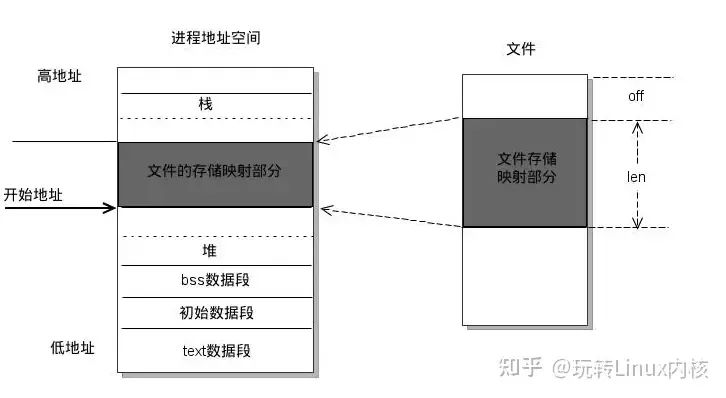
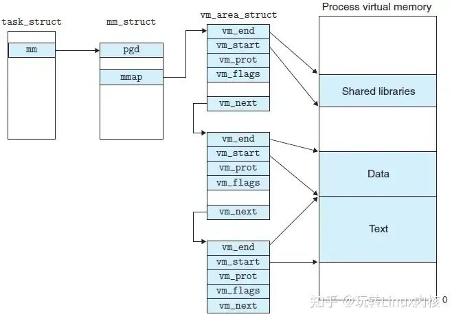
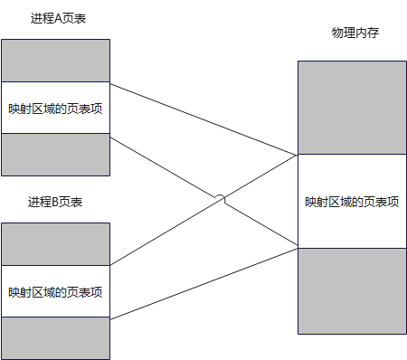
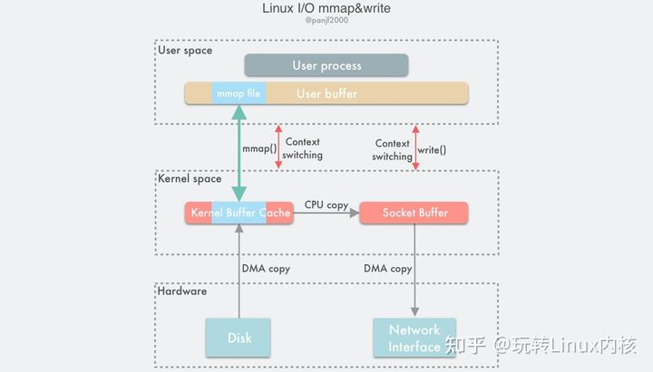
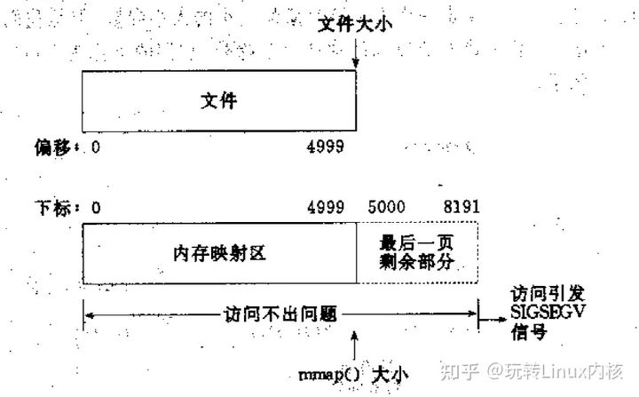
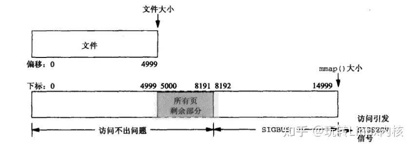
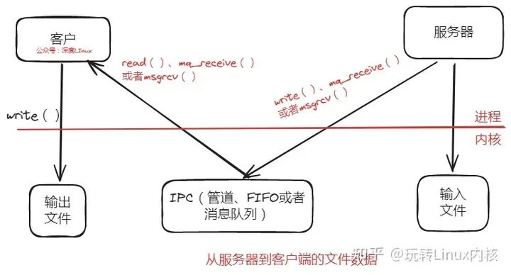
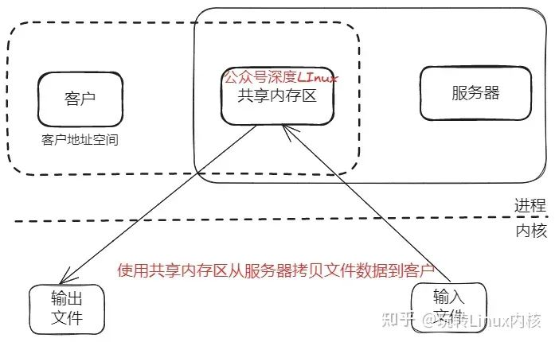

# 1 mmap基础

## 1.1 mmap基础概念

mmap是一种内存映射文件的方法，即将一个文件或者其它对象映射到进程的地址空间，实现文件磁盘地址和进程虚拟地址空间中一段虚拟地址的一一对映关系。实现这样的映射关系后，进程就可以采用指针的方式读写操作这一段内存，而系统会自动回写脏页面到对应的文件磁盘上，即完成了对文件的操作而不必再调用read,write等系统调用函数。相反，内核空间对这段区域的修改也直接反映用户空间，从而可以实现不同进程间的文件共享。

mmap() 用于申请一段内存空间，将一个文件或Posix共享内存区对象映射到进程的地址空间；munmap() 释放由mmap创建的这段内存空间。二者是实现存储映射的关键。
注意：用mmap时，open()不可省，read()/write()可省。

根据内存背后有无实体文件与之关联，映射可以分为两种：

* 文件映射：内存映射区域有实体文件与之关联。mmap系统调用将普通文件的一部分内容直接映射到进程的虚拟地址空间。一旦完成映射，就可以通过在相应的内存区域中操作字节来访问文件内容。这种映射也称为基于文件的映射。
* 匿名映射：匿名映射没有对应的文件。这种映射的内存区域会被初始化成0。

**使用mmap内存映射文件的示意图：**



由上图可以看出，进程的虚拟地址空间，由多个虚拟内存区域构成。虚拟内存区域是进程的虚拟地址空间中的一个同质区间，即具有同样特性的连续地址范围。上图中所示的text数据段（代码段）、初始数据段、BSS数据段、堆、栈和内存映射，都是一个独立的虚拟内存区域。可以看到，调用mmap，会申请一段内存空间（文件的内存映射部分），并且这段内存会自动映射到指定的文件内存映射部分。返回的是这段内存的起始地址，对应文件的内存映射部分offset处。

而为内存映射服务的地址空间处在堆栈之间的空余部分。linux内核使用vm_area_struct结构来表示一个独立的虚拟内存区域，由于每个不同质的虚拟内存区域功能和内部机制都不同，因此一个进程使用多个vm_area_struct结构来分别表示不同类型的虚拟内存区域。各个vm_area_struct结构使用链表或者树形结构链接，方便进程快速访问，如下图所示：


vm_area_struct结构中包含区域起始和终止地址以及其他相关信息，同时也包含一个vm_ops指针，其内部可引出所有针对这个区域可以使用的系统调用函数。这样，进程对某一虚拟内存区域的任何操作需要用要的信息，都可以从vm_area_struct中获得。mmap函数就是要创建一个新的vm_area_struct结构，并将其与文件的物理磁盘地址相连。

进程通过dma操作内存，而dma与文件/设备的物理地址相连，系统自动回写脏页面到对应的文件磁盘上（或写入到设备地址空间），实现内存映射文件。

**一个进程映射的内存可以与其他进程中的映射共享物理内存。所谓共享是指各个进程的页表条目指向RAM中的相同分页。**

两个进程内存共享映射：


这种进程间的内存映射的共享，通常发生在两种情况；
1）通过fork，子进程继承父进程通过mmap映射的副本；
2）多个进程通过mmap映射同一个文件的同一个区域；

**这种共享映射有什么用？**

我们知道，在Linux中，进程地址空间是相互隔离的，一个进程不能直接操作另一个进程的虚拟地址空间中的内存。而mmap给出2种解决方案：前面的1）和2）。

在1）中，通过fork子进程继承父进程mmap的副本。对于malloc出来的内存，栈变量，父子进程存在写时复制现象，也就是说是两份内存。而对于mmap创建的共享内存，可以做到进程间共享同一个共享映射。

* 私有映射（MAP_PRIVATE） 映射内容上发生的变更对其他进程不可见，也就是说堆映射内容的改变是私有的。对文件映射，变更不会同步到底层文件。内核用写时复制技术完成这个任务。
* 共享映射（MAP_SHARED） 在映射内容上发生的所有变更，对所有共享同一个映射的其他进程都可见。对文件映射，变更会同步到底层文件。共享映射用于进程间通信。

内存映射根据有无文件关联，分成文件与匿名；根据映射是否在进程间共享，分成私有和共享。两两组合，有4种情形内存映射：

| 变更可见范围 | 文件                       | 匿名           |
| ------------ | -------------------------- | -------------- |
| 共享         | 内存映射IO，进程间共享内存 | 进程间共享内存 |
| 私有         | 根据文件内存初始化内存     | 内存分配       |

**mmap 具有如下的特点：**

1. mmap 向应用程序提供的内存访问接口是内存地址连续的，但是对应的磁盘文件的 block 可以不是地址连续的；
2. mmap 提供的内存空间是虚拟空间（虚拟内存），而不是物理空间（物理内存），因此完全可以分配远大于物理内存大小的虚拟空间（如16G内存主机分配1000G的mmap内存空间）；
3. mmap 负责映射文件逻辑上一段连续的数据（物理上可以不连续存储）映射为连续内存，而这里的文件可以是磁盘文件、驱动假造出的文件（例如 DMA 技术）以及设备；
4. mmap 由操作系统负责管理，对同一个文件地址的映射将被所有线程共享，操作系统确保线程安全以及线程可见性；
5. mmap 的设计很有启发性。基于磁盘的读写单位是 block（一般大小为 4KB），而基于内存的读写单位是地址（虽然内存的管理与分配单位是 4KB）。

换言之，CPU 进行一次磁盘读写操作涉及的数据量至少是 4KB，但是进行一次内存操作涉及的数据量是基于地址的，也就是通常的 64bit（64 位操作系统）。

mmap 下进程可以采用指针的方式进行读写操作，这是值得注意的。

## 1.2 mmap内存映射原理

**内存映射文件的原理：**

首先创建虚拟区间并完成地址映射，此时还没有将任何文件数据拷贝至主存。当进程发起读写操作时，会访问虚拟地址空间，通过查询页表，发现这段地址不在物理页上，因为只建立了地址映射，真正的数据还没有拷贝到内存，因此引发缺页异常。缺页异常经过一系列判断，确定无非法操作后，内核发起请求调页过程。

最终会调用nopage函数把所缺的页从文件在磁盘里的地址拷贝到物理内存。之后进程便可以对这片主存进行读写，如果写操作修改了内容，一定时间后系统会自动回写脏页面到对应的磁盘地址，完成了写入到文件的过程。另外，也可以调用msync()来强制同步，这样所写的内存就能立刻保存到文件中。

**mmap内存映射的实现过程，总的来说可以分为三个阶段：**

**（一）进程启动映射过程，并在虚拟地址空间中为映射创建虚拟映射区域**

* 进程在用户空间调用库函数mmap，原型：void *mmap(void *start, size_t length, int prot, int flags, int fd, off_t offset);
* 在当前进程的虚拟地址空间中，寻找一段空闲的满足要求的连续的虚拟地址
* 为此虚拟区分配一个vm_area_struct结构，接着对这个结构的各个域进行了初始化
* 将新建的虚拟区结构（vm_area_struct）插入进程的虚拟地址区域链表或树中

**（二）调用内核空间的系统调用函数mmap（不同于用户空间函数），实现文件物理地址和进程虚拟地址的一一映射关系**

* 为映射分配了新的虚拟地址区域后，通过待映射的文件指针，在文件描述符表中找到对应的文件描述符，通过文件描述符，链接到内核“已打开文件集”中该文件的文件结构体（struct file），每个文件结构体维护着和这个已打开文件相关各项信息。
* 通过该文件的文件结构体，链接到file_operations模块，调用内核函数mmap，其原型为：int mmap(struct file *filp, struct vm_area_struct *vma)，不同于用户空间库函数。
* 内核mmap函数通过虚拟文件系统inode模块定位到文件磁盘物理地址。
* 通过remap_pfn_range函数建立页表，即实现了文件地址和虚拟地址区域的映射关系。此时，这片虚拟地址并没有任何数据关联到主存中。

**（三）进程发起对这片映射空间的访问，引发缺页异常，实现文件内容到物理内存（主存）的拷贝**

注：前两个阶段仅在于创建虚拟区间并完成地址映射，但是并没有将任何文件数据的拷贝至主存。真正的文件读取是当进程发起读或写操作时。

* 进程的读或写操作访问虚拟地址空间这一段映射地址，通过查询页表，发现这一段地址并不在物理页面上。因为目前只建立了地址映射，真正的硬盘数据还没有拷贝到内存中，因此引发缺页异常。
* 缺页异常进行一系列判断，确定无非法操作后，内核发起请求调页过程。
* 调页过程先在交换缓存空间（swap cache）中寻找需要访问的内存页，如果没有则调用nopage函数把所缺的页从磁盘装入到主存中。
* 之后进程即可对这片主存进行读或者写的操作，如果写操作改变了其内容，一定时间后系统会自动回写脏页面到对应磁盘地址，也即完成了写入到文件的过程。

注：修改过的脏页面并不会立即更新回文件中，而是有一段时间的延迟，可以调用msync()来强制同步, 这样所写的内容就能立即保存到文件里了。

## 1.3 mmap和常规文件操作与 Direct IO 的不同

我们首先简单的回顾一下常规文件系统操作（调用read/fread等类函数）中，函数的调用过程：

1. 进程发起读文件请求。
2. 内核通过查找进程文件符表，定位到内核已打开文件集上的文件信息，从而找到此文件的inode。
3. inode在address_space上查找要请求的文件页是否已经缓存在页缓存中。如果存在，则直接返回这片文件页的内容。
4. 如果不存在，则通过inode定位到文件磁盘地址，将数据从磁盘复制到页缓存。之后再次发起读页面过程，进而将页缓存中的数据发给用户进程。

常规文件操作需要从磁盘到页缓存(处于内核空间，不能被用户进程直接寻址)，再到用户主存的**两次数据拷贝**。

而使用mmap操作文件中，创建新的虚拟内存区域和建立文件磁盘地址和虚拟内存区域映射这两步，没有任何文件拷贝操作。而之后访问数据时发现内存中并无数据而发起的缺页异常过程，可以通过已经建立好的映射关系，只使用**一次数据拷贝**，就从磁盘中将数据传入内存的用户空间中，供进程使用。

内存映射和 Direct IO 都是用来提高文件读写性能的技术，但它们之间有一些不同。

首先，内存映射是将文件映射到进程的地址空间中，而 Direct IO 是直接使用文件描述符进行读写操作。因此，内存映射可以充分利用[虚拟内存系统]()的优势，而 Direct IO 则可以避免缓存的影响。

其次，内存映射可以实现文件的共享访问，而 Direct IO 则不行。这是因为 Direct IO 会绕过文件系统缓存，而文件系统缓存是用来实现文件共享访问的。

最后在内存映射中，修改过的数据会被缓存在内存中，并不会立即写回到磁盘中。如果需要将数据写回到磁盘中，可以使用 msync() 函数或者 munmap() 函数来实现。而 Direct IO 是可以直接将数据写入磁盘的

总结来说，常规文件操作为了提高读写效率和保护磁盘，使用了页缓存机制。这样造成读文件时需要先将文件页从磁盘拷贝到页缓存中，由于页缓存处在内核空间，不能被用户进程直接寻址，所以还需要将页缓存中数据页再次拷贝到内存对应的用户空间中。这样，通过了两次数据拷贝过程，才能完成进程对文件内容的获取任务。写操作也是一样，待写入的buffer在内核空间不能直接访问，必须要先拷贝至内核空间对应的主存，再写回磁盘中（延迟写回），也是需要两次数据拷贝。

总而言之，常规文件操作需要从磁盘到页缓存再到用户主存的两次数据拷贝。而mmap操控文件，只需要从磁盘到用户主存的一次数据拷贝过程。说白了，mmap的关键点是实现了用户空间和内核空间的数据直接交互而省去了空间不同数据不通的繁琐过程。因此mmap效率更高。

## 1.4 mmap和munmap函数

```c
#include <sys/mman.h>
void *mmap(void *start, size_t length, int prot, int flags, int fd, off_t offset)
/*
*start：指定映射的起始地址。如果为 NULL，则由操作系统自动选择一个地址。
length：指定映射的长度。
prot：指定映射区域的保护方式。可以是以下几种值的组合：
    PROT_READ： 可读。
    PROT_WRITE：可写。
    PROT_EXEC： 可执行。
    PROT_NONE： 内存段不能被访问。
flags：指定映射区域的标志。可以是以下几种值的组合：
    MAP_SHARED：   进程间共享这段内存，对该内存段的修改将反映到被映射的文件中。提供了进程间共享内存的POSIX方法
    MAP_PRIVATE：  内存段为调用进程所私有。对该内存段的修改不会反映到被映射的文件中。
    MAP_FIXED：    内存段必须位于start参数指定的地址处。start必须是内存页面大小（4096byte）的整数倍。如果指定了这个标志，则 addr 参数必须为非 NULL。
    MAP_ANONYMOUS：这段内存不是从文件映射而来的。其内容被初始化为全0。这种情况下，mmap函数的最后2个参数将被忽略。
fd：指定要映射的文件描述符。
offset：指定要映射的文件的偏移量。
*/

int munmap(void *addr, size_t length);
/*
参数start所指的映射内存起始地址，参数length则是欲取消的内存大小。当进程结束或利用exec相关函数来执行其他程序时，映射内存会自动解除，但关闭对应的文件描述符时不会解除映射。
*/
返回值
mmap成功返回指向目标内存区域的指针；失败，返回MAP_FAILED ((void*)-1)，并设置errno。
munmap成功返回0；失败返回-1，并设置errno

int msync( void *addr, size_t len, int flags );
/*
一般说来，进程在映射空间的对共享内容的改变并不直接写回到磁盘文件中，往往在调用munmap（）后才执行该操作。可以通过调用msync()实现磁盘上文件内容与共享内存区的内容一致。
*/
```

## 1.5 mmap与页大小

mmap系统调用的操作单元是页，参数addr和offset必须按页对齐，即页面大小整数倍。Linux下，页大小是4096byte，可以通过getconf命令获取：

```shell
$ getconf PAGESIZE
4096
```

也可以通过以下C代码获取

```c
long pageSize = sysconf(_SC_PAGESIZE);
```

## 1.6 四种映射

### 1.6.1 共享文件映射

1）打开文件，获取文件描述符fd，通过open完成。
2）将文件描述符作为fd参数，传给mmap。

伪代码：

```c
fd = open(...);
addr = mmap(..., MAP_SHARED, fd, ...);
close(fd); /* 可选 */
```

open打开文件时设置的权限（如读写权限O_RDWR/O_RDONLY/O_WRONLY）必须要和mmap系统调用所需权限相匹配。

具体来说，

* 打开时，必须允许读取，即O_RDONLY和O_RDWR至少指定一个；
* mmap调用时，如果prot参数中指定了PROT_WRITE，并且flags中指定了MAP_SHARED，那么打开时，必须指定O_RDWR。

注意：
1）open时，不是所有文件都支持mmap，如管道文件。
2）mmap完成后，关闭fd并不会释放内存映射对应空间，需要专门调用munmap。

如果要将修改同步到底层文件，可以对fd调用fsync或fdatasync。

由于文件是有长度的，所以正常情况下，offset和length参数应该遵循一定限制：offset < 文件长度，且offset + length < 文件长度。而mmap是不检查offset、size定义的区域是否在文件的范围内的。

### 1.6.2 私有文件映射

调用mmap时，将flags设置为MAP_PRIVATE，映射就是私有映射。常见情况是加载动态共享库，多个进程共享相同的文本段。

为了防止恶意程序篡改内存上的保护信息后再篡改程序或共享库的文本，通常会直接使用私有文件映射而不是共享文件映射。

### 1.6.3 共享匿名映射

和文件映射相对应的是匿名映射，该映射没有文件与之对应。创建匿名映射2种方法：

* 调用mmap时，在flags中指定MAP_ANONYMOUS，且将参数fd指定为-1。
* 打开/dev/zero 设备文件，并将得到的文件描述符fd传递给mmap。

不论哪种方式，得到的内存映射中字节都会被初始化为0。

调用mmap创建匿名映射时，指定了MAP_SHARED就是共享匿名映射。共享匿名映射的作用是让相关（亲缘）进程共享一块内存区域。

示例：父进程创建一个共享匿名映射，然后fork创建子进程。这样父子进程就可以通过这块内存区域通信。

```c
addr = mmap(NULL, length, PROT_READ | PROT_WRITE, MAP_SHARED | MAP_ANOUNYMOUS, -1, 0);
if (addr == MAP_SHARED) {
    /* error handle */
}
child_pid = fork();
```

### 1.6.4 私有匿名映射

调用mmap创建匿名映射时，指定了MAP_PRIVATE，那么创建出来的就是私有匿名映射。典型用途是分配进程所需内存。私有匿名映射也没有文件与之关联，对内存操作私有，不影响其他进程。
该用途典型例子是glibc的malloc实现。当要分配的内存 > MMAP_THREASHOLD字节时，glibc的malloc使用mmap来实现。通常，该阈值是128KB，可通过mallopt()调整。

```c
char* p = malloc(128*1024);
```

strace跟踪程序执行，可以看到调用mmap系统调用：

```c
mmap(NULL, 135168, PROT_READ|PROT_WRITE, MAP_PRIVATE|MAP_ANONYMOUS, -1, 0) = 0x7f2a29f0c000
```

## 1.7 mmap 的 I/O 模型

mmap 也是一种零拷贝技术，其 I/O 模型如下图所示：


**mmap 技术有如下特点：**

1. 利用 DMA 技术来取代 CPU 来在内存与其他组件之间的数据拷贝，例如从磁盘到内存，从内存到网卡；
2. 用户空间的 mmap file 使用虚拟内存，实际上并不占据物理内存，只有在内核空间的 kernel buffer cache 才占据实际的物理内存；
3. mmap() 函数需要配合 write() 系统调动进行配合操作，这与 sendfile() 函数有所不同，后者一次性代替了 read() 以及 write()；因此 mmap 也至少需要 4 次上下文切换；
4. mmap 仅仅能够避免内核空间到用户空间的全程 CPU 负责的数据拷贝，但是内核空间内部还是需要全程 CPU 负责的数据拷贝；

**利用 mmap() 替换 read()，配合 write() 调用的整个流程如下：**

1. 用户进程调用 mmap()，从用户态陷入内核态，将内核缓冲区映射到用户缓存区；
2. DMA 控制器将数据从硬盘拷贝到内核缓冲区（可见其使用了 Page Cache 机制）；
3. mmap() 返回，上下文从内核态切换回用户态；
4. 用户进程调用 write()，尝试把文件数据写到内核里的套接字缓冲区，再次陷入内核态；
5. CPU 将内核缓冲区中的数据拷贝到的套接字缓冲区；
6. DMA 控制器将数据从套接字缓冲区拷贝到网卡完成数据传输；
7. write() 返回，上下文从内核态切换回用户态。

**通过mmap实现的零拷贝I/O进行了4次用户空间与内核空间的上下文切换，以及3次数据拷贝；其中3次数据拷贝中包括了2次DMA拷贝和1次CPU拷贝**

## 1.8 mmap 的优势

**1.简化用户进程编程**

在用户空间看来，通过 mmap 机制以后，磁盘上的文件仿佛直接就在内存中，把访问磁盘文件简化为按地址访问内存。这样一来，应用程序自然不需要使用文件系统的 write（写入）、read（读取）、fsync（同步）等系统调用，因为现在只要面向内存的虚拟空间进行开发。

但是，这并不意味着我们不再需要进行这些系统调用，而是说这些系统调用由操作系统在 mmap 机制的内部封装好了。

**（1）基于缺页异常的懒加载**

出于节约物理内存以及 mmap 方法快速返回的目的，mmap 映射采用懒加载机制。具体来说，通过 mmap 申请 1000G 内存可能仅仅占用了 100MB 的虚拟内存空间，甚至没有分配实际的物理内存空间。当你访问相关内存地址时，才会进行真正的 write、read 等系统调用。CPU 会通过陷入缺页异常的方式来将磁盘上的数据加载到物理内存中，此时才会发生真正的物理内存分配。

**（2）数据一致性由 OS 确保**

当发生数据修改时，内存出现脏页，与磁盘文件出现不一致。mmap 机制下由操作系统自动完成内存数据落盘（脏页回刷），用户进程通常并不需要手动管理数据落盘。

**读写效率提高：避免内核空间到用户空间的数据拷贝**

简而言之，mmap 被认为快的原因是因为建立了页到用户进程的虚地址空间映射，以读取文件为例，避免了页从内核空间拷贝到用户空间。

**3.避免只读操作时的 swap 操作**

虚拟内存带来了种种好处，但是一个最大的问题在于所有进程的虚拟内存大小总和可能大于物理内存总大小，因此当操作系统物理内存不够用时，就会把一部分内存 swap 到磁盘上。

在 mmap 下，如果虚拟空间没有发生写操作，那么由于通过 mmap 操作得到的内存数据完全可以通过再次调用 mmap 操作映射文件得到。但是，通过其他方式分配的内存，在没有发生写操作的情况下，操作系统并不知道如何简单地从现有文件中（除非其重新执行一遍应用程序，但是代价很大）恢复内存数据，因此必须将内存 swap 到磁盘上。

**4.节约内存**

由于用户空间与内核空间实际上共用同一份数据，因此在大文件场景下在实际物理内存占用上有优势。

**4. mmap 不是银弹**

mmap 不是银弹，这意味着 mmap 也有其缺陷，在相关场景下的性能存在缺陷：

1. 由于 MMAP 使用时必须实现指定好内存映射的大小，因此 mmap 并不适合变长文件；
2. 如果更新文件的操作很多，mmap 避免两态拷贝的优势就被摊还，最终还是落在了大量的脏页回写及由此引发的随机 I/O 上，所以在随机写很多的情况下，mmap 方式在效率上不一定会比带缓冲区的一般写快；
3. 读/写小文件（例如 16K 以下的文件），mmap 与通过 read 系统调用相比有着更高的开销与延迟；同时 mmap 的刷盘由系统全权控制，但是在小数据量的情况下由应用本身手动控制更好；
4. mmap 受限于操作系统内存大小：例如在 32-bits 的操作系统上，虚拟内存总大小也就 2GB，但由于 mmap 必须要在内存中找到一块连续的地址块，此时你就无法对 4GB 大小的文件完全进行 mmap，在这种情况下你必须分多块分别进行 mmap，但是此时地址内存地址已经不再连续，使用 mmap 的意义大打折扣，而且引入了额外的复杂性；

**5. mmap 的适用场景**

mmap 的适用场景实际上非常受限，在如下场合下可以选择使用 mmap 机制：

1. 多个线程以只读的方式同时访问一个文件，这是因为 mmap 机制下多线程共享了同一物理内存空间，因此节约了内存；
2. mmap 非常适合用于进程间通信，这是因为对同一文件对应的 mmap 分配的物理内存天然多线程共享，并可以依赖于操作系统的同步原语；
3. mmap 虽然比 sendfile 等机制多了一次 CPU 全程参与的内存拷贝，但是用户空间与内核空间并不需要数据拷贝，因此在正确使用情况下并不比 sendfile 效率差；

**6.mmap使用细节**

1. 使用mmap需要注意的一个关键点是，mmap映射区域大小必须是物理页大小(page_size)的整倍数（32位系统中通常是4k字节）。原因是，内存的最小粒度是页，而进程虚拟地址空间和内存的映射也是以页为单位。为了匹配内存的操作，mmap从磁盘到虚拟地址空间的映射也必须是页。
2. 内核可以跟踪被内存映射的底层对象（文件）的大小，进程可以合法的访问在当前文件大小以内又在内存映射区以内的那些字节。也就是说，如果文件的大小一直在扩张，只要在映射区域范围内的数据，进程都可以合法得到，这和映射建立时文件的大小无关。
3. 映射建立之后，即使文件关闭，映射依然存在。因为映射的是磁盘的地址，不是文件本身，和文件句柄无关。同时可用于进程间通信的有效地址空间不完全受限于被映射文件的大小，因为是按页映射。

在上面的知识前提下，我们下面看看如果大小不是页的整倍数的具体情况：

**情形一：一个文件的大小是5000字节，mmap函数从一个文件的起始位置开始，映射5000字节到虚拟内存中。**

分析：因为单位物理页面的大小是4096字节，虽然被映射的文件只有5000字节，但是对应到进程虚拟地址区域的大小需要满足整页大小，因此mmap函数执行后，实际映射到虚拟内存区域8192个 字节，5000~8191的字节部分用零填充。映射后的对应关系如下图所示：


此时：
（1）读/写前5000个字节（0~4999），会返回操作文件内容。
（2）读字节5000\~8191时，结果全为0。写5000\~8191时，进程不会报错，但是所写的内容不会写入原文件中 。
（3）读/写8192以外的磁盘部分，会返回一个SIGSECV错误。

**情形二：一个文件的大小是5000字节，mmap函数从一个文件的起始位置开始，映射15000字节到虚拟内存中，即映射大小超过了原始文件的大小。**

分析：由于文件的大小是5000字节，和情形一一样，其对应的两个物理页。那么这两个物理页都是合法可以读写的，只是超出5000的部分不会体现在原文件中。由于程序要求映射15000字节，而文件只占两个物理页，因此8192字节~15000字节都不能读写，操作时会返回异常。如下图所示：



此时：
（1）进程可以正常读/写被映射的前5000字节(0\~4999)，写操作的改动会在一定时间后反映在原文件中。
（2）对于5000\~8191字节，进程可以进行读写过程，不会报错。但是内容在写入前均为0，另外，写入后不会反映在文件中。
（3）对于8192\~14999字节，进程不能对其进行读写，会报SIGBUS错误。
（4）对于15000以外的字节，进程不能对其读写，会引发SIGSEGV错误。

**情形三：一个文件初始大小为0，使用mmap操作映射了10004K的大小，即1000个物理页大约4M字节空间，mmap返回指针ptr。**

分析：如果在映射建立之初，就对文件进行读写操作，由于文件大小为0，并没有合法的物理页对应，如同情形二一样，会返回SIGBUS错误。但是如果，每次操作ptr读写前，先增加文件的大小，那么ptr在文件大小内部的操作就是合法的。例如，文件扩充4096字节，ptr就能操作ptr ~ [ (char)ptr + 4095]的空间。只要文件扩充的范围在1000个物理页（映射范围）内，ptr都可以对应操作相同的大小。这样，方便随时扩充文件空间，随时写入文件，不造成空间浪费。

# 2 共享内存

共享内存就是容许两个不相关的进程访问同一个逻辑内存。共享内存是在两个正在运行的进程之间共享和传递数据的一种很是有效的方式。不一样进程之间共享的内存一般安排为同一段物理内存。进程能够将同一段共享内存链接到它们本身的地址空间中，全部进程均可以访问共享内存中的地址，就好像它们是由用[C语言函数]()malloc分配的内存同样。而若是某个进程向共享内存写入数据，所作的改动将当即影响到能够访问同一段共享内存的任何其余进程。

共享内存区是最快的IPC形式。一旦这样的内存映射到共享它的进程的地址空间，这些进程间数据传递不再涉及到内核，换句话说是进程不再通过执行进入内核的系统调用来传递彼此的数据。

**用管道或者消息队列传递数据：**


**用共享内存传递数据：**


共享内存有两种方式，即 shm（shared memory） 和 mmap 方式。前者直接共享物理内存，后者通过一个中间文件间接共享内存。

### 2.1内存映射和共享内存的区别

1. mmap保存到实际硬盘，实际存储并没有反映到主存上。优点：储存量可以很大（多于主存）；缺点：进程间读取和写入速度要比主存的要慢。——每个进程地址空间中开辟出一块空间进行映射
2. shm保存到物理存储器（主存），实际的储存量直接反映到主存上。优点，进程间访问速度（读写）比磁盘要快；缺点，储存量不能非常大（多于主存）——每个进程最终会映射到同一块物理内存
3. mmap系统调用并不是完全为了用于共享内存而设计的。它本身提供了不同于一般对普通文件的访问方式，进程可以像读写内存一样对普通文件的操作。而[Posix]()或系统V的共享内存IPC则纯粹用于共享目的，当然mmap()实现共享内存也是其主要应用之一。

## 2.2 mmap内存共享映射

下面这段程序用来帮助理解mmap的内存占用情况：

```c
#include<unistd.h>
#include<stdlib.h>
#include<stdio.h>
#include<errno.h>
#include<fcntl.h>
#include<string.h>
#include<sys/file.h>
#include<sys/wait.h>
#include<sys/mman.h>

#define COUNT 100
#define MEMSIZE 1024*1024*20

int main()
{
    pid_t pid;
    int count;
    void *shm_p;

    shm_p = mmap(NULL, MEMSIZE, PROT_WRITE|PROT_READ, MAP_SHARED|MAP_ANONYMOUS, -1, 0);
    if(MAP_FAILED == shm_p) {
        perror("mmap()");
        exit(1);
    }

    bzero(shm_p, MEMSIZE);

    sleep(3000);

    munmap(shm_p, MEMSIZE);
    exit(0);
}
```

```shell
[postgres@localhost clang]$ free -m
              total        used        free      shared  buff/cache   available
Mem:            234          91          24           4         119         130
Swap:          1535           0        1535
[postgres@localhost clang]$ ./a.out &
[1] 5164
[postgres@localhost clang]$ free -m
              total        used        free      shared  buff/cache   available
Mem:            234          91           4          24         139         110
Swap:          1535           0        1535
[postgres@localhost clang]$
```

可以看出，这段内存被记录到shared和buff/cache中了。mmap有一个缺点，那就是共享的内存只能在父进程和fork产生的子进程间使用，除此之外的其它进程无法得到共享内存段的地址。
