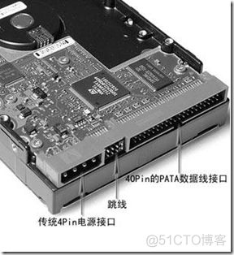
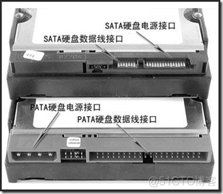
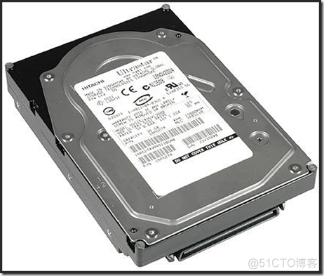
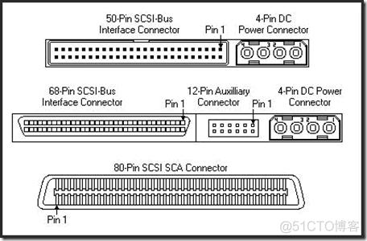

# **1 ATA （Advanced Technology Attachment）& IDE**

ATA硬盘是传统的桌面级硬盘，通常也被称为**IDE(Integrated DriveElectronics)硬盘  (意是指把控制器与盘体集成在一起的硬盘驱动器)**

采用传统40-Pin并口数据线连接主板与硬盘，外部接口速度最大为133Mbit/s，由于并口数据线的抗干扰能力差且排线占空间，不利计算机散热，ATA组件被串口ATA所取代。

特点:

一般使用16-bit数据总线, 每次总线处理时传送2个字节。PATA(Paralle ATA接口协议) 接口一般是100Mbytes/sec带宽。

# **2 SATA（Serial Advanced Technology Attachment）**

SATA(Serial ATA)口的硬盘又叫串口硬盘. SATA以它串行的数据发送方式得名,也就是使用串口的ATA接口，因抗干扰性强，且传输线比ATA的细得多，支持热插拔等功能，已被广为接受。

SATA-Ⅰ的外部接口速度已达到150MB/s，SATA-Ⅱ达到300Mbit/s，SATA-Ⅲ将达到600Mbit/s

在数据传输的过程中，数据线和信号线独立使用，并且传输的时钟频率保持独立，因此同以往的PATA相比，SATA的传输速率可以达到并行的30倍。

可以说:SATA技术并不是简单意义上的PATA技术的改进，而是一种全新的总线架构。

# 3 SCSI(Small Computer System Interface)

它出现的原因主要是因为原来的IDE接口的硬盘转速太慢，传输速率太低，因此高速的SCSI硬盘出现。

其实SCSI并不是专为硬盘设计的，实际上它是一种总线型接口。独立于系统总线工作.

这种接口的硬盘大多用于服务器等高端应用场合。SCSI硬盘支持高转速（如，15000BRM），且数据传输时占用较少的CPU资源。SCSI硬盘的单价比ATA/SATA硬盘贵。

# 4 SAS(Serial Attached SCSI)

即串行连接SCSI，是新一代的SCSI技术。其传输速度，可达到12Gbit/s。

和现在流行的SATA硬盘相同，都是采用串行技术以获得更高的传输速度，并通过缩短连结线改善内部空间等。

SAS是并行SCSI接口之后开发出的全新接口。此接口的设计是为了改善存储系统的效能、可用性和扩充性，并且提供与SATA硬盘的兼容性。

SAS的接口技术可以向下兼容SATA。具体来说，二者的兼容性主要体现在物理层和协议层的兼容。

# 5 FC(Fibre Channel)

光纤通道的英文拼写是Fibre Channel，和SCIS接口一样光纤通道最初也不是为硬盘设计开发的接口技术，是专⻔为网络系统设计的，但随着存储系统对速度的需求，才逐渐应用到硬盘系统中。

光纤通道硬盘是为提高多硬盘存储系统的速度和灵活性才开发的，它的出现大大提高了多硬盘系统的通信速度。它以点对点(或是交换)的配置方式在系统之间采用了光缆连接。

 即, 硬盘本身是不具备FC接口的, 插硬盘的机柜上带有FC接口, 通过光纤与光纤交换机互联.

# 6 SSD(Solid State Disk或Solid State Drive)

固态硬盘(Solid State Disk或Solid State Drive)，也称作电子硬盘或者固态电子盘，是由控制单元和固态存储单元(DRAM或FLASH芯片)组成的硬盘。

固态硬盘的接口规范和定义、功能及使用方法上与普通硬盘的相同，在产品外形和尺寸上也与普通硬盘一致。

由于固态硬盘没有普通硬盘的旋转介质，因而抗震性极佳。其芯片的工作温度范围很宽(-40~85°C)
