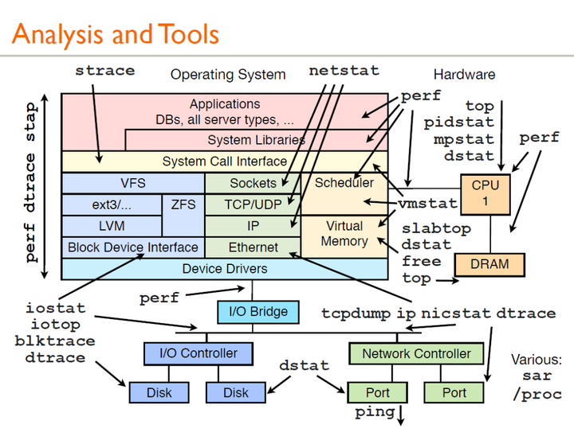
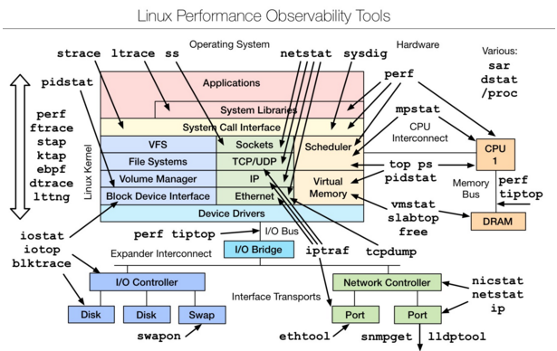
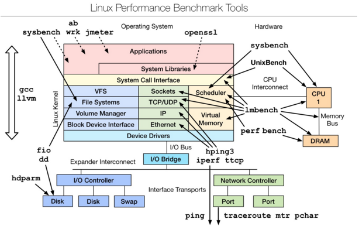
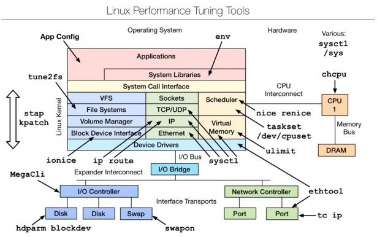
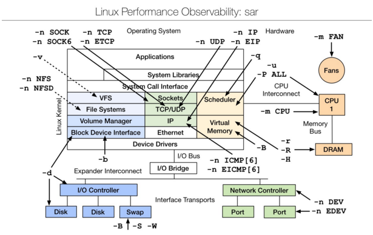

### Linux observability tools |Linux 性能观测工具


### Linux benchmarking tools | Linux 性能测评工具


### Linux tuning tools | Linux 性能调优工具


### Linux observability sar | linux性能观测工具


# vmstat

```she
[postgres@localhost ~]$ vmstat 1 5
procs -----------memory---------- ---swap-- -----io---- -system-- ------cpu-----
 r  b   swpd   free   buff  cache   si   so    bi    bo   in   cs us sy id wa st
 1  0      0 306916   2108  92060    0    0   282    26   85  178  0  0 99  0  0
 0  0      0 306904   2108  92068    0    0     0    45   58   83  0  0 100  0  0
 0  0      0 306904   2108  92068    0    0     0     0   75  107  0  0 100  0  0
 0  0      0 306904   2108  92068    0    0     0     0   65  109  0  0 100  0  0
 0  0      0 306904   2108  92068    0    0     0     0   79  107  0  1 99  0  0
```

| col1   | col2                                                             |
| ------ | ---------------------------------------------------------------- |
| procs  | r: 运行队列中进程数量                                            |
|        | b： 等待IO的进程数量                                             |
| memory | swpd: 使用虚拟内存大小                                          |
|        | free: 可用内存大小                                               |
|        | buff: 用作缓冲的内存大小                                         |
|        | cache: 用作缓存的内存大小                                        |
| swap   | si: 每秒从交换区写到内存的大小                                   |
|        | so: 每秒写入交换区的内存大小                                     |
| io     | bi: 每秒读取的块数                                               |
|        | bo: 每秒写入的块数                                               |
| system | in: 每秒中断数，包括时钟中断。【interrupt】                      |
|        | cs: 每秒上下文切换数。 【count/second】                          |
| cpu    | us: 用户进程执行时间(user time)                                  |
|        | sy: 系统进程执行时间(system time)                                |
|        | id: 空闲时间(包括IO等待时间),中央处理器的空闲时间 。以百分比表示 |
|        | wa: 等待IO时间                                                   |
