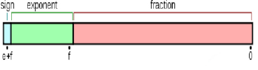
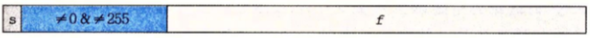
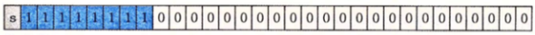
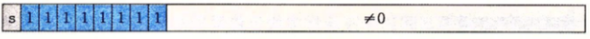
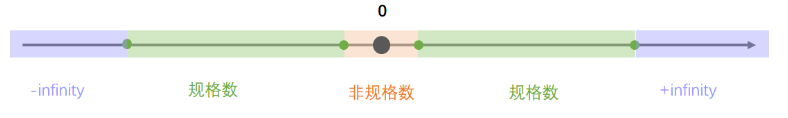

# IEEE二进制浮点数算术标准

IEEE二进制浮点数算术标准（IEEE 754）是20世纪80年代以来最广泛使用的浮点数运算标准，为许多CPU与浮点运算器所采用。这个标准定义了表示浮点数的格式（包括负零-0）与反常值（denormal number）），一些特殊数值（无穷（Inf）与非数值（NaN）），以及这些数值的“浮点数运算符”；它也指明了四种数值舍入规则和五种例外状况（包括例外发生的时机与处理方式）。

IEEE 754规定了四种表示浮点数值的方式：单精确度（32位）、双精确度（64位）、延伸单精确度（43比特以上，很少使用）与延伸双精确度（79比特以上，通常以80位实现）。只有32位模式有强制要求，其他都是选择性的。大部分编程语言都有提供IEEE浮点数格式与算术，但有些将其列为非必需的。例如，IEEE 754问世之前就有的C语言，有包括IEEE算术，但不算作强制要求（C语言的float通常是指IEEE单精确度，而double是指双精确度）。

该标准的全称为IEEE二进制浮点数算术标准（ANSI/IEEE Std 754-1985），又称IEC 60559:1989，微处理器系统的二进制浮点数算术（本来的编号是IEC 559:1989）。后来还有“与基数无关的浮点数”的“IEEE 854-1987标准”，有规定基数为2跟10的状况。最新标准是“ISO/IEC/IEEE FDIS 60559:2010”。

# 浮点数剖析

**一个浮点数 (Value) 的表示其实可以这样表示：**

$\mathrm{Value=sign*exponent*fraction} $

**浮点数的**实际值，等于**符号位**（sign bit）乘以**指数偏移值**(exponent bias)再乘以**分数值**(fraction)。

# 整体呈现

**指数偏差**

指数偏差（表示法中的指数为实际指数减掉某个值）为 ，其中的e为存储指数的比特的长度。减掉一个值因为指数必须是有号数才能表达很大或很小的数值，但是**有符号数**通常的表示法——补码（two's complement），将会使比较变得困难。为了解决这个问题，指数在存储之前需要做偏差修正，将它的值调整到一个**无符号数**的范围内以便进行比较。此外，指数采用这种方法表示的优点还在于使得浮点数的正规形式和非正规形式之间有了一个平滑的转变。

**指数偏移值**

**指数偏移值（exponent bias）**，是指浮点数表示法中的指数域的编码值为指数的实际值加上某个固定的值，IEEE 754标准规定该固定值为 $2^{e-1}-1$，其中的e为存储指数的比特的长度。

以单精度浮点数为例，它的指数域是8个比特，固定偏移值是 。此为有号数的表示方式，单精度浮点数的指数部分实际取值是从-127到+128。例如指数实际值为 17，在单精度浮点数中的指数域编码值为 144，即144=17+127 。

采用指数的实际值加上固定的偏移值的办法表示浮点数的指数，好处是可以用长度为 个比特的无符号整数来表示所有的指数取值，这使得两个浮点数的指数大小的比较更为容易，实际上可以按照字典序比较两个浮点表示的大小。

这种移码表示的指数部分，中文称作**阶码**。

# 规格数、非规格数与特殊数

根据阶码E区分，IEEE754规范规定了三种状态：

## normal number(规格数)

特点是：**阶码E不为0和且不为全1**

以float32为例，其形式为：

其值的大小为：

$V=(-1)^S\times(1.M)\times 2^{E-bias}$

对于float16（bias = 15），float32（bias = 127），float64（bias = 1023）。

**规格数不能表示0和非常靠近0的数**。

例如：对于一个float32：-3.456 该怎么表示呢？

符号位：为-1，所以s=1，3.456=(1 + 0.728 ) * 2，所以 M = 0.728  E = 1 + 127 = 128

使用工具验算[IEEE-754 Floating Point Converter (h-schmidt.net)](https://www.h-schmidt.net/FloatConverter/IEEE754.html)

## subnormal number(非规格数)

特点是：**阶码E=0, 表示0以及0附近的值**

其值的大小为（ **注意，标准规定非规格数指数为1-bias** ），无论尾数M为多少，都是一个比较接近0的值：

$V=(-1)^S\times(0.M)\times 2^{1-bias}$

同样的：对于float16（bias = 15），float32（bias = 127），float64（bias = 1023）。

## non-number(特殊数)

特点是：**阶码E为全1，包括正负Inf，非数值NAN）**

无穷大Inf：

非数值 NAN（Not A Number）：

**这几种状态在数轴上的分布如下：**

# 浮点数表示范围与精度

| col1    | 范围                                                      | 精度                        |
| ------- | --------------------------------------------------------- | --------------------------- |
| float16 | （-2 * 2^15, 2 * 2^15） 也即：（-65536，65536）           | 1/(2^10) 即 3-4位有效数字   |
| float32 | （-2 * 2^127, 2 * 2^127）也即：（-3.4e+38, 3.4e+38)       | 1/(2^23) 即 6~7位有效数字   |
| float64 | （-2 * 2^1023, 2 * 2^1023）也即：（-1.79e+308, 1.79e+308) | 1/(2^52) 即 15~16位有效数字 |
