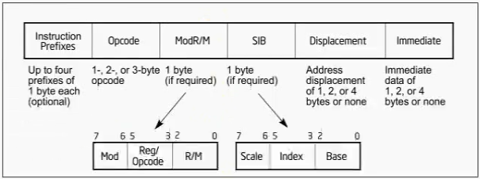
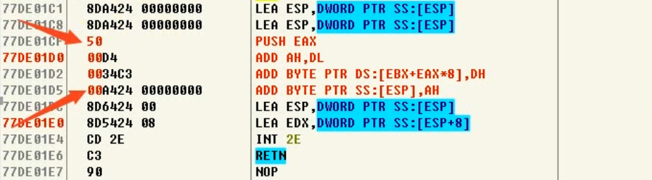
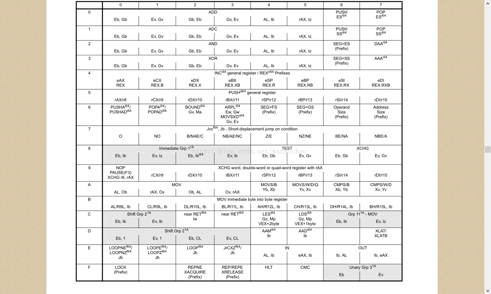
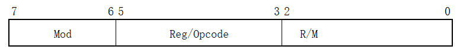
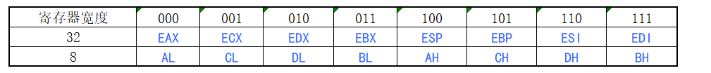
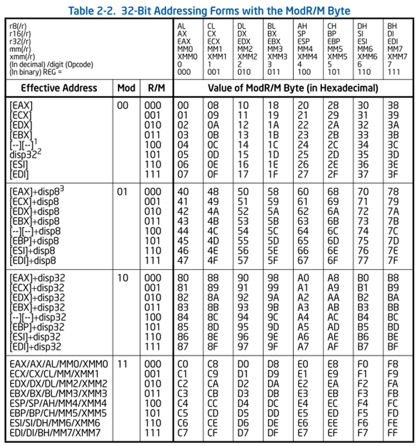
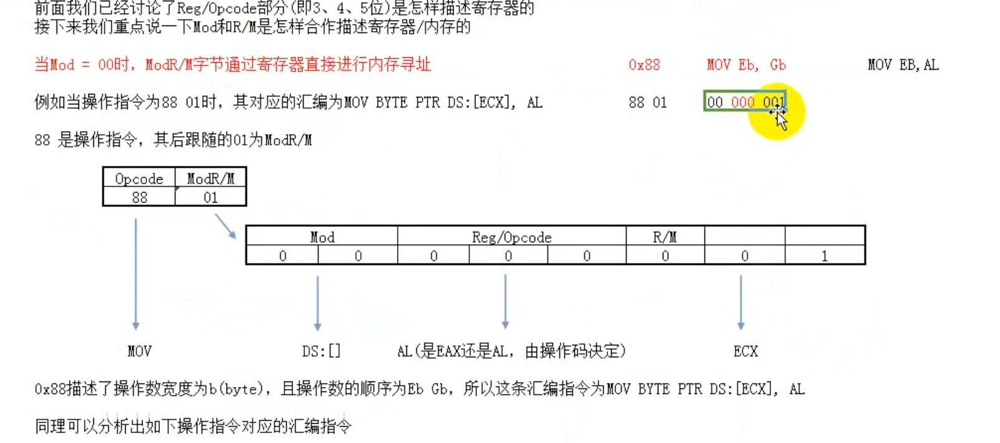
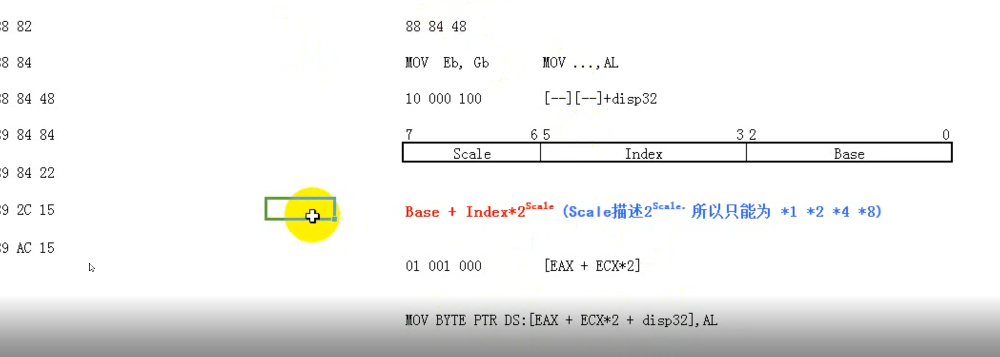
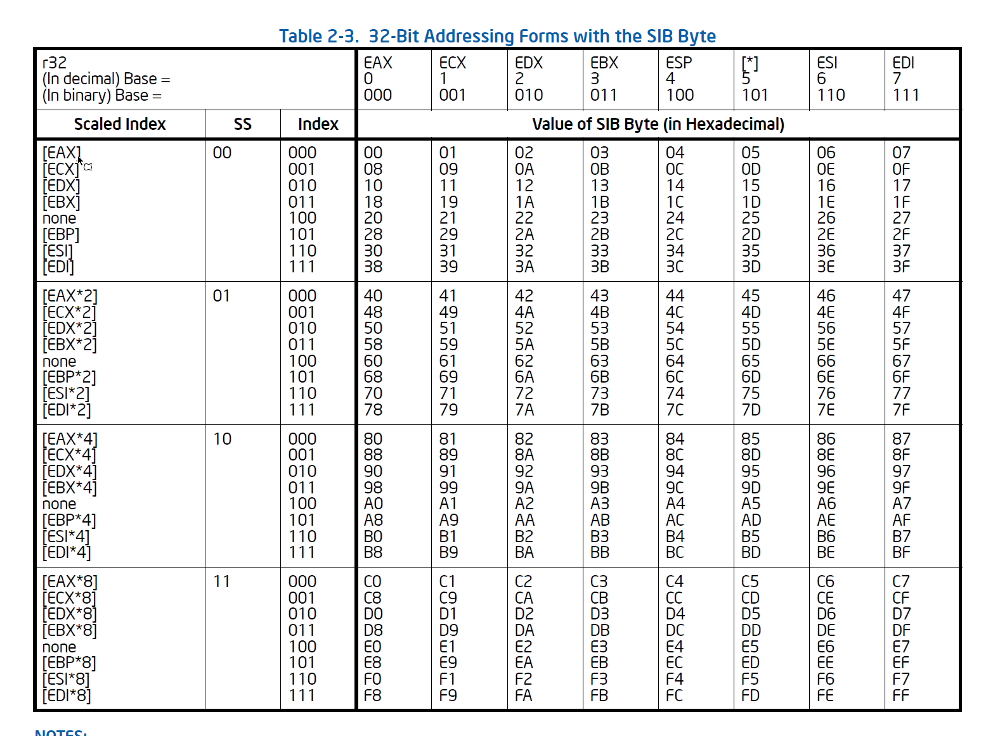

# 1 指令编码(硬编码)的结构

Up to four prefixes of 1 byte each optional：最多有四个前缀指令，每组最多一个字节

## 1.1 前阶知识

1. **定长指令:只要Opcode的值确定了，他的长度就不会再变化了**
2. **Opcode是一条指令中最重要的组成部分(必须要存在，且最少一个字节，最多三个字节)**
3. **决定当前指令的长度:Opcode、ModR/M、SIB**
4. **Opcode->决定有没有->ModR/M->决定有没有->SIB**

## 1.2 定长还是变长

确定了Opcode的就是定长指令(例如:50)，仅仅通过Opcode是无法确定长度的就是变长指令(例如:00D4)(如下图 )

# 2 前缀指令

**前缀指令的分组**

LOCK和REPEAT前缀指令

1. LOCK F0
   `(锁地址总线)如果再汇编指令中加上 LOCK ，当前这个地址，在多个CPU执行的时，某个时刻只能有一个核CPU能读这个地址(在多核下才有意义)`
2. REPNE/REPNZ F2
   `重复执行后面的某一个指令(ZF标志位为0时执行)`
3. REP/REPZ F3
   `重复执行后面的某一个指令(ZF标志位为0时执行)`

段前缀指令(明确告诉CPU使用哪个段，ESP/EBP默认使用SS段寄存器，默认全局地址使用DS段寄存器)

1. CS(2E)（CS寄存器中有个db位决定着CPU是32(为1)位状态还是16(为0)位状态）
2. SS(36)
3. DS(3E)
4. ES(26)
5. FS(64)
6. GS(65)

操作数宽度前缀指令

1. 66
   `改变操作数的默认宽度32(EBP)->16(BP),反之一样`

地址宽度前缀指令

1. 67
   `改变寻址方式(32位与16位的寻址方式不同)`
   `32位:MOV DWORD PTR SS:[EBP-18],ESP`
   `16位:MOV DWORD PTR DS:[DI+FFE8],ESP `

**总结**

**前缀指令没有顺序要求，直接在最前面添加需要的指令即可，最少0个最多四个，每组最多使用一个，同时，原本是32位寻址，加上67就是16位寻址，反之亦然，66也是如此**

# 3 Opcode

opcode Map 作用是详细列出各个汇编指令格式与opcode的对应关系如图

给你一个操作码 02 代表"ADD Gb,Eb"

给你一个操作码03 代表“ADD Gv,Ev”

这里的Gb的大些“G"代表的是操作数的类型，例如 G代表REG

这里的Gb第小写“b”代表的是此操作数的 大小，例如b代表Byte

**常见操作数类型描述：**

| 简写 | 描述            | 寻址方式                          |
| ---- | --------------- | --------------------------------- |
| E    | 操作数是REG/MEM | 由ModRM的R/M提供寻址              |
| G    | 操作数是REG     | 由ModRM的REG提供寻址              |
| I    | 操作数是IMM     | 立即数体现在OPCode中              |
| M    | 操作数是MEM     | 由ModRM的R/M提供寻址，且MOD！=11b |

**常见操作数大小描述**

| 简写 | 描述                     | 简写 | 描述                            |
| ---- | ------------------------ | ---- | ------------------------------- |
| a    | word或Dword,依赖指令前缀 | q    | Qword四字，64位                 |
| b    | byte字节，8位            | dq   | Double Qword八字，128位        |
| w    | word字，16位             | v    | word或Dword或Qword,依赖指令前缀 |
| d    | Dword双字，32位          |      | 任意一个                        |

类似于Eb，Gb(有E或者G的)都属于变长的，因为根据帮助文档可知，带有E,G的在Opcode后面都带有ModR/M,带有ModR/M指令一定是变长的

# 4  ModR/M

不是所有的指令都是,看到opcode就知道有多长(定长指令)，当指令中出现内存操作对象的时候，就需要在操作码后面附加一个字节来进行补充说明，这个字节被称为**ModR/M**。

该字节的8个位被分成了三部分：

其中，Reg/Opcode(第3、4、5位，共3个字节)描述指令中的G部分，即寄存器

Mod(第6、7位)和R/M(第0、1、2位)共同描述指令中的E部分，即寄存器/内存

# 5 SIB

如果查表得出这样的格式[--][--]+disp8，

那么说明光靠Table 2-2确定不了，还要往后跟一个字节，SIB

解释：

1. [--][--]：表示使用SIB结构。
2. disp32：表示32位偏移。
3. [--][--]+disp8：表示使用SIB结构，且SIB结构后面有一个8位的偏移。
4. [--][--]+disp32：表示使用SIB结构，且SIB结构后面有一个32位的偏移。

