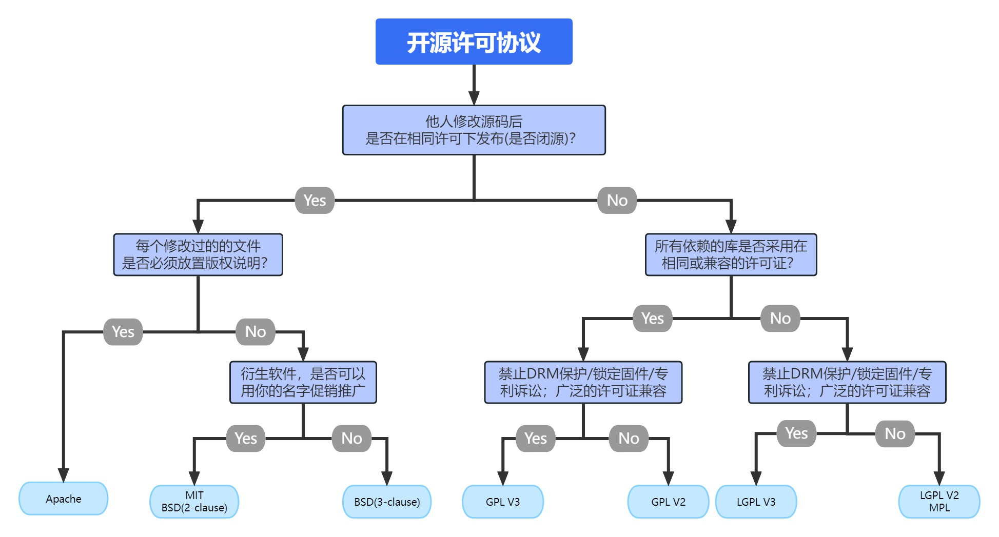

常见两类开源

开源协议上百种。常见的开源许可协议主要有 Apache、MIT、BSD、GPL、LGPL、MPL等，可以大致分为两大类：宽松型开源许可协议和传染型开源许可协议。

# 1、宽松型

其中宽松型开源许可协议有Apache、MIT、BSD；

协议说明

1、BSD（二条款版）分发软件时，必须保留原始的许可证声明。

2、BSD（三条款版）分发软件时，必须保留原始的许可证声明。不得使用原始作者的名字为软件促销。

3、MIT 分发软件时，必须保留原始的许可证声明，与 BSD（二条款版）基本一致。

4、Apache 2 分发软件时，必须保留原始的许可证声明。凡是修改过的文件，必须向用户说明该文件修改过；没有修改过的文件，必须保持许可证不变。

基本特点:

1、没有使用限制。用户可以使用代码，做任何想做的事情。

2、没有担保。不保证代码质量，用户自担风险。

3、披露要求（notice requirement）用户必须披露原始作者。

# 2、传染型

传染型开源许可协议有GPL 、LGPL、MPL。

协议说明

1、Affero GPL (AGPL) 如果云服务（即 SAAS）用到的代码是该许可证，那么云服务的代码也必须开源。

2、GPL 如果项目包含了 GPL 许可证的代码，那么整个项目都必须使用 GPL 许可证。

3、LGPL 如果项目采用动态链接调用该许可证的库，项目可以不用开源。

4、Mozilla（MPL） 只要该许可证的代码在单独的文件中，新增的其他文件可以不用开源。

区别：

1、GPL 开源授权协议的库开发的软件，也必须要开源；GPL允许用户使用、修改和分发软件，只要他们提供访问源代码权限和他们所做的任何更改。 但是 GPL 并不要求仅通过网络与软件交互的用户共享其源代码。

2、AGPL 是 GPL 的扩展，包括对与软件交互的用户的附加要求 通过网络软件。 这些用户还必须共享他们的源代码和他们对软件所做的任何更改。这意味着如果您使用 AGPL 许可的程序并在您的服务器上运行它并通过网络将其提供给其他人，您还必须 这些用户可用的源代码。 这在 GPL 下不是必需的。简而言之，AGPL 是比 GPL 更严格的许可，因为它要求用户在通过网络使用软件时共享他们的源代码。

3、基于 LGPL 开源协议的库开发的软件，视是否只是调用来看，如果只是连接、调用，则可以封闭源代码，否则也必须要开源。

# 3、其他类型

此外如：SSPL等，还有存在目前无法分类的情况：

SSPL

MongoDB 再2018 年 10 月 16 日创建的一个新许可证SSPL。这个是官方修改开源协议（从 AGPL 到 SSPL，基于修改协议前的最后一个稳定版本4.0.3），存在较大争议，开放源代码促进会 OSI 甚至认为 SSPL 就不是开源许可协议。

cc

还有一类是 Creative Commons(CC)知识共享协议。严格意义上说该协议并不能说是真正的开源协议, 它们大多是被使用于设计类、在线文档、博客文章的工程上。CC 协议种类繁多, 每一种都授权特定的权利。

主要包含：

作者可声明得权益

* 署名（Attribution，简写为by）：必须提到原作者;
* 非商业用途（Noncommercial，简写为nc）：不得用于盈利性目的;
* 禁止演绎（No Derivative Works，简写为nd）：不得修改原作品;
* 相同方式共享（Share Alike，简写为sa）：如果允许修改原作品，那么必须使用相同的许可证发布;

使用者可获得权益

* 复制作品；
* 散发作品；
* 公开展示或表演作品；
* 将作品完全一致地转化成另一种格式。

# 4、开源协议选择

1) 如果您想为GPL世界添砖加瓦，或者项目引用了GPL许可证的模块，那么当然得使用GPL许可证；
2) 如果您想分享自己的编程心得，不想让许可证限制了知识的传播，这时可使用MIT许可证；
3) 如果您想更强的控制源代码，或者考虑商业化，那么推荐Apache许可证。
4) 如果是文章文档类一般选择cc协议

MIT是约束最少的, GPL是约束最多的; 如果是个人随意作品，建议MIT许可; 如果是公司或者需要严格保护，建议 GPL。

https://choosealicense.rustwiki.org/ 这个网站可以指导开发者选择一个适合的协议

开源合规

1、主要是开发者、企业在使用、修改、分发、商业化等方面了解各个软件的开源协议。

2、避免开源软件不同开源协议带来的法律风险、公关危机与安全隐患等问题。

3、了解开源风险的典型案例，对开源风险的防控措施能提前准备。
