# 概述


统计信息，在 PostgreSQL 其实可以细分为两类，一类是数据分布的统计信息，另一类是数据库运行过程中的运行状态统计数据。前者关于数据分布状况的统计数据存在于 pg_statistic 系统表中，

不过由于其人为不易阅读，因此我们往往看的是 pg_stats 视图。

```shell
postgres=# \d pg_stats;
                     View "pg_catalog.pg_stats"
         Column         |   Type   | Collation | Nullable | Default
------------------------+----------+-----------+----------+---------
 schemaname             | name     |           |          |
 tablename              | name     |           |          |
 attname                | name     |           |          |
 inherited              | boolean  |           |          |
 null_frac              | real     |           |          |
 avg_width              | integer  |           |          |
 n_distinct             | real     |           |          |
 most_common_vals       | anyarray |           |          |
 most_common_freqs      | real[]   |           |          |
 histogram_bounds       | anyarray |           |          |
 correlation            | real     |           |          |
 most_common_elems      | anyarray |           |          |
 most_common_elem_freqs | real[]   |           |          |
 elem_count_histogram   | real[]   |           |          |
```

每一个字段的内容不再赘述，此处让我们聚焦于 **MCV (most_common_vals，高频值)**、**MCF (most_common_freqs，高频值相应出现的频率)** 和 **histogram_bounds**。那么为何 PostgreSQL 会如此实现？

或者说，直方图有什么用？为什么需要直方图？PostgreSQL 中的直方图相较于其他类别的直方图有何优势？

# 直方图的作用

说白了，直方图就是一种使数据库了解数据分布状态的一种机制，以更好地优化路径选择。我在 PPT 中大概列举了以下几点：

1. How many rows match the condition? (selectivity estimation)
2. How many rows is produced by the join? (selectivity estimation)
3. How much memory will be needed for the aggregate?
4. estimating the cardinality important for several reasons
5. choosing join type and join ordering (nested loop, hash join)
6. choosing table access method (sequential scan, index scan)
7. deciding whether to materialise or not

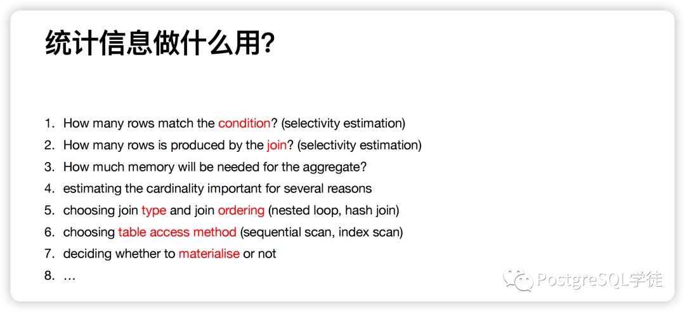
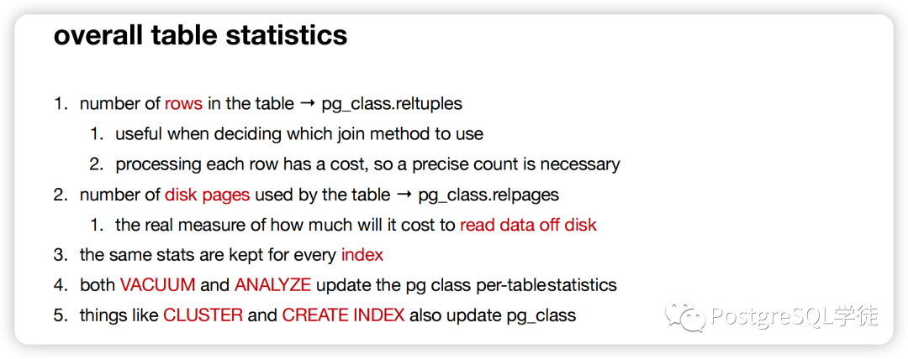

比如用于评估表中满足过滤条件的行数有多少，确认满足过滤条件的选择率是多少，然后进一步确认扫描表的方式，如果是多表关联的话则用于确认表 JOIN 的方式。按照常识，假如优化器预估满足 WHERE 条件的行数很少，

选择率很低，那么优化器会倾向于走索引扫描；反之则更倾向于走顺序扫描。

直⽅图的基本原理是将数据排序后分成若⼲个桶 (bucket)，并记录每个桶中数据的最⼤值、最⼩值、出现频次等信息。假设现在有个查询：select * from test where col1 between a and b
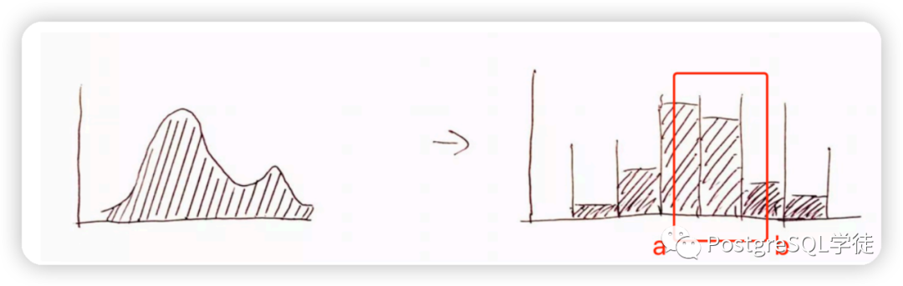

数据库便会根据直方图和具体的算法，估算出满足 col1 between A and B 的行数有多少。
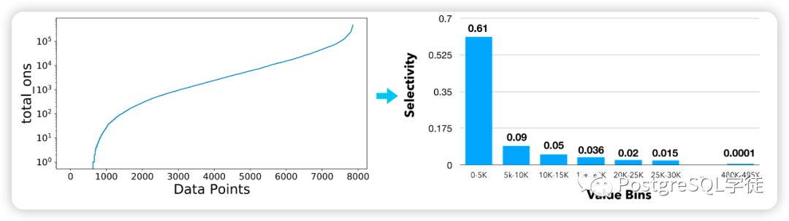

假设现在有这么一个字段：Data Points，X 轴代表 Data Points 值的分布情况，Y 轴则表示对应的出现频次。

# 等宽直方图

等宽直方图，顾名思义，等宽直方图将数据最大、小值之间的区间等分为 N 份，每个桶中最大、小值之差都为整体数据最大、小值之差/N，即所谓的"等宽"。以下是一个样例


那么，等宽直方图有什么好处？又有何缺点？其优点不言而喻，收集十分简单，并且易于理解。先看个最为简单的例子：要预估 total_ons <= 5000 的行数，优化器会怎么评估满足条件的行数？
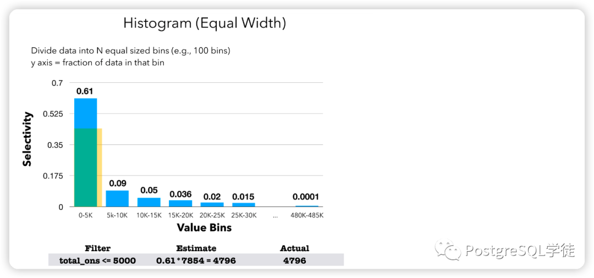

很简单，这个条件优化器发现正好落在了第一个 bucket 里面，那就很方便，取出其选择率 0.61，乘以总行数就是预估的行数。

当然实际情况并不会这么简单，再看看下面这个例子：要预估 total_ons <= 7500 的行数，优化器又会如何预估？
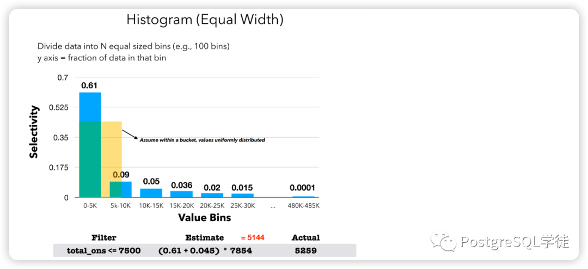

可以看到这个条件正好完整覆盖了第一个桶，并且一半落在了第二个桶中，那么优化器的预估方式是第一个桶的选择率 (完整覆盖)：0.61，

加上第二个桶的一半数量 (因为第二个桶的数据分布状况是 5000~10000)，0.09 / 2 = 0.045，

因此预估的总行数就是 (0.61+ 0.045) * total_nums。到这里其实各位应该就可以猜到可能会出现的问题了—— **优化器假设数据是均匀分布的！** 因此简单的将选择率除以了 2，得出了 0.045。

但是等宽直方图的最大劣势就是无法很好反应值的频次
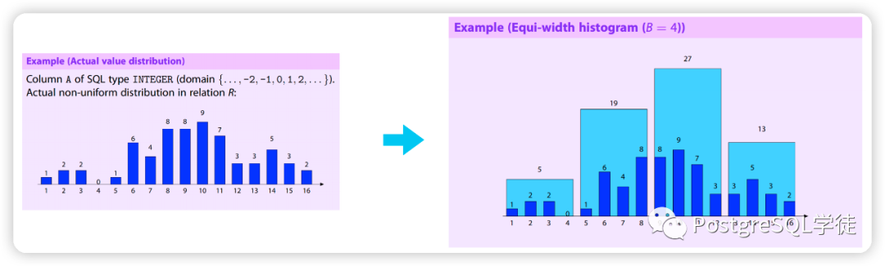

还是以这个图为例，在第二个桶中，总频次是 19，但是我们并不知道是实际情况那样 (5出现了1次，6出现了6次，7出现了4次，8出现了8次），还是 5 出现了 16次，6、7、8 各出现 1 次。)

因此，当桶的数量远小于列中 distinct value 数量、单个桶中 distinct value 过多且分布不均时，`Equi-width Histogram` 很有可能做出错误的估算并影响优化结果。

比如这个图中，按照优化器的理解，X=0 的条件就是 0.61 * 1 / 5000，但是实际情况是第一个桶中 50% 的值都是 X=0，那么优化器预估出来的结果就相差了 2500 倍。
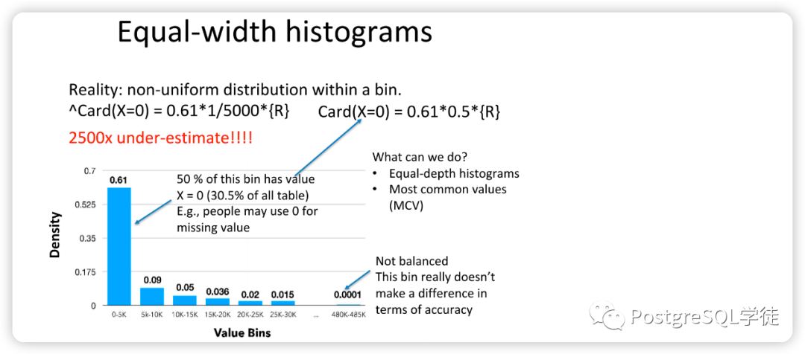

# 等高直方图

那让我们再看看等高直方图，顾名思义，每个桶的高度相同
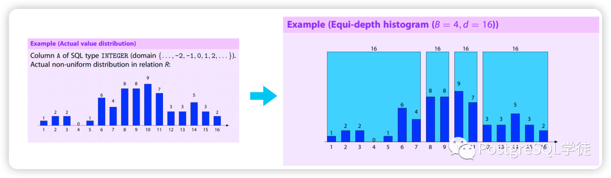

数据集中的区间内每个桶中的数值跨度更⼩，这样有利于增加选择率估算的准确性；⽽数据分散的区间内每个桶中的数值跨度更⼤，有利于减⼩储存直⽅图所消耗的内存。

但是等⾼直⽅图也有⾃⼰的缺点，当存在某个频次占⽐远⾼于总⾏数/N 的数值时，等桶中的数据分布将出现较⼤倾斜，会导致其他桶相对较宽，仅当数据分布偏差不⼤时才适⽤于范围查询。

另外，等高直方图的维护代价也要较等宽直方图的代价高，比如更新之后，要继续维持桶的高度一致。
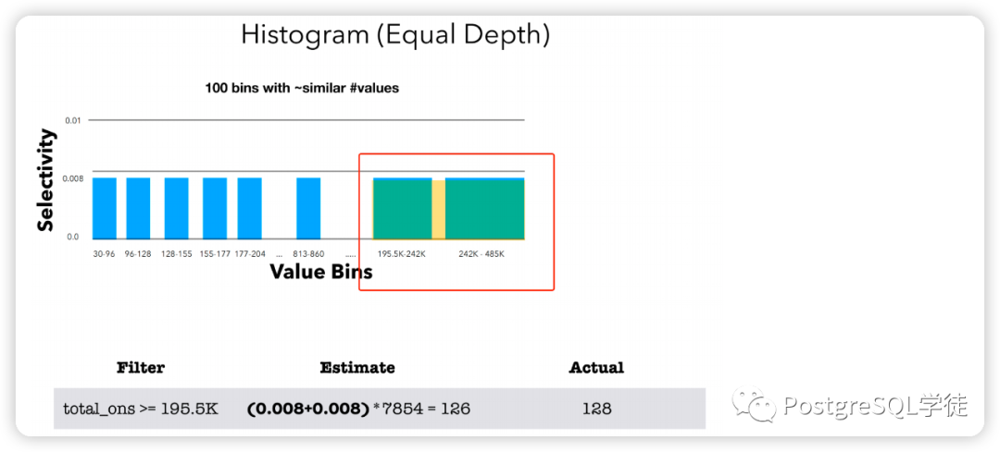
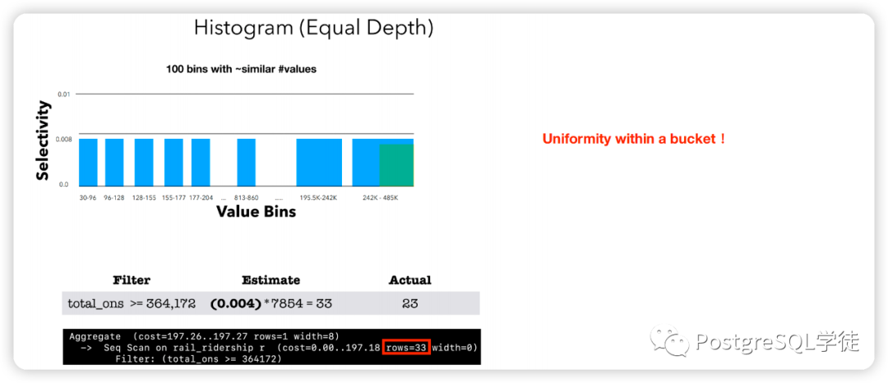

原理一样，也是假设数据是均匀分布的。可以看到，第二个例子就有不少的误差了：23/33

# Singleton Histogram

`Singleton Histogram` 可以视为等宽直方图在桶数量与 distinct value 数目相等时的特殊情况，每个桶都只记录一个值的出现频次。`Singleton Histogram` 能够提供最为精确的数据分布信息，

但当列中的 distinct value 较多时，`Singleton Histogram` 占用的内存也会到达一个难以接受的数值。

# 其他类型

当然还有其他类型的直方图，比如 Serial Histogram 、End-biased histograms 等，此处就不再一一介绍。

# Compressed Histogram

前面提到了， 对于 `Equi-height Hisgotram` 和 `Singleton Histogram` 都比较尴尬的分布方式：少数数值出现频率极高，而大多数数值则占比不大且分布较为均匀。

对于这样的数据，使用 `Equi-height Hisgotram` 会遇到高占比数值引起的统计数据倾斜，而使用 `Singleton Histogram` 则需要对占比不大的数据也单独建桶，颇有大材小用之嫌。

那么在等宽直方图不行，等高直方图也不行的情况下，PostgreSQL 是如何解的？没错，专业术语是 Compressed Histogram。
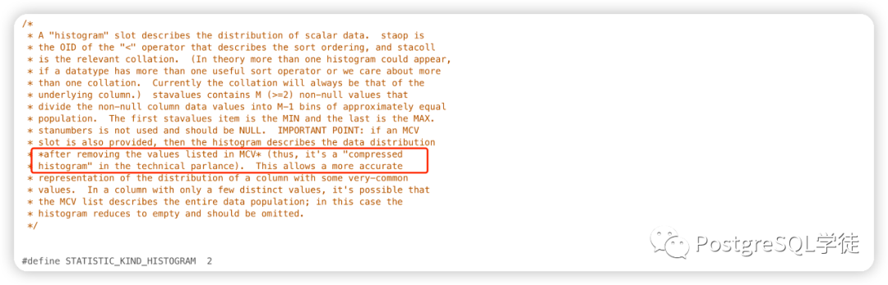

在代码中有这么一段详细的注解：

> thus, it's a " **compressed histogram** " in the technical parlance)

它是 `Equi-height Hisgotram` 和 `Singleton Histogram` 的结合，既会分配单独的桶给出现频次较高、对选择率影响较大的数值 (也就是前面说的 MCV/MCF)，也会建立类似于等高直方图的桶来聚合频次较低、没有必要单独建桶的数值，

同时集合了 `Singleton Histogram` 的高精度和 `Equi-height Hisgotram` 的高聚合度。现在回过头来看 pg_stats 里面的内容也能窥见一二，n_distinct 用于单独记录非重复值的比例，histogram_bounds 和 MCV/MCF 互补用于评估值的分布情况。有了 Compressed Histogram，优化器的预估方式就会更加准确了：

1. 放宽了数值在每个桶内都是均匀分布的假设
2. 在单列上过滤预估行数会更加准确和高效
   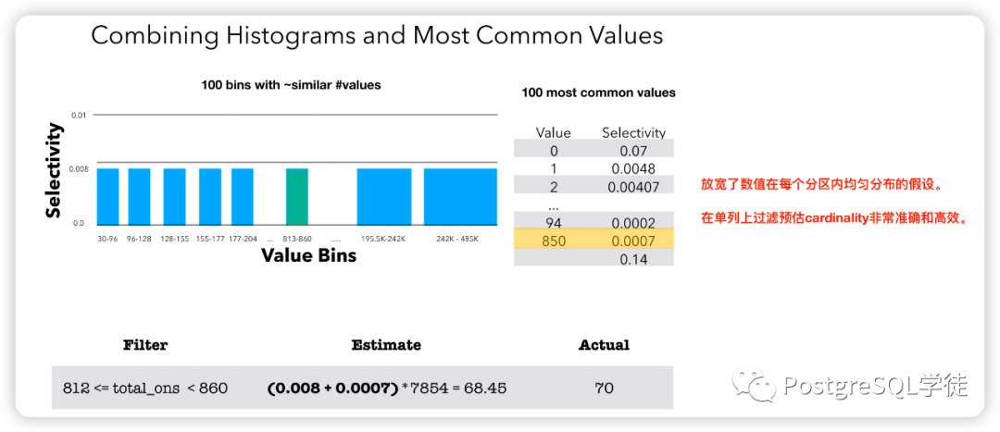

可以看到，对于 812 <= total_ons < 800 这样的查询，他正好落在了上图中绿色的桶里，那么其选择率就变成了 0.008 (绿色桶的选择率) + 0.0007 (850 是高频值，也满足查询条件) * total_nums，最终预估出 68.45，和实际满足条件的 70 行，误差就要小得多了，实际上优化器的逻辑是先检查 MCV，再去检测直方图。

另外，统计信息"bucket"的数量是可以调整的，默认 100 个桶，不难理解，桶的数量越多，值的分布就越细，优化器对于数据分布知晓地就更为全面，但是代价自然就是 analyze 的时间会相较久一点。

**可以看到，PostgreSQL 中的 compressed histogram ，放宽了数值在每个桶内都是均匀分布的假设，让优化器对于谓词的预估能够更为准确**
